# 교과 8 · 조각김치 이물 객체검출 (YOLO11)

> 교과 7에서 검수한 정답 데이터로 YOLO11 객체검출 모델을 학습 · 평가 · 개선한다.
>
> **Dataset Version** `kimchi_v1` · **라벨 지문** `5c2b4fc2c3e6` · **진행 상황** 3일차 완료 (Split Freeze · data/yolo 구성 · Smoke Test) · 4일차 완료 (Baseline 학습) · 5일차 완료 (Baseline 평가) · 6일차 완료 (실패 분석 · H1 확정) · 7일차 완료 (exp001 imgsz 1280 · Final 후보) · 8일차 완료 (Final Model 확정 · Frozen Test 1회 · Auto Label → Human Review) · **9일차 완료** (Feature Freeze · Acceptance **ACCEPTED** 33/33 · 교과 14 Handoff 확정 · 태그 `subject8_final_v1`) · 산출물 8 (발표) 준비 중

---

## 1. 프로젝트 목적

- 교과 7 FINAL(JPG 900장 + YOLO TXT 900개)을 학습용 Dataset으로 구성한다.
- YOLO11n Baseline을 학습하고 Validation에서 Precision · Recall · mAP · FP · FN을 분석한다.
- 실패 원인 하나만 바꾼 Improved Model을 같은 Validation에서 비교해 Final Model을 고르고, Frozen Test로 최종 성능과 한계를 확인한다.
- Final Model로 Detection · Auto Label 후보를 만들고 교과 7 라벨링 도구로 Human Review까지 연결한다.

## 2. 교과 7 → 교과 8 연결

- 교과 7 FINAL: `data/subject7_final/` (원본: `master_data/final` · Git 미포함 · 읽기 전용)
- JPG 900장 / YOLO TXT 900개 · Pair 900 · 동일 이미지(md5) 0쌍
- scene_type: kimchi_with_target 750장 / object_only 150장 (normal_kimchi 0장 · other_review 0장)
- Empty Label 0개 · Class 4(고무장갑) 0건 (교과 7에서 enabled: false)
- BBox 4,601개 (`kimchi_v1` · 아래 Class 표)
- QA 상태: 900장 전체 QA PASS · 교과 7 QA 결과: `prj07/reports/qa_summary.md`

## 3. Dataset 설명

| source_dataset | original_split | 수량 |
|---|---|---:|
| 이물검출_학습데이터1 | train | 500 |
| 이물검출_학습데이터2 | train | 220 |
| 이물검출_학습데이터2 | validation | 180 |
| **합계** | | **900** |

## 4. Class

| ID | 이물 종류 | 영문 이름 | 사용 | BBox | 비율 |
|---|---|---|---|---:|---:|
| 0 | 나뭇잎·종이류 | leaf_paper | O | 924 | 20.1% |
| 1 | 플라스틱류·돌·금속류 | plastic_stone_metal | O | 1,897 | 41.2% |
| 2 | 나뭇가지류 | branch | O | 711 | 15.5% |
| 3 | 벌레류 | insect | O | 378 | 8.2% |
| 4 | 고무장갑 | rubber_glove_unused | X (발견 시 REVIEW 확인) | 0 | 0.0% |
| 5 | 병해·갈변 | disease_browning | O | 439 | 9.5% |
| 6 | 파·고추 | green_onion_pepper | O | 252 | 5.5% |
| | **합계** | | | **4,601** | 100% |

> **Dataset Version: `kimchi_v1`** · 라벨 지문(sha256 앞 12자리): `5c2b4fc2c3e6` · 5명 일치 확인 (2026-10-12)
> 교과 7 문서(qa_summary · handoff)는 4,602개로 적혀 있지만, 10/08 라벨 추가 수정(Class 2→0 56개 등)을 반영한 4,601개를 기준으로 한다. 상세: `reports/issue_log.md`, `docs/split_policy.md`

## 5. 실행환경

| 항목 | 값 |
|---|---|
| OS | Windows + WSL Ubuntu 22.04 · VS Code |
| Python | 3.10.12 |
| PyTorch | 2.14.1+cu130 |
| Ultralytics | 8.4.175 |
| GPU | NVIDIA GeForce RTX 3060 (학교 PC) |
| YOLO11n Load | 성공 |

### 팀원 환경 확인 (2026-10-12)

| 팀원 | Ultralytics | CUDA | GPU | YOLO Load | 라벨 지문 |
|---|---|---|---|---|---|
| 최용훈 | 8.4.175 | True | RTX 3060 | 성공 | `5c2b4fc2c3e6` |
| 박건 | 8.4.175 | True | RTX 3060 | 성공 | `5c2b4fc2c3e6` |
| 이승훈 | 8.4.175 | True | RTX 3060 | 성공 | `5c2b4fc2c3e6` |
| 김하민 | 8.4.175 | True | RTX 3060 | 성공 | `5c2b4fc2c3e6` |
| 심준형 | 8.4.175 | True | RTX 3060 | 성공 | `5c2b4fc2c3e6` |

## 6. 설치 · 실행 방법

### 6.1 처음 한 번 (환경 · 데이터 준비)

```bash

# 가상환경
python3 -m venv .venv
source .venv/bin/activate

# ① torch 먼저: CUDA 13.0용 전용 주소에서 받기 (1일차 환경표 2.14.1+cu130과 맞춤)
pip install torch==2.14.1 --index-url https://download.pytorch.org/whl/cu130
# ② 나머지 패키지 (ultralytics는 이미 깔린 torch를 그대로 사용)
pip install -r requirements.txt

# 교과 7 FINAL 복사 (Git에 없음 · FINAL 위치는 각자 PC 기준으로 바꾸기)
FINAL=~/exe_01/master_data/final
mkdir -p data/subject7_final
cp -r "$FINAL/images" "$FINAL/labels" data/subject7_final/
chmod -R a-w data/subject7_final             # 읽기 전용 잠금

# 데이터 버전 확인 → 5c2b4fc2c3e6 이어야 kimchi_v1
LC_ALL=C cat data/subject7_final/labels/*.txt | sha256sum | cut -c1-12
```

### 6.2 스크립트 실행 (모두 `prj08/`에서)

| 순서 | 명령 | 정상 결과 |
|:-:|---|---|
| 1 | `python scripts/01_check_environment.py` | CUDA True · YOLO Load 성공 (Class 80개) |
| 2 | `python scripts/02a_make_audit_fixture.py` | `data/audit_test/` 생성 · 버그 9종 목록 |
| 3 | `python scripts/02_audit_subject7_final.py --fixture` | 9종 각 1건 검출 |
| 4 | `python scripts/02_audit_subject7_final.py` | PASS 19 / FAIL 0 (기대값 v2 · kimchi_v1 기준 · 이력은 `reports/audit_expected.md` 9장) |
| 5 | `python scripts/03_split_analysis.py` | Leakage PASS 4 / FAIL 1 (136 vs 135 경계값 · 정상 · 10/14 팀 결정: 지금처럼 FAIL 1 유지) |
| 6 | `python scripts/04_make_split.py` | 합격 기준 8 / 8 PASS · Frozen Test 지문 `4f9291849fe6` |
| 7 | `python scripts/05_freeze_split.py` | 검사 13항목 전부 PASS 후 `manifests/` 생성 (이미 Freeze 되어 있고 같으면 확인만) |
| 8 | `python scripts/05a_dataset_summary.py` | 검사 8항목 전부 PASS (manifest 스키마 v2 · Dataset Version 포함) |
| 9 | `python scripts/06_build_yolo_dataset.py --overwrite` | `data/yolo` 구성 (train 600 / val 74 / test 80 · Bridge 제외 · Freeze 전 리허설은 `--from-split`) · 검사 1~3 PASS |
| 10 | `python scripts/07_verify_yolo_dataset.py` | 19항목 모두 PASS · FAIL 0 |
| 11 | `python scripts/08_train_baseline.py --dry-run` | 학습 전 검사 12항목 PASS (학습 안 함 · 몇 초 · `configs` · `src` · `scripts` · `manifests`가 커밋 전이면 WARN) · `reports/baseline_training_condition.md` 미리 작성 |
| 12 | `python scripts/08_train_baseline.py` | 검사 12항목 PASS → Baseline 학습 → 완료 epoch · loss NaN/inf 0 확인 → `models/baseline/baseline_best.pt` 보관 · 조건 문서 상태 `완료` (`configs` · `src` · `scripts` · `manifests`가 커밋된 상태여야 시작) |
| 13 | `python scripts/09_evaluate_baseline.py` | 평가 전 검사 10항목 PASS → Val 평가 · `reports/baseline_metrics.csv` · 그림 3장 · `reports/baseline_val_image_check.csv` · `reports/baseline_class_check.csv` (Val만 · Test · Bridge 미사용) |
| 14 | `git status --short` | **아무것도 안 나오면** 내 결과 = 팀 기준 결과 (확인 후 `git restore reports/ splits/`) |
| 15 | `python scripts/09a_branch_fp_check.py` | 6일차 · 실행 전 검사 6항목 PASS → Val branch 예측 5종 분류 · 용훈 PC 결과와 비교 `다름 0` · `reports/branch_pred_check.csv` (사람 확인 칸은 비어 있음 · **확인을 채운 뒤에는 다시 돌리지 않기** · 덮어씀 · Val만 · Test · Bridge 미사용) |
| 16 | `python scripts/09b_failure_images.py` | 6일차 · `baseline_best.pt` sha 확인 → `reports/failure_analysis.csv` 대표 실패 사진(Val만 · 중복 제거) 14장 비교 그림 `demo/failure_analysis/*_compare.jpg` (Git 제외 · NDA) · 목록 `reports/failure_image_list.csv` |
| 17 | `python scripts/10_train_experiment.py --config configs/exp001.yaml --smoke` | 7일차 · 1 epoch 시험 → `runs/exp001_smoke/` · 시간 · GPU 메모리만 확인 (기록 안 남김 · exp001은 최대 9.97GB < 11GB → imgsz 1280 채택) |
| 18 | `python scripts/10_train_experiment.py --config configs/exp001.yaml --dry-run` | 학습 전 검사 PASS (Baseline과 다른 학습 설정 **정확히 1개** · `reports/improvement_experiment.md` **상태: 확정** · 덮어쓰기 방지) · `reports/exp001_training_condition.md` 초안 |
| 19 | `python scripts/10_train_experiment.py --config configs/exp001.yaml` | 검사 PASS → exp001 학습 50 / 50 epoch · loss NaN/inf 0 → `models/improved/exp001_best.pt` 보관 · 조건 문서 상태 `완료` (`configs` · `src` · `scripts` · `manifests`가 커밋된 상태여야 시작) |
| 20 | `python scripts/11_evaluate_experiment.py --config configs/exp001.yaml` | 평가 전 검사 10항목 PASS → 09 채점 함수 그대로 Val 평가 · `reports/exp001_metrics.csv` · `exp001_class_check.csv` · `exp001_val_image_check.csv` · 그림 3장 · `reports/experiment_log.csv` 갱신 (decision 칸은 보존) · `reports/baseline_vs_improved.md`는 없을 때만 초안 (Val만 · Test · Bridge 미사용) |
| 21 | `python scripts/12_evaluate_final_test.py --dry-run` | 8일차 · Frozen Test 평가 전 검사 15항목 (`reports/final_model_selection.md` **상태: 확정 · 커밋됨** · `final_best.pt` sha = 선택 문서 = exp001 기록 · Test 지문 `4f9291849fe6` · 1회 잠금) · Test는 열지 않음 |
| 22 | `python scripts/12_evaluate_final_test.py` | **딱 1회** · Final Model(imgsz 1280)로 Frozen Test 80장 평가 → `reports/final_metrics.csv` · `final_class_check.csv` · `final_test_image_check.csv` · `final_test_runs.csv` · 그림 `reports/figures/final_test_*.png` (`final_metrics.csv`가 있으면 다시 실행 거부 · Bridge 미사용) |
| 23 | `python scripts/13_auto_label.py --dry-run` | 8일차 · Auto Label 준비 검사 (Frozen Test 평가 끝남 · Final sha · 고른 사진이 전부 Test · 검수 시작 전) + 사용할 Test 사진 8장 목록 (새 사진이 없어 가이드 21.3 방식) |
| 24 | `python scripts/13_auto_label.py` | Final Model(imgsz 1280 · conf 0.25)로 `demo/prediction_images/` Detection 결과 · `demo/auto_label/candidate_labels/` 후보 TXT · 교과 7 프로그램 검수 폴더 `demo/auto_label/review_workspace/` (정답은 `gt_hidden/`에 따로 · 전부 Git 제외) · `reports/auto_label_candidates.csv` |
| (사람) | `cd ../prj07 && python main.py` | 교과 7 라벨링 프로그램 v4.1 → **data 폴더 열기** `prj08/demo/auto_label/review_workspace` → 후보 박스 확인 · 수정 · 삭제 · 추가 → 저장 (그대로 = DONE · 고침 = EDITED · 애매함 = REVIEW) |
| 25 | `python scripts/14_auto_label_review.py` | 후보 vs 사람 검수 비교 → 승인 · Class 수정 · BBox 수정 · 삭제 · 누락 추가 · REVIEW 집계 `reports/auto_label_review.csv` · 검수 라벨 `demo/auto_label/reviewed_labels/` |
| (참고) | Smoke Test 명령 | `reports/smoke_test.md` 2장 · 1 epoch · `runs/smoke_day3/` (Git 제외) · 재현용이 아니라 파이프라인 연결 확인용 |

> `05b_upgrade_manifest_schema.py`는 10/13 `manifests/`를 v1(3칸) → v2(9칸)로 바꿀 때 **한 번** 쓴 스크립트입니다. 지금 main의 `manifests/`는 이미 v2라 실행할 필요가 없습니다. (실행해도 "이미 v2" 확인만 하고 아무것도 쓰지 않음)

> `10_train_experiment.py`는 **① `--smoke` → `improvement_experiment.md`를 `상태: 확정`으로 → ② `--dry-run` → ③ 본 학습** 순서로 씁니다. `runs/exp001/` · `models/improved/exp001_best.pt`가 이미 있으면 덮어쓰지 않고 멈추므로, 다음 실험은 `configs/exp002.yaml`처럼 **새 이름**으로 만듭니다. 10 · 11은 둘 다 `--config`로 같은 실험 설정 파일을 받습니다.

## 7. 폴더 구조

### 7.1 필수 산출물

| No. | 산출물 | 가이드 지정 파일 |
|--:|---|---|
| 1 | 학습용 Dataset Version | `configs/dataset.yaml` · `manifests/split_manifest.csv` · `manifests/train.csv` · `val.csv` · `test.csv` · `bridge_holdout.csv` · `docs/split_policy.md` · `reports/dataset_summary.csv` |
| 2 | Baseline Model | `models/baseline/baseline_best.pt` · `runs/baseline_v1/results.csv` · `reports/baseline_training_condition.md` · `reports/baseline_metrics.csv` |
| 3 | Failure Analysis | `reports/failure_analysis.csv` · `demo/failure_analysis/*.jpg` · `reports/failure_hypothesis.md` |
| 4 | Improved / Final Model | `models/improved/exp001_best.pt` · `models/final/final_best.pt` · `reports/improvement_experiment.md` · `reports/final_model_selection.md` |
| 5 | 성능·실험 기록 | `reports/experiment_log.csv` · `reports/final_metrics.csv` · `reports/baseline_vs_improved.md` · `reports/baseline_metrics.csv` · `reports/figures/` (학습곡선 · Confusion Matrix) |
| 6 | Detection · Auto Label | `demo/prediction_images/` · `demo/auto_label/candidate_labels/` · `demo/auto_label/reviewed_labels/` · `reports/auto_label_review.csv` |
| 7 | 문서·교과 14 연결 | `README.md` · `reports/acceptance_test.md` · `docs/handoff_subject14.md` |
| 8 | 최종 발표·시연 | `presentation/final_presentation.pdf` · `presentation/qna_guide.md` · `demo/final_detection_demo.mp4` · `demo/auto_label_human_review_demo.mp4` (또는 실시간 시연) |

> ⚠ `models/` · `runs/` · `demo/`는 NDA · 용량 때문에 Git에서 제외합니다 (17장 데이터 보안).

### 7.2 우리 산출물


| 위치 | 개수 |
|---|---|
| `reports/` | 33 (그림 4 포함) |
| `configs/` | 2 |
| `splits/` | 1 |
| `daily_csv/` | 4 |
| `docs/` | 그림 7 · `code_flow.md` 1 · `code_review/` 26 |

> 파일별로 왜 만들었는지는 [`docs/deliverables_map.md`](docs/deliverables_map.md)에 정리했습니다.

### 7.3 전체 폴더 트리

```
prj08/
├── README.md                          # 산출물 7 · 이 문서
├── requirements.txt                   # pillow · pyyaml · ultralytics==8.4.175 · pandas
├── .venv/                             # ⚠ Git 제외 · prj08 전용 가상환경
├── yolo11n.pt                         # ⚠ Git 제외 (*.pt) · YOLO Load 때 자동 다운로드된 COCO 사전학습 모델
│
├── configs/
│   ├── dataset.yaml                   # 산출물 1 · path: data/yolo · Class ID 0~6 영문 이름 · Bridge 미포함
│   ├── baseline.yaml                  # 4일차 · Baseline 학습 조건 (팀 확정값 · epochs 50 · batch 16 · imgsz 640 · AdamW 0.000909 · 0.9 · seed 42)
│   └── exp001.yaml                    # 7일차 · 개선 실험 조건 (baseline.yaml 복사 + imgsz 640 → 1280 한 줄만 변경 · name · reason)
│
├── src/                               # 재사용 "기능" (혼자 실행하지 않음)
│   ├── __init__.py                    # src를 패키지로 인식시키는 빈 파일
│   ├── dataset_audit.py               # Pair · YOLO 형식 · Class · 좌표 · Manifest 검사 함수
│   ├── capture_group.py               # 파일명 → 촬영 시각 · 촬영 세션(capture_group) 묶기 · 시간 차 계산
│   ├── manifest.py                    # manifests/ 읽기 · 쓰기 공통 (v1 · v2 스키마 · split 이름 · 지문) → 05 · 05a · 05b · 06 · 07 · 08 · 09 · 09a · 09b · 10 · 11 · 12 · 13이 import
│   ├── train_detector.py              # 4일차 · YOLO 학습 공통 함수 (TRAIN_KEYS 12개만 model.train()에 전달) → 08 · 10이 import (11은 TRAIN_KEYS만)
│   └── evaluate_detector.py           # 5일차 · Val 평가 · 이미지 예측 · TP/FP/FN 짝짓기 (Frozen Test 보호) → 09 · 09a · 09b · 11 · 12 · 13 · 14가 import
│
├── scripts/                           # 실제 "실행" 파일 (번호 = 실행 순서)
│   ├── 01_check_environment.py        # 1일차 · Python / PyTorch / Ultralytics / GPU · YOLO11n Load
│   ├── 02a_make_audit_fixture.py      # 2일차 · 버그 9종을 심은 테스트 데이터 생성 (검사기 검증용)
│   ├── 02_audit_subject7_final.py     # 2일차 · 900장 Audit + 기대값 19항목 대조 (--fixture: 테스트 모드)
│   ├── 03_split_analysis.py           # 2일차 · Class 분포 · EXIF · 1/5/10분 세션 비교 · Leakage 재확인
│   ├── 04_make_split.py               # 3일차 선행 · 정책대로 전수 탐색 배정 + 합격 기준 8개 검증
│   ├── 05_freeze_split.py             # 3일차 · 검사 13항목 통과 시 split을 manifests/로 Freeze
│   ├── 05a_dataset_summary.py         # 3일차 · 산출물 1 — reports/dataset_summary.csv (학습용 Dataset Version 요약표)
│   ├── 05b_upgrade_manifest_schema.py # 3일차 보완 · manifests/ v1(3칸) → v2(9칸 · 가이드 16.1) · 배정은 그대로 (1회성)
│   ├── 06_build_yolo_dataset.py       # 3일차 · Split 목록대로 data/yolo 학습 폴더 구성 (복사 · Bridge 제외)
│   ├── 07_verify_yolo_dataset.py      # 3일차 · data/yolo가 manifests와 같은지 19항목 검증 (읽기만)
│   ├── 08_train_baseline.py           # 4일차 · 학습 전 12항목 검사 → Baseline 학습 → 조건 문서 자동 기록 (--dry-run: 검사만)
│   ├── 09_evaluate_baseline.py        # 5일차 · Baseline Val 평가 · Class별 지표 · 이미지별 FP/FN · Class별 TP/FN/FP (Test · Bridge 미사용)
│   ├── 09a_branch_fp_check.py         # 6일차 · Val branch 예측 5종 분류 (H3 · 오검출 확인) · 사람 확인 칸 (Test · Bridge 미사용)
│   ├── 09b_failure_images.py          # 6일차 · 대표 실패 사례 Val 사진에 정답(초록 · 놓침 노랑) + 예측(빨강)을 겹친 비교 그림 (demo/ · Git 제외)
│   ├── 10_train_experiment.py         # 7일차 · 한 변수 원칙 검사 → 개선 실험 학습 (--smoke: 1 epoch 시험 · --dry-run: 검사만) · 08 도우미 재사용
│   ├── 11_evaluate_experiment.py      # 7일차 · 09 채점 함수 그대로 개선 모델 Val 평가 → Baseline 비교 · experiment_log.csv (Test · Bridge 미사용)
│   ├── 12_evaluate_final_test.py      # 8일차 · Final Model Frozen Test 1회 평가 (선택 문서 커밋 확인 · 1회 잠금 · 09 채점 함수 그대로 · 가이드 이름 11_evaluate_final_test.py)
│   ├── 13_auto_label.py               # 8일차 · Final Model Detection 이미지 · Auto Label 후보 TXT · 교과 7 검수 폴더 (Test 8장 · Frozen Test 평가 뒤에만 · 가이드 이름 12_auto_label.py)
│   └── 14_auto_label_review.py        # 8일차 · Auto Label 후보 vs 사람 검수 비교 → 승인 · 수정 · 삭제 · 추가 집계
│
├── docs/
│   ├── split_policy.md                # 산출물 1 · Split 정책 확정본 (5분 세션 · 600/75/75/150 · 예외 E1)
│   ├── code_flow.md                   # 코드 흐름 (일차별 그림 6장 · import 표 · 그림 원본)
│   ├── figures/                       # 파이프라인 그림 SVG 7장 (pipeline_overview = README 8장 · pipeline_1~6 = code_flow 1장)
│   └── code_review/                   # 코드와 같은 구조의 파일별 리뷰
│       ├── README.md                  # 목차 · 읽는 순서 · 우선순위
│       ├── configs/                   # dataset_yaml.md
│       ├── src/                       # dataset_audit.md · capture_group.md · manifest.md · train_detector.md · evaluate_detector.md
│       └── scripts/                   # 01 · 02a · 02 · 03 · 04 · 05 · 05a · 05b · 06 · 07 · 08 · 09 · 09a · 09b · 10 · 11 · 12 · 13 · 14 리뷰
│
├── reports/                           # 결과 · 기록 (파일명 · 숫자만 · Git에 올림)
│   ├── figures/                       # 09 · 11 · 12 · 학습곡선 · Confusion Matrix · PR (baseline_* · exp001_* · final_test_* · 그래프만)
│   ├── audit_expected.md              # Audit 전에 고정한 기대값 (Test Oracle · 교과 7 문서 기준)
│   ├── audit_issue.csv                # 900장 문제 목록 (0건 → 제목 줄만)
│   ├── audit_check.csv                # 기대값 vs 실제 19항목 (v2 기준 PASS 19 / FAIL 0)
│   ├── audit_label_stats.csv          # 이미지별 BBox · Class 수 · 출처 · split · scene_type → 03 · 04의 입력
│   ├── class_scene_distribution.csv   # 출처 × split × scene_type별 이미지 · Class 수
│   ├── filename_time_check.csv        # 파일명 시각 vs EXIF (EXIF 없음)
│   ├── capture_group_compare.csv      # 1 · 5 · 10분 기준 세션 수 비교 (106 · 18 · 13)
│   ├── capture_groups.csv             # 이미지별 촬영 시각 + 1/5/10분 세션 번호 → 04의 입력
│   ├── capture_group_summary.csv      # 5분 세션 G01~G18 상세 (시각 · 이미지 · Class 수)
│   ├── split_check.csv                # 배정 합격 기준 8개 PASS / FAIL
│   ├── split_summary.csv              # 역할별 이미지 · BBox · Class · 날짜 · 세션 (600 / 74 / 80 / 146)
│   ├── freeze_check.csv               # 05 · Freeze 전 검사 13항목 (item · expected · actual · result)
│   ├── dataset_summary.csv            # 05a · 산출물 1 · 역할별 이미지 · BBox · Class · 세션 · 장면 · yaml 포함 (합 900)
│   ├── manifest_schema_check.csv      # 05b · manifests v1 → v2 불변 조건 검사 (배정 변경 0)
│   ├── yolo_build_summary.csv         # 06 · 역할별 이미지 · 라벨 · BBox 수 · Test 지문
│   ├── yolo_verify_check.csv          # 07 · data/yolo 검증 19항목 PASS / FAIL
│   ├── baseline_training_condition.md # 08 · 산출물 2 · 실제 학습 조건 · 학습 전 검사 · 실행 기록 · 4일차 Gate (자동 생성)
│   ├── baseline_results.csv           # 08 · runs/baseline_v1/results.csv 사본 (숫자만)
│   ├── baseline_metrics.csv           # 09 · 산출물 2 · Val 전체 + Class별 P · R · mAP50 · mAP50-95
│   ├── baseline_val_image_check.csv   # 09 · 이미지별 GT · 예측 · TP · FP · FN · 작은 객체 FN → 6일차 Failure Analysis 입력
│   ├── baseline_class_check.csv       # 09 · Class별 GT · TP · FN · FP · conf 0.25 기준 Recall · Precision → 7일차 비교 기준
│   ├── branch_pred_check.csv          # 09a · branch 예측 1개 = 1행 · 분류 5종 · 원본 좌표 · 사람 확인(human_check · memo) → H3 근거
│   ├── failure_analysis.csv           # 6일차 · 실패 대표 사례 (원인 · 증거 · 다음 행동) · H3 행은 branch_pred_check.csv 근거 → 09b · 11의 입력
│   ├── failure_hypothesis.md          # 6일차 · 산출물 3 · 실패 가설 H1~H4 · L · 가이드 19장 분류와의 대응 · 7일차 결정 규칙
│   ├── failure_image_list.csv         # 09b · 비교 그림을 만든 사진 목록 · 실패 유형 · TP · FP · FN (숫자만)
│   ├── improvement_experiment.md      # 7일차 · 산출물 4 · 개선 실험 계획 (바꿀 변수 imgsz 하나 · 상태: 확정이어야 10이 학습)
│   ├── exp001_training_condition.md   # 10 · exp001 실제 학습 조건 · 학습 전 검사 · 실행 기록 · Weight sha (자동 생성)
│   ├── exp001_results.csv             # 10 · runs/exp001/results.csv 사본 (숫자만)
│   ├── exp001_metrics.csv             # 11 · exp001 Val 전체 + Class별 P · R · mAP50 · mAP50-95 (baseline_metrics.csv와 같은 형식)
│   ├── exp001_val_image_check.csv     # 11 · exp001 이미지별 GT · 예측 · TP · FP · FN · 작은 객체 FN
│   ├── exp001_class_check.csv         # 11 · exp001 Class별 GT · TP · FN · FP · conf 0.25 기준 Recall · Precision
│   ├── experiment_log.csv             # 11 · 산출물 5 · 실험 1개 = 1행 (조건 · 바꾼 변수 · Val 지표 · sha · decision은 팀이 작성)
│   ├── baseline_vs_improved.md        # 11 초안 + 팀 작성 · 같은 Val 비교 · 핵심 FP/FN 변화 · Final Model 후보 (Frozen Test 안 봄)
│   ├── final_model_selection.md       # 8일차 · 산출물 4 · Final Model = exp001 · 원본 Weight · sha · 선택 이유 (Test 전에 커밋)
│   ├── final_metrics.csv              # 12 · 산출물 5 · Frozen Test 전체 + Class별 P · R · mAP50 · mAP50-95
│   ├── final_class_check.csv          # 12 · Frozen Test Class별 GT · TP · FN · FP (conf 0.25)
│   ├── final_test_image_check.csv     # 12 · Frozen Test 이미지별 TP · FP · FN · 작은 객체 FN (교과 14 대표 FP/FN 근거)
│   ├── final_test_runs.csv            # 12 · Frozen Test 실행 기록 (1회 증거)
│   ├── auto_label_candidates.csv      # 13 · Auto Label 사진별 후보 BBox 수 · Class (숫자만)
│   ├── auto_label_review.csv          # 14 · 산출물 6 · 사진별 승인 · Class 수정 · BBox 수정 · 삭제 · 누락 추가 · REVIEW
│   ├── label_preview.md               # 가이드 16.4 · Split 복사 후 라벨 Preview 20장 (교과 7 도구 · 20/20 일치)
│   ├── smoke_test.md                  # 가이드 16.5~16.7 · 1 epoch → Weight → Prediction 연결 확인 · 가이드와 다른 점 6장
│   └── issue_log.md                   # 문제 · 원인 · 해결 기록
│
├── splits/
│   └── kimchi_v1_split.csv            # 04 출력 · 파일별 역할 3칸 (file_name · capture_group · role) · Bridge 값은 `bridge` · 05가 manifests/로 Freeze
│
├── daily_csv/
│   ├── 10_12.csv                      # 일일 작업 기록
│   ├── 10_13.csv                      # 일일 작업 기록
│   ├── 10_14.csv                      # 일일 작업 기록
│   └── 10_15.csv                      # 일일 작업 기록
│
├── manifests/                         # 산출물 1 · 05가 Freeze · v2 9칸 (file_name · image_path · label_path · source_dataset ·
│   │                                  #   original_split · scene_type · capture_group · split · dataset_version)
│   ├── split_manifest.csv             # 900장 전체 · split = train / val / test / bridge_holdout
│   ├── train.csv                      # 600
│   ├── val.csv                        # 74
│   ├── test.csv                       # 80 · Frozen Test (지문 4f9291849fe6 · 8일차 전 사용 금지)
│   └── bridge_holdout.csv             # 146 · 교과 14 보존 · 교과 8 사용 금지
│
├── demo/                              # (6 · 8일차) ⚠ Git 제외 · failure_analysis/ (09b 비교 그림) · prediction_images/ (13 Detection) · auto_label/ (13 후보 · 검수 폴더 · 숨긴 정답 · 14 reviewed_labels)
├── presentation/                      # (9일차) 발표 PDF · Q&A
├── models/                            # ⚠ Git 제외 · baseline/ (baseline_best.pt) · improved/ (exp001_best.pt) · final/ (final_best.pt = exp001)
├── runs/                              # ⚠ Git 제외 · Ultralytics 결과 (smoke_day3 · smoke_day3_predict* · baseline_v1 · baseline_v1_val · predict/baseline_val_images · predict/branch_check · exp001_smoke · exp001 · exp001_val · predict/exp001_val_images · final_test · predict/final_test_images)
│
└── data/                              # ⚠ Git 제외 (NDA)
    ├── subject7_final/                # 교과 7 FINAL 복사본 · 읽기 전용 · 라벨 지문 5c2b4fc2c3e6
    │   ├── images/*.jpg               # 900장 (파일명 = 촬영 시각 YYMMDD_HHMMSS + 마이크로초)
    │   └── labels/*.txt               # 900개 (class x y w h)
    ├── audit_test/                    # 02a가 만든 Fixture (8쌍 + 버그 9종) · 언제든 다시 생성 가능
    └── yolo/                          # 06이 만든 학습 폴더 · images · labels / train · val · test · Bridge 미포함
```

> Git은 빈 폴더를 저장하지 않습니다. `demo/`, `presentation/`, `models/` 하위 폴더는 각자 PC에만 있고, 파일이 생기는 날 Git에 올라갑니다.

## 8. 실행 순서와 데이터 흐름



> 위 그림은 **단계만** 보여 줍니다 (주황 = 사람이 정한 지점 · 검정 = 실행 스크립트). 일차별 상세 그림은 [`docs/code_flow.md`](docs/code_flow.md) 1장, import 관계는 3장, 아래는 실행 순서를 글로 적은 전체 지도입니다.


```
[1일차]  01_check_environment.py ──→ 화면 출력 → 5장 팀원 환경 표

[2일차]  02a_make_audit_fixture.py ──→ data/audit_test/ (8쌍 + 버그 9종)
              │
              ▼
         02_audit_subject7_final.py --fixture ──→ 9종 각 1건 검출 확인   (검사기부터 검사)
         02_audit_subject7_final.py           ──→ reports/audit_issue · audit_check · audit_label_stats.csv
              │  (import src.dataset_audit)            │
              │                                        ▼
         03_split_analysis.py ←──────────── audit_label_stats.csv
              │  (import src.capture_group)
              ▼
         reports/class_scene_distribution · capture_group_* · capture_groups · filename_time_check.csv
              │
              ▼
         [사람] 팀 회의 → docs/split_policy.md (숫자 근거 + 결정)

[3일차 선행]
         04_make_split.py ←── capture_groups.csv + audit_label_stats.csv + 정책 상수
              ▼
         splits/kimchi_v1_split.csv · reports/split_check.csv · split_summary.csv · Frozen Test 지문 4f9291849fe6

[3일차]
         05_freeze_split.py ←── splits/kimchi_v1_split.csv (검사 13항목 · 전부 PASS일 때만 Freeze)
              ▼
         manifests/split_manifest.csv · train · val · test · bridge_holdout.csv · reports/freeze_check.csv
              ▼
         05a_dataset_summary.py ←── manifests/ + audit_label_stats.csv + configs/dataset.yaml (검사 8항목 · PASS일 때만 저장)
              ▼
         reports/dataset_summary.csv (산출물 1 · 네 역할 합 900)
              ▼
         06_build_yolo_dataset.py ←── manifests/ + data/subject7_final (복사만 · Bridge 제외)
              ▼
         data/yolo/{images,labels}/{train,val,test} · reports/yolo_build_summary.csv
              ▼
         07_verify_yolo_dataset.py ←── manifests/ + data/yolo + 원본 labels (읽기만)
              ▼
         reports/yolo_verify_check.csv (19항목 · 종료 코드 0 / 1)
              ▼
         [사람] 라벨 Preview 20장 (교과 7 도구 · 읽기 전용 작업 공간) ──→ reports/label_preview.md
              ▼
         Smoke Test: yolo detect train (1 epoch · Train 600 / Val 74) → predict (Val · conf 0.05 / 0.25)
              ▼
         runs/smoke_day3/weights/best.pt (Git 제외 · Baseline 아님) · reports/smoke_test.md

[3일차 보완]  05b_upgrade_manifest_schema.py : manifests/ v1 → v2 (1회 · reports/manifest_schema_check.csv)
              (05 · 05a · 05b · 06 · 07 · 08 · 09 · 09a · 09b · 10 · 11 · 12 · 13은 manifest 읽기 · 쓰기를 src/manifest.py 하나로 공유)

[4일차]
         08_train_baseline.py ←── configs/baseline.yaml + configs/dataset.yaml + manifests/ + data/yolo
              │  (import src.manifest · src.train_detector · 학습 전 07 실행 → 종료 코드 0 확인)
              │  학습 전 검사 12항목 · 전부 PASS일 때만 학습 (--dry-run: 검사 + 조건 문서만)
              ▼
         runs/baseline_v1/ (results.csv · weights) · models/baseline/baseline_best.pt (Git 제외)
         reports/baseline_training_condition.md · reports/baseline_results.csv (Git)

[5일차]
         09_evaluate_baseline.py ←── models/baseline/baseline_best.pt + baseline_training_condition.md (상태 · sha) + manifests/val.csv + data/yolo (val)
              │  (import src.manifest · src.evaluate_detector · 평가 전 07 실행 → 종료 코드 0 확인)
              │  평가 전 검사 10항목 · split = val 고정 (Frozen Test · Bridge 미사용)
              ▼
         reports/baseline_metrics.csv · reports/figures/baseline_*.png · reports/baseline_val_image_check.csv · reports/baseline_class_check.csv (Git)
         runs/baseline_v1_val/ · runs/predict/baseline_val_images/ (Git 제외 · NDA · 박스 그린 Val 이미지는 사람이 눈으로 확인)

[6일차]
         09a_branch_fp_check.py ←── models/baseline/baseline_best.pt + baseline_training_condition.md (sha) + manifests/val.csv + data/yolo (val) + reports/baseline_val_image_check.csv (비교용)
              │  (import src.manifest · src.evaluate_detector · 실행 전 07 실행 → 종료 코드 0 확인)
              │  실행 전 검사 6항목 · Val branch 예측을 정답과 대조해 5종으로 분류 (TP · 중복 · 다른 이물 위 · 위치 어긋남 · 정답 없는 자리)
              ▼
         reports/branch_pred_check.csv (Git · human_check · memo는 사람이 채움) · runs/predict/branch_check/ (Git 제외 · NDA)
              ▼
         [사람] branch 박스 확인 (라벨 누락 · 김치 줄기 착각 · 다른 이물) ──→ reports/failure_analysis.csv H3 행 · (라벨 누락이면) reports/issue_log.md
              ▼
         [사람] FN · FP 많은 Val 사진 14장 선정 ──→ reports/failure_analysis.csv · reports/failure_hypothesis.md (H1~H4 · L)
              ▼
         09b_failure_images.py ←── reports/failure_analysis.csv + models/baseline/baseline_best.pt + baseline_training_condition.md (sha) + manifests/val.csv + data/yolo (val)
              │  (import src.manifest · src.evaluate_detector.match_boxes · Val만 · conf 0.25 · IoU 0.5 = 09와 같은 기준)
              ▼
         demo/failure_analysis/*_compare.jpg (Git 제외 · NDA · 정답 초록 · 놓침 노랑 · 예측 빨강) · reports/failure_image_list.csv (Git)
              ▼
         [사람] 10/15 회의 → H1 개선 대상 확정 ──→ configs/exp001.yaml · reports/improvement_experiment.md (변수 imgsz 하나 · 상태: 확정)

[7일차]
         10_train_experiment.py --smoke ←── configs/exp001.yaml (1 epoch · runs/exp001_smoke · 기록 안 남김 · 최대 9.97GB < 11GB → imgsz 1280)
              ▼
         10_train_experiment.py ←── configs/exp001.yaml + configs/baseline.yaml (학습 설정 차이 = 정확히 1개) + improvement_experiment.md (확정) + manifests/ + data/yolo
              │  (import src.manifest · src.train_detector · 08을 모듈로 불러 지문 · git · 환경 도우미 재사용 · 학습 전 07 실행 → 종료 코드 0 확인)
              ▼
         runs/exp001/ · models/improved/exp001_best.pt (Git 제외) · reports/exp001_training_condition.md · reports/exp001_results.csv (Git)
              ▼
         11_evaluate_experiment.py ←── models/improved/exp001_best.pt + exp001_training_condition.md (상태 · sha) + reports/baseline_*.csv 3개 + reports/failure_analysis.csv
              │  (import src.manifest · src.evaluate_detector · src.train_detector.TRAIN_KEYS · 09를 모듈로 불러 채점 함수 그대로 · 평가 전 07 실행)
              │  평가 전 검사 10항목 · split = val 고정 (Frozen Test · Bridge 미사용)
              ▼
         reports/exp001_metrics · exp001_class_check · exp001_val_image_check.csv · reports/figures/exp001_*.png · reports/experiment_log.csv (Git)
         runs/exp001_val/ · runs/predict/exp001_val_images/ (Git 제외)
              ▼
         [사람] reports/baseline_vs_improved.md 해석 · experiment_log.csv decision 작성 ──→ Frozen Test 를 보지 않고 exp001 을 Final Model 후보로

[8일차]
         [사람] reports/final_model_selection.md (상태: 확정) · models/improved/exp001_best.pt → models/final/final_best.pt ──→ 커밋 · 푸시 (Test 보다 먼저)
              ▼
         12_evaluate_final_test.py ←── models/final/final_best.pt + final_model_selection.md (확정 · 커밋 · sha) + configs/exp001.yaml (imgsz 1280) + data/yolo (test)
              │  (09 · 08 을 모듈로 불러 채점 함수 · git 도우미 재사용 · allow_test=True · Test 지문 확인 · 1회 잠금)
              ▼
         reports/final_metrics · final_class_check · final_test_image_check · final_test_runs.csv · reports/figures/final_test_*.png (Git)
         runs/final_test/ · runs/predict/final_test_images/ (Git 제외)
              ▼
         13_auto_label.py ←── models/final/final_best.pt + final_model_selection.md (sha) + reports/final_metrics.csv (12가 끝났다는 증거) + manifests/test.csv + data/yolo (test)
              │  (12 를 모듈로 불러 Final 경로 · sha 규칙 공유 · import src.manifest · src.evaluate_detector.predict_images)
              │  준비 검사 8항목 · Test 사진 8장 (Class · 세션 골고루 · 같은 입력이면 같은 목록) · Bridge · Train · Val 사진 거부
              ▼
         demo/prediction_images/ (Detection) · demo/auto_label/candidate_labels/ (후보 TXT) · review_workspace/ (검수 폴더) · gt_hidden/ (정답 · 비공개) (Git 제외)
         reports/auto_label_candidates.csv (Git)
              ▼
         [사람] 교과 7 라벨링 프로그램 v4.1 (cd ../prj07 && python main.py) → review_workspace 열기 → 승인 · 수정 · 삭제 · 추가 → work/ · final/ 저장
              ▼
         14_auto_label_review.py ←── candidate_labels/ + review_workspace/{final,work}/labels + 작업대장 dataset_manifest.csv + gt_hidden/ (참고 비교만)
              │  (import src.evaluate_detector.iou_xywh · match_boxes · 후보 ↔ 검수 1:1 짝짓기 · 승인 IoU ≥ 0.95)
              ▼
         demo/auto_label/reviewed_labels/ (Git 제외) · reports/auto_label_review.csv (Git · 승인 31 / 43)
```

| 파일 | 입력 | 출력 | 의존 |
|---|---|---|---|
| `01_check_environment.py` | 현재 Python 환경 | 화면 | torch · ultralytics |
| `02a_make_audit_fixture.py` | `data/subject7_final` 앞 8쌍 | `data/audit_test/` | shutil |
| `02_audit_subject7_final.py` | images · labels · 교과 7 Manifest · `EXPECTED` | `reports/audit_*.csv` | `src.dataset_audit` |
| `03_split_analysis.py` | `audit_label_stats.csv` · images(EXIF) | `reports/` CSV 5개 | `src.capture_group` · PIL |
| `04_make_split.py` | `capture_groups.csv` · `audit_label_stats.csv` | `splits/` · `reports/split_*.csv` | pandas만 (src 의존 없음) |
| `05_freeze_split.py` | `splits/kimchi_v1_split.csv` · `audit_label_stats.csv` · images · labels | `manifests/` (v2) · `reports/freeze_check.csv` | `src.manifest` |
| `05a_dataset_summary.py` | `manifests/split_manifest.csv` · `audit_label_stats.csv` · `configs/dataset.yaml` | `reports/dataset_summary.csv` | `src.manifest` · PyYAML |
| `05b_upgrade_manifest_schema.py` | `manifests/` (v1) · split CSV · `audit_label_stats.csv` | `manifests/` (v2) · `reports/manifest_schema_check.csv` | `src.manifest` |
| `06_build_yolo_dataset.py` | `manifests/split_manifest.csv` (`--from-split`이면 split CSV) · images · labels | `data/yolo/` · `reports/yolo_build_summary.csv` | `src.manifest` (읽기만) |
| `07_verify_yolo_dataset.py` | `manifests/split_manifest.csv` · `data/yolo` · 원본 labels | `reports/yolo_verify_check.csv` | `src.manifest` (읽기만 · 06 import 안 함) |
| Smoke Test (CLI) | `configs/dataset.yaml` → `data/yolo` train · val | `runs/smoke_day3/` · `reports/smoke_test.md` | ultralytics |
| `08_train_baseline.py` | `configs/baseline.yaml` · `configs/dataset.yaml` · `manifests/` · `data/yolo` (07 검증 PASS) · 원본 labels (지문) | `runs/baseline_v1/` · `models/baseline/baseline_best.pt` · `reports/baseline_training_condition.md` · `reports/baseline_results.csv` | `src.manifest` · `src.train_detector` · PyYAML · torch · ultralytics · git |
| `09_evaluate_baseline.py` | `models/baseline/baseline_best.pt` · `reports/baseline_training_condition.md` · `configs/baseline.yaml` · `manifests/val.csv` · `data/yolo` (val) | `reports/baseline_metrics.csv` · `reports/figures/` · `reports/baseline_val_image_check.csv` · `reports/baseline_class_check.csv` · `runs/baseline_v1_val/` · `runs/predict/baseline_val_images/` | `src.manifest` · `src.evaluate_detector` · PyYAML |
| `09a_branch_fp_check.py` | `models/baseline/baseline_best.pt` · `reports/baseline_training_condition.md` (sha) · `configs/dataset.yaml` · `manifests/val.csv` · `data/yolo` (val) · `reports/baseline_val_image_check.csv` (비교용) | `reports/branch_pred_check.csv` · `runs/predict/branch_check/` | `src.manifest` · `src.evaluate_detector` · PyYAML |
| `09b_failure_images.py` | `reports/failure_analysis.csv` · `models/baseline/baseline_best.pt` · `reports/baseline_training_condition.md` (sha) · `manifests/val.csv` · `data/yolo` (val) | `demo/failure_analysis/*_compare.jpg` · `reports/failure_image_list.csv` | `src.manifest` · `src.evaluate_detector` (`match_boxes`) · Pillow · ultralytics |
| `10_train_experiment.py` | `configs/exp001.yaml` · `configs/baseline.yaml` · `reports/improvement_experiment.md` · `configs/dataset.yaml` · `manifests/` · `data/yolo` (07 검증 PASS) · 원본 labels (지문) | `runs/exp001/` (`--smoke`: `runs/exp001_smoke/`) · `models/improved/exp001_best.pt` · `reports/exp001_training_condition.md` · `reports/exp001_results.csv` | `src.manifest` · `src.train_detector` · `08_train_baseline.py` (importlib) · PyYAML · torch · git |
| `11_evaluate_experiment.py` | `models/improved/exp001_best.pt` · `reports/exp001_training_condition.md` · `configs/exp001.yaml` · `configs/baseline.yaml` · `reports/baseline_*.csv` 3개 · `reports/failure_analysis.csv` · `data/yolo` (val) | `reports/exp001_metrics.csv` · `reports/exp001_class_check.csv` · `reports/exp001_val_image_check.csv` · `reports/figures/exp001_*.png` · `reports/experiment_log.csv` · `reports/baseline_vs_improved.md` (없을 때만) · `runs/exp001_val/` · `runs/predict/exp001_val_images/` | `src.manifest` · `src.evaluate_detector` · `src.train_detector` (`TRAIN_KEYS`) · `09_evaluate_baseline.py` (importlib) · PyYAML |
| `12_evaluate_final_test.py` | `models/final/final_best.pt` · `reports/final_model_selection.md` (확정 · 커밋 · sha) · `reports/exp001_training_condition.md` (sha) · `configs/exp001.yaml` · `configs/dataset.yaml` · `manifests/` · `data/yolo` (test) | `reports/final_metrics.csv` · `reports/final_class_check.csv` · `reports/final_test_image_check.csv` · `reports/final_test_runs.csv` · `reports/figures/final_test_*.png` · `runs/final_test/` · `runs/predict/final_test_images/` | `src.manifest` · `src.evaluate_detector` (`allow_test=True`) · `08` · `09` (importlib) · PyYAML · git |
| `13_auto_label.py` | `models/final/final_best.pt` · `reports/final_model_selection.md` (sha) · `reports/final_metrics.csv` (12 완료 증거) · `configs/exp001.yaml` (imgsz) · `manifests/` (4개 역할 확인) · `data/yolo` (test) | `demo/prediction_images/` · `demo/auto_label/candidate_labels/` · `demo/auto_label/review_workspace/` · `demo/auto_label/gt_hidden/` · `reports/auto_label_candidates.csv` | `src.manifest` · `src.evaluate_detector` (`predict_images`) · `12` (importlib) · PyYAML |
| `14_auto_label_review.py` | `demo/auto_label/candidate_labels/` · `demo/auto_label/review_workspace/{final,work}/labels/` · `review_workspace/manifests/dataset_manifest.csv` · `demo/auto_label/gt_hidden/` | `demo/auto_label/reviewed_labels/` · `reports/auto_label_review.csv` | `src.evaluate_detector` (`iou_xywh` · `match_boxes`) |

> 함수 단위 설명과 리뷰는 [`docs/code_review/README.md`](docs/code_review/README.md), 그림은 [`docs/code_flow.md`](docs/code_flow.md)를 참고합니다.

## 9. Dataset Split

**상태**: 정책 확정 (2026-10-12 · 팀 회의) · 배정 선행 완료 · **3일차 Freeze 완료** (2026-10-13 · `manifests/` v2 · 검사 13항목 PASS)

| 역할 | 목표 | 현재 배정 | 용도 |
|---|---:|---:|---|
| Train | 600 | 600 | 학습 (Baseline · Improved) |
| Val | 75 | 74 | 모델 비교 · 개선 실험 |
| Frozen Test | 75 | 80 | Final Model 선택 후 **마지막에 한 번** |
| Bridge Holdout | 150 | 146 | 교과 14 연결용 보존 · 교과 8 사용 금지 · `dataset.yaml` 미포함 |

- **배정 단위**: 5분 촬영 세션(capture_group) 18개 · 한 세션은 한 역할에만 (기존 validation 180장은 전부 train과 같은 세션 → 그대로 사용하지 않음)
- **object_only 150장(G18)**: 한 세션이라 전부 Train
- **예외 E1**: 파·고추 252개 중 251개가 G01에만 있어 G01만 2분 하위 세션으로 분할 배정 (Class 6 점수는 참고값)
- **검증**: 합격 기준 8 / 8 PASS (`reports/split_check.csv`) · Frozen Test 지문 `4f9291849fe6`
- **data/yolo 구성 · 검증**: 06이 Train · Val · Test만 복사하고(Bridge는 `data/yolo`에 넣지 않음) 07이 `manifests/`와 같은지 확인 (이미지 600 / 74 / 80 · BBox 2,957 / 389 / 477)
- **Frozen Test 보호**: 08 · 10은 test 평가 코드가 없고, 09 · 11의 평가 함수는 `val`만 허용하며, 09a · 09b는 Val 사진만 씁니다 (`test`는 8일차에 `allow_test=True`를 명시해야 열림 · 12만 사용 · 1회 · 13은 12가 끝난 뒤 Test 사진 8장만 시연에 사용 · `bridge_holdout`은 막힘)
- 근거와 결정 기록: `docs/split_policy.md`

## 10. Baseline

**상태**: 4일차 학습 완료 · 5일차 Validation 평가 완료 (`scripts/09_evaluate_baseline.py`)

팀 회의로 확정한 학습 조건 (`configs/baseline.yaml` · 2026-10-14):

| 항목 | 값 |
|---|---|
| Model | YOLO11n |
| Epochs | 50 |
| Batch | 16 |
| Image Size | 640 |
| Optimizer · Learning Rate · Momentum | AdamW · 0.000909 · 0.9 (auto 대신 명시 고정) |
| Seed | 42 |
| 데이터 | Train 600 · Val 74 · Dataset Version `kimchi_v1` · 라벨 지문 `5c2b4fc2c3e6` |

- **optimizer를 고정한 이유**: Smoke Test에서 `optimizer=auto`가 `lr0=0.01`을 무시하고 `AdamW(lr=0.000909)`를 자동으로 골랐고, epoch 수가 바뀌면 자동 선택도 바뀌기 때문 (`reports/smoke_test.md` 4장 ③)
- **학습 스크립트**: `scripts/08_train_baseline.py` (이름 08 확정 · 가이드 이름은 06이지만 우리 06은 `06_build_yolo_dataset.py`) · 학습 전 검사 12항목을 모두 통과해야 시작
- **산출물**: `reports/baseline_training_condition.md` (실제 학습 조건 · 실행 기록 · 4일차 Gate) · `reports/baseline_results.csv` (Git) · `models/baseline/baseline_best.pt` · `runs/baseline_v1/` (Git 제외)
- **사용하지 않은 데이터**: Frozen Test · Bridge Holdout (학습 · 평가 모두 미사용)
- **학습 결과**: 50 / 50 epoch 완료 · 13.9분 (10:18 → 10:32) · loss NaN 0 · GPU_mem 2.48G · Weight sha `22f35d20a5ea` (`reports/baseline_training_condition.md` 3장)
- **학습곡선**: Val mAP50이 30~40 epoch에서 천장(0.600 → 0.621)에 닿고 50 epoch에서 0.578로 내려감 · val loss는 40 이후 다시 오름 → `best.pt`는 40 근처 가중치 · 학습량은 충분 (`reports/figures/baseline_results.png`)
- **성능 결과** (Val 74장 · 전체): **P 0.655 · R 0.595 · mAP50 0.622 · mAP50-95 0.462** → 6일차 Failure Analysis의 출발점 (Class별 값은 `reports/baseline_metrics.csv` · 이미지별 FP/FN은 `reports/baseline_val_image_check.csv`)
- **Val GT 라벨 오류 2건** 발견 → `reports/issue_log.md` 10/14 참고 (평가 해석 시 함께 확인)
- **Confusion Matrix 읽는 법**: `reports/figures/baseline_confusion_matrix.png`는 Ultralytics 평가 기본값 **conf 0.001** 기준이라 background 칸에 저신뢰 예측 수천 개가 포함됨 → 실제 오검출(FP) 수는 conf 0.25 기준인 `reports/baseline_val_image_check.csv`로 확인

## 11. Failure Analysis (6일차)

Baseline(baseline_v1 · imgsz 640)을 Val 74장에서 conf 0.25 로 예측해 보니 **놓침(FN) 159개 · 오검출(FP) 92개**가 나왔다.
FN · FP 가 많은 사진 14장을 골라 정답(초록) · 놓친 정답(노랑, MISSED) · 예측(빨강)을 한 장에 겹친 비교 이미지(`scripts/09b_failure_images.py`)로 직접 보고, 실패를 다음 가설로 나눴다.
(H1~H4 · L 은 우리 팀이 붙인 이름이며, 가이드 19.1 · 19.3 분류와의 대응은 `reports/failure_hypothesis.md` 에 정리)

| 가설 | 내용 | 근거 (Baseline) |
|---|---|---|
| **H1** 작은 객체 | 작은 이물이 640 입력에서 너무 작아져 놓침 | FN 159 중 **153개**가 작은 객체 (작은 객체 363개 중 153개 놓침) · plastic_stone_metal FN 147 |
| H2 Class 특정 FN | 갈변이 색 · 질감이 김치와 비슷해 구분 실패 | disease_browning FN 6/6 · FP 13 |
| H3 오검출 | 김치 줄기 등을 branch 로 착각 | branch FP 30 |
| H4 배경 같은 객체 | 배경과 비슷한 이물을 놓침 | 140005 사진 FN 6 |
| L 라벨 | 라벨 오류 2건 · 라벨 누락 후보 2건 | 사진 검토 중 발견 |

**10/15 팀 회의 결정**
1. 가장 영향이 큰 **H1 을 개선 대상으로 확정**했다. 변수는 imgsz 하나만 바꾸며, smoke(1 epoch) 메모리가 11GB 미만이면 1280, 아니면 960 으로 정했다.
2. Dataset 은 **kimchi_v1 을 그대로 유지**한다. 라벨 문제(L)는 기록만 하고 교과 14 인수인계 목록으로 넘긴다. 실험 중에 데이터를 바꾸면 비교가 공정하지 않기 때문이다.

자세한 내용: `reports/failure_analysis.csv` · `reports/failure_hypothesis.md` · `reports/failure_image_list.csv`
(비교 이미지는 회사 데이터라 `demo/failure_analysis/` 에만 두고 Git 에 올리지 않음)

## 12. Improvement (7일차)

6일차 실패 분석에서 놓침 159개 중 153개가 작은 객체(H1)였기 때문에, 변수 하나만 바꾼 실험 exp001 로 **imgsz 640 → 1280** 을 시험했다 (smoke 1 epoch 최대 메모리 9.97GB < 11GB 기준 → 1280 채택).
같은 kimchi_v1 · 같은 Val 74장에서 비교한 결과, mAP50 0.622 → **0.756**, mAP50-95 0.462 → **0.641**, Recall(conf 0.25) 0.591 → **0.846** 으로 올랐다.
놓침(FN)은 159 → 60, 오검출(FP)은 92 → 41 로 함께 줄었고, 작은 객체 FN 은 153 → 57, branch 오검출은 30 → 1 이 되었다.
반면 갈변(disease_browning)은 FN 6 → 6 으로 그대로여서 크기가 아닌 색·질감 문제(H2)로 보고 남은 약점으로 기록한다. 대가로 학습 시간은 13.9 → 18.8분, 메모리는 2.48 → 10.14GB 로 늘었다.
**Frozen Test 를 보지 않고** exp001 을 Final Model 후보로 정했으며, 8일차에 확정한 뒤 Frozen Test 를 imgsz 1280 으로 1회 평가한다.
자세한 내용: `reports/baseline_vs_improved.md` · `reports/experiment_log.csv`

## 13. Final Model (8일차)

**Final Model = exp001** (`models/final/final_best.pt` · sha `029c0e92e594` = `models/improved/exp001_best.pt` · Git 제외).
Frozen Test 를 보기 **전에** 같은 Val 74장 결과만으로 baseline_v1 과 exp001 중에서 골랐다 (`reports/final_model_selection.md` · 상태: 확정 · 커밋 후 Test).

| 근거 (Val · conf 0.25) | baseline_v1 (640) | **exp001 (1280)** |
|---|---|---|
| mAP50 · mAP50-95 | 0.622 · 0.462 | **0.756 · 0.641** |
| FN · FP | 159 · 92 | **60 · 41** |
| 작은 객체 FN (/363) | 153 | **57** |

- 선택 이유: 6일차 반복 문제(H1 작은 이물 놓침)가 가설대로 줄었고, FN · FP 가 함께 줄었다.
- 알려진 약점: 갈변(disease_browning) 6개는 두 모델 모두 0개 검출 · 입력 1280 이라 메모리 · 처리 시간이 더 든다.
- Frozen Test 는 Final Model 과 같은 **imgsz 1280** 으로 **1회만** 평가한다 (`scripts/12_evaluate_final_test.py` · 두 번째 실행 거부).

## 14. Frozen Test (8일차)

Final Model(exp001 · sha `029c0e92e594`)을 확정 · 커밋한 **뒤** Frozen Test 80장(지문 `4f9291849fe6`)을 imgsz 1280 으로 **1회** 평가했다 (`scripts/12_evaluate_final_test.py` · 실행 기록 `reports/final_test_runs.csv`).

| 지표 | Val 74장 | **Frozen Test 80장** |
|---|---|---|
| P · R (Ultralytics) | 0.729 · 0.732 | **0.844 · 0.560** |
| mAP50 · mAP50-95 | 0.756 · 0.641 | **0.606 · 0.478** |
| Recall (conf 0.25) | 0.846 | **0.683** |
| 정답 · FN · FP (conf 0.25) | 389 · 60 · 41 | **477 · 151 · 168** |
| 작은 객체 FN | 57 / 363 | **124 / 315** |

| Class (Test · conf 0.25) | 정답 | FN | FP | Recall |
|---|---:|---:|---:|---:|
| leaf_paper | 143 | 33 | 86 | 0.77 |
| plastic_stone_metal | 147 | 39 | 9 | 0.73 |
| branch | 122 | 51 | 40 | 0.58 |
| insect | 24 | 2 | 17 | 0.92 |
| disease_browning | 21 | 18 | 14 | 0.14 |
| green_onion_pepper | 20 | 8 | 2 | 0.60 |

- **Val 보다 낮은 이유 ① Val 대표성**: Val 정답의 90% 가 플라스틱(351/389)이고 leaf · branch 는 7 · 8개뿐이라 Val mAP50 0.964 · 0.995 로 과대평가됐다. Test(143 · 122개)에서 0.565 · 0.649 로 처음 제대로 측정됐고, **이 두 Class 가 mAP50 하락(−0.150)의 83%** 다.
- **Val 보다 낮은 이유 ② 새 촬영 세션 일반화**: Test 를 Val 과 같은 Class 비율로 맞춰 계산해도 Recall(conf 0.25)은 0.726 (Val 0.846) — 플라스틱도 0.85 → 0.73 으로 떨어졌고 작은 객체 놓침이 16% → 39% 로 늘었다.
- **Confusion Matrix** (`reports/figures/final_test_confusion_matrix_normalized.png` · 비율만 참고): branch 의 39% → leaf · leaf 의 29% → branch (서로 혼동) · plastic 의 27% → leaf · 갈변의 43% 놓침 · 정답 없는 자리 오검출의 54% 가 갈변.
- 갈변은 21개 중 3개 검출 (Val 0개) — 여전히 가장 약한 Class.
- **결과를 보고 모델을 바꾸거나 다시 학습하지 않았다** (가이드 21.2). 한계로 기록하고 교과 14 로 넘긴다.

## 15. Detection / Auto Label (8일차)

새 사진(학습 · Val · Test 에 안 쓴 사진)이 없어 **가이드 21.3 방식**으로, Frozen Test 평가를 끝낸 뒤 Test 사진 8장(Class · 촬영 세션 골고루 · `scripts/13_auto_label.py`)으로 시연했다. 정답 TXT 는 따로 보관하고(검수자 비공개), 이 결과로 모델을 다시 학습하지 않았다.

1. **Detection**: Final Model(imgsz 1280 · conf 0.25) → `demo/prediction_images/` (BBox · Class · Confidence · Git 제외)
2. **Auto Label 후보**: YOLO TXT 43개 박스 → `demo/auto_label/candidate_labels/` (Git 제외)
3. **Human Review**: 교과 7 라벨링 프로그램 v4.1 로 `demo/auto_label/review_workspace` 를 열어 검수 (후보 = 원본 라벨 자리 · 그대로 저장 = DONE · 고침 = EDITED)
4. **집계**: `scripts/14_auto_label_review.py` → `reports/auto_label_review.csv` · 검수 라벨 `demo/auto_label/reviewed_labels/`

| 가이드 21.5 항목 | **공식 (심준형)** | 검수자 3명 범위 (김하민 · 심준형 · 박건) |
|---|---:|---|
| 사진 · AI 후보 BBox | 8장 · 43개 | 같음 |
| 그대로 승인 | **31 (72%)** | 30 ~ 32 (70 ~ 74%) |
| Class 수정 | 2 | 1 ~ 3 |
| BBox 수정 | 3 | 1 ~ 7 |
| 삭제 (오검출) | 7 | 5 ~ 7 |
| 누락 추가 | 7 | 3 ~ 7 |
| REVIEW | 0 | 0 |
| 검수 후 최종 BBox | 43 | 41 ~ 43 |
| (참고) 정답 46개와 일치 | AI 후보만 33 (72%) → 검수 후 **36 (78%)** | 검수 후 35 ~ 36 (76 ~ 78%) |

- **AI 후보의 약 3/4 을 사람이 손대지 않고 승인**했다 — 3명 모두 70% 이상으로 재현됨. 교과 7 처럼 처음부터 그리는 대신, 4개 중 1개 정도만 고치고 놓친 것을 추가하면 된다.
- **사람마다 가장 많이 갈린 것은 BBox 수정(1 ~ 7) · 누락 추가(3 ~ 7)** — 박스를 얼마나 꼭 맞출지 · 작은 조각을 이물로 볼지의 판단 차이. 오검출 삭제(5 ~ 7)는 비교적 일치했다. → 교과 7 의 Class · BBox 기준서를 검수 전에 다시 맞출 필요.
- 사람 검수 후에도 정답과의 일치는 76 ~ 78% (정답 46개 중 10 ~ 11개 불일치) — 4K 의 아주 작은 조각 · 나뭇잎 ↔ 나뭇가지 경계는 사람에게도 어렵다 (참고 비교 · 정답 자체 오류 가능성도 있음).
- 공식 결과 선정 규칙: 결과를 보기 전에 정한 대로 **3명의 중앙값에 가장 가까운 검수자**(정답 일치율로는 고르지 않음) → 심준형.

## 16. 알려진 한계

- **정상 김치(Negative) 0장** → 정상 김치를 이물로 잘못 찾는(FP) 경향을 평가할 수 없음 · 5일차 확인 결과 Val에도 정상 김치 사진이 없어 측정 불가 → 대신 이물 장면 안의 배경 오검출(정답 없는 자리)로 일부 확인 (`reports/baseline_val_image_check.csv`)
- **object_only 150장은 전부 Train** → "이물만 있는 장면"의 성능은 평가하지 않음
- **Class 6(파·고추)은 G01 한 세션에만 존재** → 예외 E1로 분할 · Class 6 점수는 참고값
- **Val이 Class 1 중심** (BBox 389개 중 351개) → 모델 비교 때 전체 mAP와 함께 Class별 AP 확인
- **Frozen Test 80장** → 작아서 점수 변동이 클 수 있음
- **Auto Label 시연은 Test 사진 8장 · 박스 43개** → 새 사진이 아니고 표본이 작아 승인율(70 ~ 74%)은 참고값 · 검수자 간 BBox 판단 차이가 큼 (BBox 수정 1 ~ 7)
- **Val 이 Test 분포를 대표하지 못함** → Val 은 플라스틱 90% · Test 는 leaf · branch 56% → Val 로 고른 Final 이 Test 에서 mAP50 0.756 → 0.606 · Split 때 'Class별 20개 이상' 기준을 Test · Bridge 에만 두고 Val 에는 두지 않았음 → 교과 14 에서는 Class 균형을 맞춘 검증 세트 필요
- **leaf_paper ↔ branch 혼동** (Test: branch 의 39% → leaf · leaf 의 29% → branch) · plastic 의 27% 도 leaf 로 예측 → 두 Class 기준 재확인 필요
- **갈변 ↔ 김치 배경 양방향 혼동** (Test: 갈변 43% 놓침 · 정답 없는 자리 오검출의 54% 가 갈변) · Val 0/6 · Test 3/21
- **Val GT 라벨 오류 2건** (`reports/issue_log.md` 10/14) → Baseline Val 점수에 영향을 줄 수 있어 Failure Analysis에서 함께 확인
- **촬영 조건이 단조로움** (4일 · 같은 트레이 · 같은 조명) → 다른 환경에서의 성능은 이 데이터로 알 수 없음

## 17. 데이터 보안

- 기업 제공 데이터(NDA)는 Git · 디스코드 · 외부 클라우드에 올리지 않는다. (`data/`, `*.jpg`, `*.pt`, `runs/`, `models/` 제외)
- **보안정책이 `.gitignore`보다 우선**한다 (가이드 22.2)
- 커밋 전 확인 (`git add` 한 뒤 · 레포 최상위에서):

```bash
# ① 아무것도 안 나와야 정상 (회사 이미지 · 가중치 · data · runs · models)
git diff --cached --name-only | grep -iE '\.(jpe?g|pt)$|/data/|/runs/|/models/'

# ② png 가 나오면 reports/figures/ 의 그래프인지 눈으로 확인 (김치 사진이 보이는 그림은 올리지 않음)
git diff --cached --name-only | grep -iE '\.png$'
```

## 18. 교과 14 Handoff

**상태**: 확정 (10/15 · 9일차) — [`docs/handoff_subject14.md`](docs/handoff_subject14.md) · Acceptance **ACCEPTED** (33/33 · FAIL 0 · [`reports/acceptance_test.md`](reports/acceptance_test.md))

- **첫 연결점**: Bridge Holdout 146장 (BBox 778 · 교과 8 미사용 · `manifests/bridge_holdout.csv`)으로 Final Model(exp001 · imgsz 1280 · sha `029c0e92e594`)을 다시 확인
- **넘기는 약점**: 나뭇잎 ↔ 나뭇가지 혼동 · 갈변 · 새 촬영 세션(4/24 G11에 Test FP 81% · FN 68%) · 정상 김치 0장 · 라벨 이슈 3건
- **넘기는 할 일**: Class · 날짜 균형 검증 세트 · 두 Class 기준 재정리 → `kimchi_v2` · 갈변 데이터 · Negative 사진 · 현장 속도

## 참고 문서

| 문서 | 내용 |
|---|---|
| [`docs/split_policy.md`](docs/split_policy.md) | Split 정책 · 근거 · 결정 기록 |
| [`docs/code_review/README.md`](docs/code_review/README.md) | 파일별 코드 리뷰 (코드와 같은 폴더 구조) |
| [`docs/code_flow.md`](docs/code_flow.md) | Mermaid 코드 흐름도 |
| [`reports/audit_expected.md`](reports/audit_expected.md) | Audit 기대값 (Test Oracle) |
| [`reports/issue_log.md`](reports/issue_log.md) | 문제 · 원인 · 해결 기록 |
| [`reports/smoke_test.md`](reports/smoke_test.md) | Smoke Test 기록 · 가이드와 다른 점 |
| [`reports/baseline_training_condition.md`](reports/baseline_training_condition.md) | Baseline 실제 학습 조건 · 실행 기록 · 4일차 Gate (08이 자동 생성) |
| [`reports/failure_hypothesis.md`](reports/failure_hypothesis.md) | 6일차 실패 가설 H1~H4 · L · 가이드 19장 분류 대응 |
| [`reports/improvement_experiment.md`](reports/improvement_experiment.md) | 7일차 개선 실험 계획 (변수 하나 · 상태: 확정) |
| [`reports/exp001_training_condition.md`](reports/exp001_training_condition.md) | exp001 실제 학습 조건 · 실행 기록 (10이 자동 생성) |
| [`reports/baseline_vs_improved.md`](reports/baseline_vs_improved.md) | Baseline vs exp001 같은 Val 비교 · Final Model 후보 |
| [`reports/final_model_selection.md`](reports/final_model_selection.md) | 8일차 Final Model 선택 이유 · 원본 Weight · Frozen Test 조건 (Test 전에 커밋) |
| [`reports/acceptance_test.md`](reports/acceptance_test.md) | 9일차 Acceptance Test (**ACCEPTED** · 33/33 · Final Gate 자가점검 포함) |
| [`docs/handoff_subject14.md`](docs/handoff_subject14.md) | 교과 14 인계 (Bridge · Final · 성능 · 약점 · 할 일) |
| [`docs/deliverables_map.md`](docs/deliverables_map.md) | 필수 산출물 vs 우리 산출물 구분 · 추가 파일을 만든 이유 |