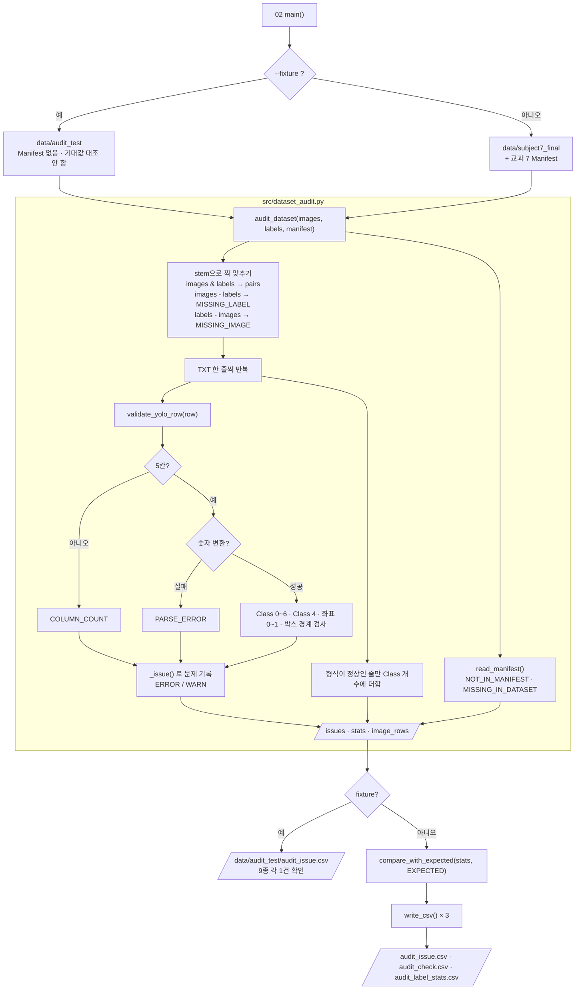
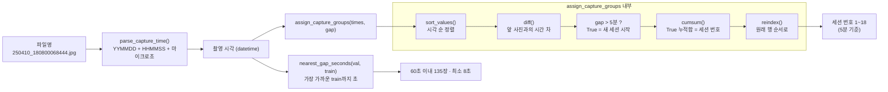
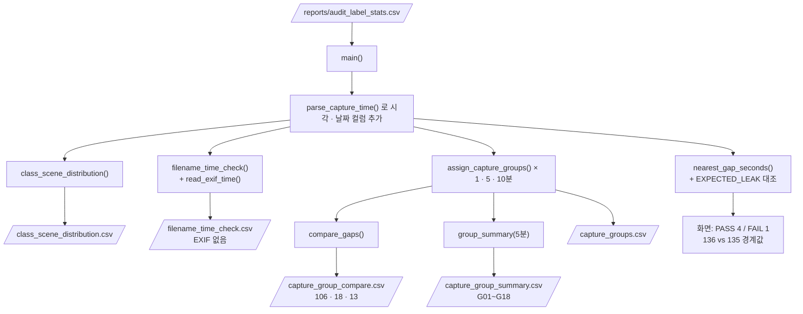
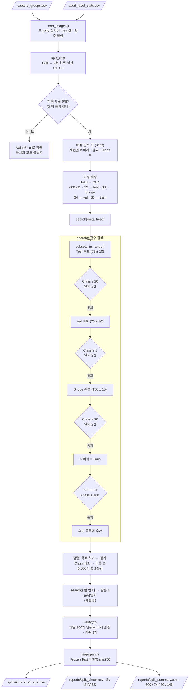
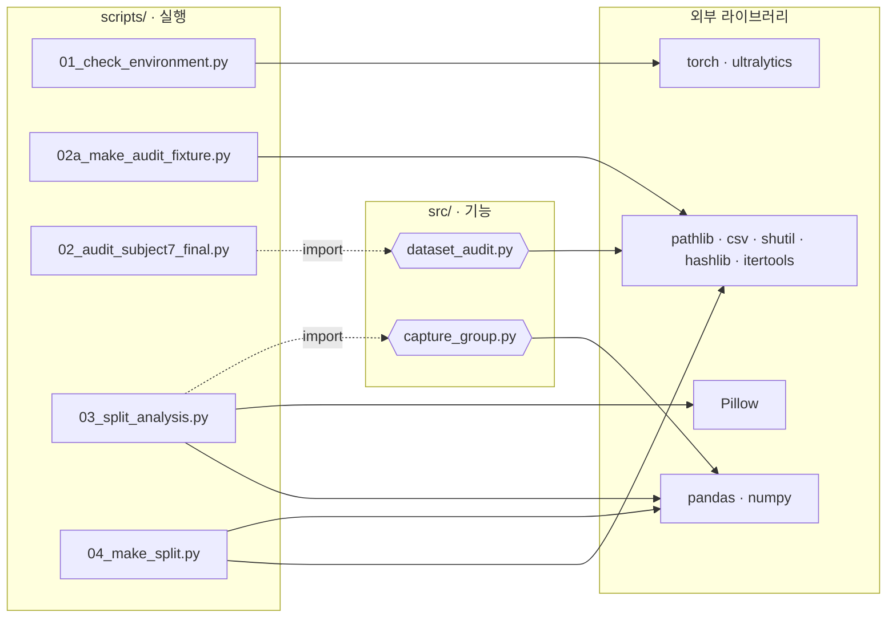

# 교과 8 · 코드 흐름도 (Mermaid)

> 기준: `main` · PR #73 (2026-10-12) · `prj08/`
> GitHub에서 이 파일을 열면 그림으로 보입니다. VS Code는 "Markdown Preview Mermaid Support" 확장을 설치하면 미리보기에서 보입니다.

**범례**: 원통 = 데이터(읽기 전용) · 육각형 = `src` 기능 · 사각형 = `scripts` 실행 파일 · 평행사변형 = 결과 파일 · 둥근 사각형 = 사람의 결정 · 점선 = import / 규칙 반영

---

## 1. 전체 파이프라인 (파일 단위)

```mermaid
flowchart LR
    subgraph IN["② 입력 · 교과 7 FINAL (Git 제외 · 읽기 전용)"]
        IMG[("data/subject7_final/images<br/>JPG 900장")]
        LBL[("data/subject7_final/labels<br/>TXT 900개 · 지문 5c2b4fc2c3e6")]
        MAN[("prj07/manifests/<br/>dataset_manifest.csv")]
    end

    EXP(["reports/audit_expected.md<br/>기대값 · Test Oracle"])
    YAML[/"configs/dataset.yaml<br/>Class 0~6 · Bridge 제외"/]

    subgraph D1["① 1일차 · 환경"]
        S01["scripts/01_check_environment.py"]
        ENV[/"README 팀원 환경 표"/]
    end

    subgraph AUD["③ 2일차 · Audit"]
        SRC1{{"src/dataset_audit.py"}}
        S02A["scripts/02a_make_audit_fixture.py"]
        FIX[("data/audit_test<br/>8쌍 + 버그 9종")]
        S02["scripts/02_audit_subject7_final.py"]
        O02[/"audit_issue.csv<br/>audit_check.csv<br/>audit_label_stats.csv"/]
    end

    subgraph ANA["④ 2일차 · 분포 · Leakage"]
        SRC2{{"src/capture_group.py"}}
        S03["scripts/03_split_analysis.py"]
        O03[/"class_scene_distribution.csv<br/>capture_group_compare.csv<br/>capture_groups.csv<br/>capture_group_summary.csv<br/>filename_time_check.csv"/]
    end

    subgraph DEC["⑤ 사람의 결정"]
        POL(["docs/split_policy.md<br/>5분 세션 · 600/75/75/150 · E1"])
        LOG(["reports/issue_log.md"])
    end

    subgraph SPL["⑥ 3일차 선행 · 배정"]
        S04["scripts/04_make_split.py"]
        O04[/"splits/kimchi_v1_split.csv<br/>split_check.csv · split_summary.csv<br/>Frozen Test 지문 4f9291849fe6"/]
    end

    NEXT["3일차 남은 일<br/>manifests/*.csv · data/yolo · Smoke Test"]

    S01 --> ENV

    IMG --> S02A
    LBL --> S02A
    S02A --> FIX
    FIX -->|"fixture 모드"| S02

    IMG --> S02
    LBL --> S02
    MAN --> S02
    SRC1 -.->|import| S02
    EXP -.->|EXPECTED 19항목| S02
    S02 --> O02
    O02 -.->|FAIL 5 원인| LOG

    O02 -->|audit_label_stats| S03
    IMG -->|EXIF 확인| S03
    SRC2 -.->|import| S03
    S03 --> O03

    O03 -.->|숫자 근거| POL
    POL -.->|정책 → 상수| S04
    O03 -->|capture_groups| S04
    O02 -->|audit_label_stats| S04
    S04 --> O04
    O04 -.-> NEXT
    YAML -.-> NEXT

    classDef data fill:#E9ECE8,stroke:#9AA3AE,color:#1B2430
    classDef src fill:#FFFFFF,stroke:#2a78d6,stroke-width:2px,color:#1B2430
    classDef script fill:#1B2430,stroke:#1B2430,color:#FFFFFF
    classDef out fill:#FFFFFF,stroke:#9AA3AE,stroke-dasharray:4 3,color:#1B2430
    classDef human fill:#FBF1E6,stroke:#C26A1E,stroke-width:2px,color:#1B2430
    classDef next fill:#F3F4F1,stroke:#B8C2CF,stroke-dasharray:4 3,color:#6B7280

    class IMG,LBL,MAN,FIX data
    class SRC1,SRC2 src
    class S01,S02A,S02,S03,S04 script
    class O02,O03,O04,ENV,YAML out
    class EXP,POL,LOG human
    class NEXT next
```

---

## 2. Audit — `02_audit_subject7_final.py` → `src/dataset_audit.py`

---

## 3. 세션 묶기 — `src/capture_group.py`

---

## 4. 분석 — `scripts/03_split_analysis.py`

---

## 5. 배정 — `scripts/04_make_split.py`

---

## 6. 모듈 의존 관계 (누가 누구를 import 하나)

> `04_make_split.py`는 `src`를 import하지 않고 **결과 CSV 두 개만** 읽습니다. 그래서 앞 단계 코드가 바뀌어도 CSV가 같으면 배정 결과가 같습니다.
