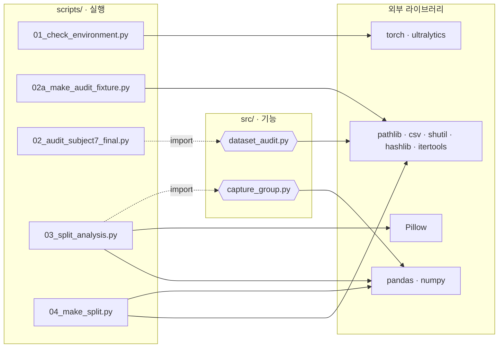

# 교과 8 · 코드 흐름도 (Mermaid)

> 기준: `main` · PR #73 코드 (2026-10-12) · `prj08/`
> 이 문서는 **파일 사이**의 흐름(전체 지도)만 다룹니다. 파일 **안쪽** 흐름은 각 코드 리뷰 문서의 "흐름 그림"에 있습니다.
> GitHub에서 이 파일을 열면 그림으로 보입니다. VS Code는 "Markdown Preview Mermaid Support" 확장을 설치하면 미리보기에서 보입니다.

**범례**: 원통 = 데이터(읽기 전용) · 육각형 = `src` 기능 · 사각형 = `scripts` 실행 파일 · 평행사변형 = 결과 파일 · 둥근 사각형 = 사람의 결정 · 점선 = import / 규칙 반영

---

## 1. 전체 파이프라인 (파일 단위)

---

## 2. 파일별 흐름 그림

파일 **안쪽** 흐름은 각 코드 리뷰 문서 3장에 있습니다. 같은 그림을 두 곳에 두지 않으려고 여기서는 링크만 둡니다.

| 파일 | 그림 내용 | 위치 |
|---|---|---|
| `configs/dataset.yaml` | path → images → labels 자동 치환 | [dataset_yaml.md](code_review/configs/dataset_yaml.md#흐름-그림) |
| `src/dataset_audit.py` | 짝 맞추기 → 한 줄 검사 → issues · stats | [dataset_audit.md](code_review/src/dataset_audit.md#흐름-그림) |
| `src/capture_group.py` | sort → diff → 비교 → cumsum | [capture_group.md](code_review/src/capture_group.md#흐름-그림) |
| `scripts/01_check_environment.py` | 버전 → CUDA → YOLO Load | [01_check_environment.md](code_review/scripts/01_check_environment.md#흐름-그림) |
| `scripts/02a_make_audit_fixture.py` | 지우기 → 8쌍 복사 → 버그 9종 | [02a_make_audit_fixture.md](code_review/scripts/02a_make_audit_fixture.md#흐름-그림) |
| `scripts/02_audit_subject7_final.py` | fixture 분기 → Audit → 기대값 대조 | [02_audit_subject7_final.md](code_review/scripts/02_audit_subject7_final.md#흐름-그림) |
| `scripts/03_split_analysis.py` | main → 분석 5갈래 → CSV 5개 | [03_split_analysis.md](code_review/scripts/03_split_analysis.md#흐름-그림) |
| `scripts/04_make_split.py` | E1 → 전수 탐색 → 재현성 → verify | [04_make_split.md](code_review/scripts/04_make_split.md#흐름-그림) |

---

## 3. 모듈 의존 관계 (누가 누구를 import 하나)

> `04_make_split.py`는 `src`를 import하지 않고 **결과 CSV 두 개만** 읽습니다. 그래서 앞 단계 코드가 바뀌어도 CSV가 같으면 배정 결과가 같습니다.
