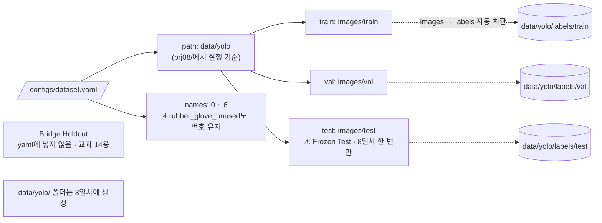

# `configs/dataset.yaml` 코드 리뷰

> 1일차 · 산출물 1 · 가이드 12장 · 11.4장

## 1. 한 줄 요약

YOLO에게 "학습 · 검증 · 시험 이미지가 어디 있고, Class 번호가 무슨 뜻인지" 알려 주는 **데이터 안내서**입니다.

## 2. 입력 · 출력 · 실행

| 구분 | 내용 |
|---|---|
| 누가 읽나 | Ultralytics YOLO (`model.train(data="configs/dataset.yaml")`) · 4일차부터 |
| 기준 위치 | `prj08/`에서 실행 (`path: data/yolo`는 실행 위치 기준) |
| 지금 상태 | 파일만 있음 · 가리키는 `data/yolo/` 폴더는 **06으로 생성 완료** |

## 3. 내용

```yaml
path: data/yolo            # 기준 폴더 (prj08/ 에서 실행 기준)

train: images/train        # → data/yolo/images/train
val: images/val            # → data/yolo/images/val
test: images/test          # → data/yolo/images/test

names:
  0: leaf_paper
  1: plastic_stone_metal
  2: branch
  3: insect
  4: rubber_glove_unused   # 0건이어도 번호 유지
  5: disease_browning
  6: green_onion_pepper
```

### 흐름 그림



점선은 YOLO가 스스로 찾아가는 경로입니다. 라벨 폴더를 따로 적지 않는 이유가 이것입니다.

## 4. 핵심 읽기

### 4.1 라벨 폴더는 적지 않는다

YOLO는 `images/train/a.jpg`를 보면 자동으로 `labels/train/a.txt`를 찾습니다. 그래서 **images와 labels 폴더 구조가 똑같아야** 합니다(3일차 YOLO 폴더 만들 때 주의).

### 4.2 Class 번호는 교과 7 그대로

Class 4(고무장갑)가 0건이어도 `5 → 4`, `6 → 5`처럼 당기지 않습니다. 번호를 바꾸면 교과 7 라벨 900개의 의미가 전부 틀어집니다(가이드 3장 2.1).

### 4.3 Bridge Holdout은 넣지 않는다

yaml에 적힌 경로는 YOLO가 언제든 읽을 수 있습니다. Bridge는 교과 14 전용이라 **목록에서 아예 빼서** 실수로도 쓰이지 않게 합니다(가이드 11.4).

## 5. 연결된 파일

| 관계 | 파일 |
|---|---|
| 이름 기준 | README 4장 Class 표 · 교과 7 `configs/classes.yaml` |
| 폴더를 만들 파일 | (3일차) Split Freeze · YOLO 폴더 구성 스크립트 |
| 이 파일을 읽을 파일 | (3일차) Smoke Test · (4일차) Baseline 학습 |
