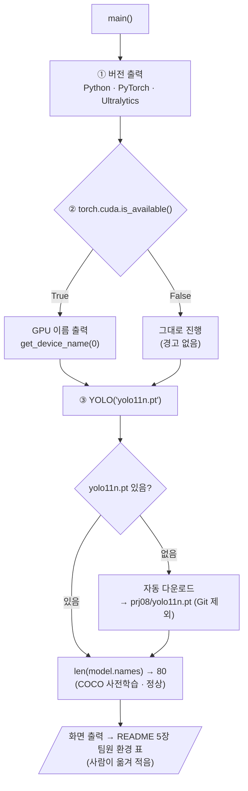

# `scripts/01_check_environment.py` 코드 리뷰

> 1일차 · 36줄 · 가이드 14.3 · 14.4

## 1. 한 줄 요약

팀원 5명이 **같은 환경**(Python · PyTorch · Ultralytics · GPU)에서 작업하는지 확인하고, YOLO11n 사전학습 모델이 **정상으로 Load되는지** 확인합니다.

## 2. 입력 · 출력 · 실행

| 구분 | 내용 |
|---|---|
| 입력 | 현재 가상환경 (`prj08/.venv`) |
| 출력 | 화면 출력 (버전 · CUDA · GPU · Class 수) · 처음 실행 시 `yolo11n.pt` 자동 다운로드 |
| 실행 | `cd prj08` → `python scripts/01_check_environment.py` |
| 결과 기록 | README 5장 실행환경 · 팀원 환경 표 (사람이 옮겨 적음) |

## 3. 구조

| 줄 | 내용 |
|--:|---|
| 1~10 | 설명 · `PROJECT_ROOT`를 `sys.path`에 추가 |
| 12~14 | `torch` · `ultralytics` · `YOLO` import |
| 17~33 | `main()`: ① 버전 ② GPU ③ YOLO Load |
| 36 | `if __name__ == "__main__": main()` |

### 흐름 그림



분기가 두 군데뿐인 짧은 파일입니다. CUDA가 False여도 멈추지 않고 그대로 진행합니다.

## 4. 핵심 코드 읽기

```python
print("Python      :", sys.version.split()[0])
print("PyTorch     :", torch.__version__)
print("Ultralytics :", ultralytics.__version__)

print("CUDA 사용 가능:", torch.cuda.is_available())      # False면 CPU 학습 → 매우 느림
if torch.cuda.is_available():
    print("GPU         :", torch.cuda.get_device_name(0))

model = YOLO("yolo11n.pt")                                  # 없으면 자동 다운로드
print("YOLO Load 성공, Class 수:", len(model.names))        # 80 (COCO)
```

- **왜 버전을 맞추나**: 같은 데이터 · 같은 설정이라도 라이브러리 버전이 다르면 학습 결과가 달라질 수 있습니다. 4일차 "팀 공통 Baseline"을 비교하려면 출발선이 같아야 합니다.
- **왜 Class가 80개인가**: `yolo11n.pt`는 COCO(사람 · 자동차 등 80종)로 미리 학습된 모델입니다. 우리 7개 Class는 Fine-tuning 후에 적용됩니다. 1일차는 "불러와지는가"만 확인합니다.
- `torch.cuda.get_device_name(0)`의 `0`은 첫 번째 GPU 번호입니다.

## 5. 연결된 파일

| 관계 | 파일 |
|---|---|
| 버전 기준 | `requirements.txt` (`ultralytics==8.4.175`) |
| 결과 기록 | `README.md` 5장 |
| 다운로드 결과 | `prj08/yolo11n.pt` (Git 제외 `*.pt`) → 4일차 Baseline의 시작 가중치 |
