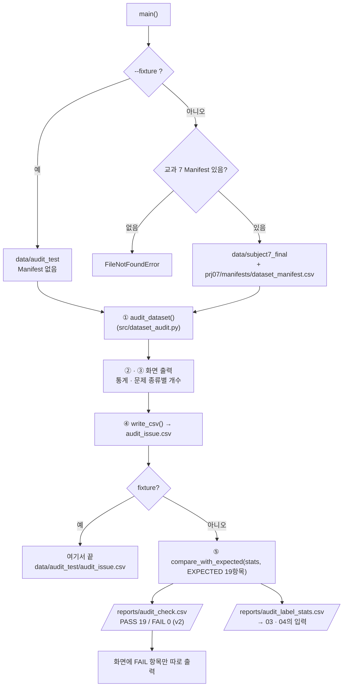

# `scripts/02_audit_subject7_final.py` 코드 리뷰

> 2일차 · 118줄 · 가이드 15.1 · 15.6 Daily Gate

## 1. 한 줄 요약

`src/dataset_audit.py`를 불러 교과 7 FINAL 900장을 검사하고, **Audit 전에 고정해 둔 기대값 19항목**과 비교해 PASS / FAIL을 남깁니다. `--fixture` 옵션이면 테스트 데이터로 검사기 자체를 시험합니다.

## 2. 입력 · 출력 · 실행

| 모드 | 입력 | 출력 |
|---|---|---|
| `--fixture` | `data/audit_test/` | `data/audit_test/audit_issue.csv` (Git 제외) |
| 기본 | `data/subject7_final/` + `prj07/manifests/dataset_manifest.csv` + `EXPECTED` | `reports/audit_issue.csv` · `audit_check.csv` · `audit_label_stats.csv` |

```bash
python scripts/02_audit_subject7_final.py --fixture   # 검사기 시험
python scripts/02_audit_subject7_final.py             # 900장 · 정상 결과 PASS 19 / FAIL 0 (기대값 v2)
```

## 3. 구조

| 줄 | 내용 |
|--:|---|
| 18~22 | `PROJECT_ROOT` · `from src.dataset_audit import ...` |
| 27~30 | 경로: `FINAL_DIR` · `FIXTURE_DIR` · `MANIFEST` · `REPORT_DIR` |
| 35~55 | `EXPECTED` 기대값 19항목 |
| 57 | `ISSUE_FIELDS` (CSV 컬럼) |
| 60~114 | `main()`: 옵션 → 검사 → 화면 → 저장 → 대조 |

### 흐름 그림



`--fixture`일 때는 ④에서 끝나서 기대값 대조와 `reports/` 저장을 하지 않습니다. 검사 내부는 [`src/dataset_audit.md`](../src/dataset_audit.md)의 그림을 보세요.

## 4. 핵심 코드 읽기

### 4.1 교과 7 Manifest를 상대경로로

```python
MANIFEST = PROJECT_ROOT.parent / "prj07" / "manifests" / "dataset_manifest.csv"
```

`prj08/`의 한 단계 위(레포 루트)에서 `prj07/`로 들어갑니다. 레포 구조(prj07 · prj08 폴더)를 활용해 교과 7 결과를 **복사하지 않고 그대로** 읽습니다.

### 4.2 기대값 — 결과를 보고 고치지 않는다

```python
# 기대값: reports/audit_expected.md v2 1·2장에서 옮겨 적은 값 (실행 결과를 보고 고치지 않음)
# 기준 데이터: kimchi_v1 (10/08 수정본 · 라벨 지문 5c2b4fc2c3e6)
EXPECTED_DOC_VERSION = "v2"
EXPECTED = {
    "jpg_count": 900, "txt_count": 900, "pair_count": 900,
    "missing_label": 0, "missing_image": 0, "empty_label": 0,
    "class4_files": 0, "format_errors": 0,
    "bbox_total": 4601,                                   # v1: 4602
    "class_0": 924, "class_1": 1897, "class_2": 711, "class_3": 378,   # v1: 868 · 767
    "class_4": 0, "class_5": 439, "class_6": 252,         # v1: 441 · 251
    "manifest_rows": 900, "not_in_manifest": 0, "missing_in_dataset": 0,
}
```

**v1 (10/12)**: 교과 7 문서(10/07 QA)의 숫자를 그대로 옮겼습니다. 실제 라벨(10/08 수정본)은 4,601이라 **PASS 14 / FAIL 5**가 나왔고, 이 FAIL을 숨기지 않고 추적해서 "10/08 수정이 문서에 반영되지 않았다"는 원인을 찾았습니다. 팀원 2명이 옛 버전을 쓰고 있다는 것도 이때 발견했습니다.

**v2 (10/13)**: 원인이 데이터 결함이 아니라 **기준 문서가 낡은 것**으로 확인되고, 팀이 `kimchi_v1`(4,601 · 지문 `5c2b4fc2c3e6`)을 확정했기 때문에 기준 문서를 v2로 개정하고 `EXPECTED`를 다시 옮겨 적었습니다. 실행 결과에 맞춰 숫자를 바꾼 것이 아니라 **근거 문서 → 팀 합의 → 문서 개정 → 코드 반영** 순서를 지켰고, 개정 이유는 `reports/audit_expected.md` 9장에 남겼습니다. 이제 이 값은 "교과 7 인계가 맞는지"가 아니라 **"kimchi_v1이 그대로인지"** 를 지키는 회귀 기준(Regression Baseline)입니다.

### 4.3 한 스크립트, 두 모드

```python
parser.add_argument("--fixture", action="store_true", help="...")
args = parser.parse_args()

if args.fixture:
    data_dir, manifest, out_dir = FIXTURE_DIR, None, FIXTURE_DIR      # Manifest · 기대값 대조 안 함
else:
    data_dir, manifest, out_dir = FINAL_DIR, MANIFEST, REPORT_DIR
    if not MANIFEST.exists():
        raise FileNotFoundError(f"Manifest를 찾을 수 없습니다: {MANIFEST}")
```

- `action="store_true"` → 옵션을 쓰면 `True`, 안 쓰면 `False`
- Fixture 결과는 `data/audit_test/`에 저장 → **Git에 올라가지 않고**, 실제 결과(`reports/`)를 덮어쓰지도 않습니다.

### 4.4 검사 → 저장 → 대조

```python
issues, stats, image_rows = audit_dataset(data_dir / "images", data_dir / "labels", manifest)
write_csv(issues, out_dir / "audit_issue.csv", ISSUE_FIELDS)
if args.fixture:
    return                                         # 시험 모드는 여기까지
check_rows = compare_with_expected(stats, EXPECTED)
write_csv(check_rows, REPORT_DIR / "audit_check.csv", ["item", "expected", "actual", "result"])
write_csv(image_rows, REPORT_DIR / "audit_label_stats.csv", stat_fields)
```

`audit_label_stats.csv`는 단순 기록이 아니라 **다음 단계(03 · 04)의 입력 데이터**입니다.

## 5. 연결된 파일

| 관계 | 파일 |
|---|---|
| 불러 쓰는 기능 | `src/dataset_audit.py` |
| 기대값 출처 | `reports/audit_expected.md` |
| 교과 7 입력 | `prj07/manifests/dataset_manifest.csv` |
| 결과를 쓰는 곳 | `audit_label_stats.csv` → `03_split_analysis.py` · `04_make_split.py` |
| 원인 기록 | `reports/issue_log.md` |
