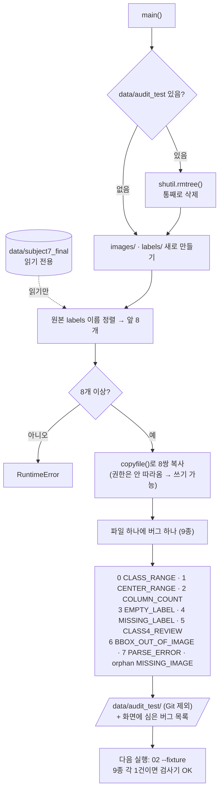

# `scripts/02a_make_audit_fixture.py` 코드 리뷰

> 2일차 · 76줄 · 가이드 예시 2-⑧ "작은 시험: 일부러 오류를 만든 TXT"

## 1. 한 줄 요약

검사기(`dataset_audit`)가 **정말 오류를 찾는지** 시험하기 위해, 원본 8쌍을 복사한 뒤 **버그 9종을 하나씩 심은 테스트 데이터(Fixture)**를 만듭니다.

> 비유: 연기 감지기에 연기를 뿌려 보는 것. 900장에서 "문제 0건"이 나와도, 검사기가 잘 찾아서 0인지 못 찾아서 0인지 구분하려면 먼저 시험해야 합니다.

## 2. 입력 · 출력 · 실행

| 구분 | 내용 |
|---|---|
| 입력 | `data/subject7_final/{images,labels}` 앞 8쌍 (읽기만) |
| 출력 | `data/audit_test/{images,labels}` + 화면에 심은 버그 목록 |
| 실행 | `python scripts/02a_make_audit_fixture.py` → 이어서 `python scripts/02_audit_subject7_final.py --fixture` |
| Git | `data/` 아래라 올라가지 않음 · 언제든 다시 생성 가능 |

## 3. 구조

| 줄 | 내용 |
|--:|---|
| 16~18 | `PROJECT_ROOT` · `SRC`(원본) · `DST`(복사본) |
| 21 | `append_line(txt, line)` — TXT 끝에 한 줄 추가 |
| 29 | `main()` |
| 31~34 | 이전 테스트 데이터 삭제 후 새 폴더 |
| 37~42 | 원본 앞 8쌍 복사 |
| 47~66 | 버그 9종 목록 + 심기 |
| 69~72 | 심은 버그 출력 |

### 흐름 그림



"지우고 → 복사하고 → 하나씩 망가뜨린다" 순서입니다. 원본(왼쪽 위 원통)은 읽기만 합니다.

## 4. 핵심 코드 읽기

### 4.1 매번 새로 만든다

```python
if DST.exists():
    shutil.rmtree(DST)          # 이전 테스트 데이터 통째로 삭제
(DST / "images").mkdir(parents=True)
(DST / "labels").mkdir(parents=True)
```

이전 실행 결과가 남아 있으면 버그가 두 번 심어질 수 있습니다. 항상 **같은 시작점**에서 만들어야 테스트 결과를 믿을 수 있습니다.

### 4.2 원본은 건드리지 않는다

```python
stems = sorted(p.stem for p in (SRC / "labels").glob("*.txt"))[:8]
for s in stems:
    shutil.copyfile(SRC / "images" / f"{s}.jpg", DST / "images" / f"{s}.jpg")
    shutil.copyfile(SRC / "labels" / f"{s}.txt", DST / "labels" / f"{s}.txt")
```

- `copyfile`은 **내용만** 복사합니다. 원본의 읽기 전용 권한(`chmod a-w`)이 따라오지 않아서 복사본에는 버그를 쓸 수 있습니다. (`shutil.copy2`였다면 권한까지 복사되어 쓰기가 막힙니다.)
- `sorted(...)[:8]` → 실행할 때마다 **같은 8장**을 고릅니다.

### 4.3 파일 하나에 버그 하나

```python
lbl = lambda i: DST / "labels" / f"{stems[i]}.txt"     # i번째 라벨 경로

append_line(lbl(0), "9 0.5 0.5 0.1 0.1")      # CLASS_RANGE      (Class 9)
append_line(lbl(1), "0 1.5 0.5 0.1 0.1")      # CENTER_RANGE     (x = 1.5)
append_line(lbl(2), "0 0.5 0.5 0.1")          # COLUMN_COUNT     (4칸)
lbl(3).write_text("", encoding="utf-8")       # EMPTY_LABEL      (내용 삭제)
lbl(4).unlink()                               # MISSING_LABEL    (TXT 삭제)
append_line(lbl(5), "4 0.5 0.5 0.1 0.1")      # CLASS4_REVIEW
append_line(lbl(6), "0 0.98 0.5 0.1 0.1")     # BBOX_OUT_OF_IMAGE (0.98 + 0.05 = 1.03)
append_line(lbl(7), "0 abc 0.5 0.1 0.1")      # PARSE_ERROR
(DST / "labels" / "orphan_000.txt").write_text(...)   # MISSING_IMAGE (짝 없는 TXT)
```

파일 하나에 버그 하나만 넣어서, Audit 결과가 나왔을 때 **어떤 파일의 어떤 버그가 잡혔는지 1:1로** 대조할 수 있습니다.

## 5. 연결된 파일

| 관계 | 파일 |
|---|---|
| 원본 | `data/subject7_final/` (읽기 전용) |
| 다음 실행 | `scripts/02_audit_subject7_final.py --fixture` |
| 검사하는 기능 | `src/dataset_audit.py` |
