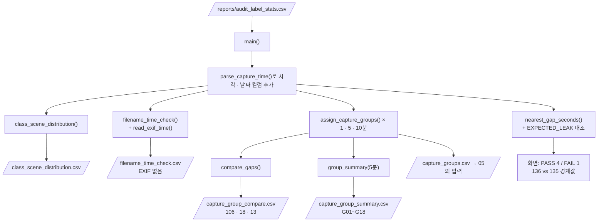

# `scripts/04_split_analysis.py` 코드 리뷰

> 2일차 · 202줄 · 가이드 15.2 (분포) · 15.3 (Leakage)

## 1. 한 줄 요약

Split 정책을 정하기 전에 **"데이터 지도"**를 그립니다. Class가 어디에 몰려 있는지, 파일명이 촬영 시각인지, 세션을 몇 분 기준으로 끊을지, 기존 validation이 train과 얼마나 가까운지를 숫자로 만듭니다.

## 2. 입력 · 출력 · 실행

| 구분 | 내용 |
|---|---|
| 입력 | `reports/audit_label_stats.csv` (03 결과) · `data/subject7_final/images` (EXIF용) |
| 출력 | `reports/` CSV 5개 + 화면에 Leakage 기대값 대조 |
| 실행 | `python scripts/04_split_analysis.py` (`--gap 10`으로 상세 표 기준 변경 가능) |
| 정상 결과 | 세션 18개 · Leakage PASS 4 / FAIL 1 (136 vs 135 경계값) |

## 3. 구조

| 줄 | 이름 | 결과 |
|--:|---|---|
| 32~42 | 경로 · `GAP_CANDIDATES` · `LEAK_SECONDS` · `EXPECTED_LEAK` | |
| 45 | `save(df, name)` | CSV 저장 도우미 |
| 54 | `class_scene_distribution(df)` | `class_scene_distribution.csv` |
| 68 | `read_exif_time(path)` | 사진 1장의 EXIF 시각 |
| 84 | `filename_time_check(df)` | `filename_time_check.csv` |
| 103 | `compare_gaps(df)` | `capture_group_compare.csv` |
| 125 | `group_summary(df, gap)` | `capture_group_summary.csv` |
| 146 | `main()` | 위 함수들 순서대로 + `capture_groups.csv` + Leakage 대조 |

### 흐름 그림



`main()` 하나가 다섯 갈래로 나뉘고, 갈래마다 CSV 하나씩 나옵니다. 세션 묶기 내부는 [`src/capture_group.md`](../src/capture_group.md)의 그림을 보세요.

## 4. 핵심 코드 읽기

### 4.1 파일명에서 시각 · 날짜 컬럼 만들기

```python
df["capture_time"] = df["file_name"].map(parse_capture_time)   # src/capture_group.py
df["date"] = df["file_name"].str[:6]                           # '250410'
```

`.map(함수)`는 컬럼의 값 하나하나에 함수를 적용합니다.

### 4.2 Class × scene_type 분포 — Named Aggregation

```python
keys = ["source_dataset", "original_split", "scene_type"]
table = df.groupby(keys).agg(images=("file_name", "count"),
                             bbox=("n_bbox", "sum"),
                             **{c: (c, "sum") for c in CLASS_COLS}).reset_index()
```

- `새컬럼=("원래컬럼", "계산")` 형식으로 여러 집계를 한 번에 합니다.
- `**{...}`는 dict를 키워드 인자로 펼칩니다 → `class_0=("class_0","sum"), class_1=...`을 반복 없이 씁니다.
- 결과에서 "파·고추 · 병해는 김치 장면에만 있다", "벌레 155개가 dataset2 train에 몰려 있다"를 발견했습니다.

### 4.3 EXIF 확인 — 실패해도 멈추지 않기

```python
try:
    exif = Image.open(path).getexif()
except OSError:
    return None
raw = exif.get_ifd(0x8769).get(36867) or exif.get(306)   # DateTimeOriginal 또는 DateTime
```

- `36867`, `306`은 EXIF 표준의 태그 번호입니다(촬영 시각).
- 이미지가 없거나 EXIF가 없으면 `None` → CSV에 "EXIF 없음"으로 기록하고 다음으로 넘어갑니다. 결과: 12장 모두 EXIF 없음 → 연속 사진을 직접 보고 "파일명 = 촬영 순서"로 판단했습니다.

### 4.4 세션 기준 비교 — 1 · 5 · 10분

```python
for gap in GAP_CANDIDATES:                                         # [1, 5, 14]
    df[f"group_{gap}m"] = assign_capture_groups(df["capture_time"], gap)
...
n_split = g["original_split"].nunique()                            # 한 세션 안 split 종류 수
mixed_ids = n_split[n_split > 1].index                             # train · validation이 섞인 세션
```

| 기준 | 세션 | 가장 큰 | 1장짜리 | 섞인 세션 |
|---|--:|--:|--:|--:|
| 1분 | 106 | 132 | 29 | 57 |
| **5분** | **18** | 150 | 1 | 17 |
| 10분 | 13 | 150 | 0 | 13 |

### 4.5 Leakage 재확인 — 여기서도 기대값 대조

```python
gaps = nearest_gap_seconds(val["capture_time"], train["capture_time"])
actual = {"val_within_60s": int((gaps <= LEAK_SECONDS).sum()), ...}
for k, exp in EXPECTED_LEAK.items():
    print(f"  {'PASS' if actual[k] == exp else 'FAIL'}  {k} 기대 {exp} / 실제 {actual[k]}")
```

교과 7 문서는 136장, 이 코드는 135장 → 60.28초 떨어진 사진 1장 때문입니다. 교과 7은 초 단위로 잘라 계산했고, 이 코드는 마이크로초까지 계산합니다(**경계값 분석**).

## 5. 연결된 파일

| 관계 | 파일 |
|---|---|
| 입력 | `reports/audit_label_stats.csv` (← `03`) |
| 불러 쓰는 기능 | `src/capture_group.py` |
| 결과를 쓰는 곳 | `capture_groups.csv` → `05_make_split.py` · 모든 CSV → `docs/split_policy.md` 근거 |
