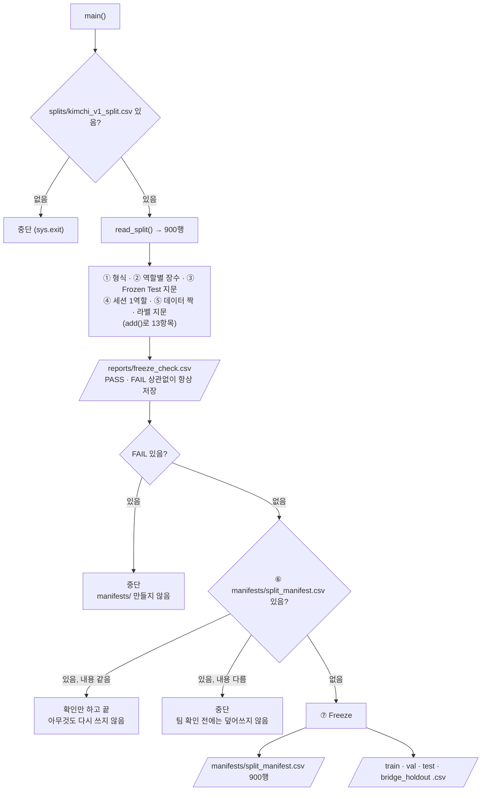

# `scripts/05_freeze_split.py` 코드 리뷰

> 3일차 · 147줄 · split_policy.md 1 · 8장 · README 9장

## 1. 한 줄 요약

`splits/kimchi_v1_split.csv`(900행)를 **13개 항목으로 검사**하고, 하나도 빠짐없이 PASS일 때만 `manifests/`에 확정본을 만들어 **얼립니다(Freeze)**. 하나라도 FAIL이면 아무 파일도 쓰지 않고, 이미 얼려 둔 것은 다시 쓰지 않습니다.

## 2. 입력 · 출력 · 실행

| 구분 | 파일 |
|---|---|
| 입력 | `splits/kimchi_v1_split.csv` + `data/subject7_final/images` · `labels` |
| 출력 (항상) | `reports/freeze_check.csv` (item · expected · actual · result) |
| 출력 (전부 PASS일 때만) | `manifests/split_manifest.csv` (900행) · `train.csv` · `val.csv` · `test.csv` · `bridge_holdout.csv` |

```bash
python scripts/05_freeze_split.py   # prj08 폴더에서 실행 · 옵션 없음
```

## 3. 구조

| 줄 | 내용 |
|--:|---|
| 16~19 | `import` (`pathlib` · `csv` · `hashlib` · `sys`) |
| 24~29 | 경로: `SPLIT_CSV` · `SRC_IMG` · `SRC_LBL` · `MANIFEST_DIR` · `CHECK_CSV` |
| 34~41 | 기준값: `LABEL_FP` · `FROZEN_TEST_FP` · `EXPECTED_COUNTS` · `TOTAL` · `FIELDS` · `ROLE_FILES` |
| 44~57 | `fingerprint()` · `label_fingerprint()` (지문 계산) |
| 59~69 | `read_split()` · `write_rows()` (CSV 읽기 · 쓰기) |
| 71~143 | `main()`: 검사 ①~⑤ → 저장 → 중단 판단 → ⑥ 이미 Freeze? → ⑦ Freeze |

### 흐름 그림



검사에 쓰는 숫자는 모두 문서에서 옮겨 적은 값이라, **실행 결과가 아니라 문서가 기준**입니다.

## 4. 핵심 코드 읽기

### 4.1 기준값 — 결과를 보고 고치지 않는다

```python
LABEL_FP = "5c2b4fc2c3e6"           # kimchi_v1 라벨 지문 (README 6.1 명령과 같은 계산)
FROZEN_TEST_FP = "4f9291849fe6"     # Frozen Test 지문 (split_policy.md 8장)
EXPECTED_COUNTS = {"train": 600, "val": 74, "test": 80, "bridge": 146}   # 배정 결과 (8장)
TOTAL = 900
```

- 값의 출처는 `split_policy.md` 1 · 8장과 README 9장입니다. 코드에서 계산한 값을 기준으로 삼지 않습니다.
- 역할별 장수 600 / 74 / 80 / 146은 04단계 목표(train 600 / val 75 / test 75 / bridge 150, ±10장) 안에 들어 있습니다.
- 라벨 지문 `5c2b4fc2c3e6`은 02단계 Audit의 기준 데이터(`kimchi_v1`)와 같은 값입니다.

### 4.2 라벨 지문 — `cat | sha256sum`과 같은 값

```python
def label_fingerprint(label_dir: Path) -> str:
    h = hashlib.sha256()
    for p in sorted(label_dir.glob("*.txt"), key=lambda p: p.name.encode("utf-8")):
        h.update(p.read_bytes())                     # cat 처럼 파일 내용을 순서대로 이어 붙임
    return h.hexdigest()[:12]
```

- README의 `LC_ALL=C cat labels/*.txt | sha256sum`과 **같은 결과**가 나오게 만든 함수입니다.
- `LC_ALL=C`는 파일 이름을 **바이트 순서**로 정렬하므로, Python에서도 이름을 `bytes`로 바꿔 정렬합니다.
- 반면 `fingerprint()`는 파일명 목록을 정렬해 이어 붙인 문자열의 지문이며, `04_make_split.py`와 같은 방식입니다. Frozen Test 지문(③)이 이쪽입니다.

### 4.3 검사를 모아 담는 `add()`

```python
checks = []                                             # (item, expected, actual)

def add(item, expected, actual):
    checks.append({"item": item, "expected": expected, "actual": actual,
                   "result": "PASS" if str(expected) == str(actual) else "FAIL"})
```

`str()`로 바꿔서 비교하기 때문에 숫자(`900`)와 문자(`"900"`)를 따로 신경 쓰지 않아도 됩니다. 검사 13항목은 다음과 같습니다.

| 번호 | 항목 | 내용 |
|:--:|---|---|
| ① | `columns` · `rows` · `duplicate_file_name` · `unknown_role` | 칸 이름 · 900행 · 중복 0 · 모르는 역할 0 |
| ② | `count_train` · `count_val` · `count_test` · `count_bridge` | 역할별 장수 |
| ③ | `test_fingerprint` | Frozen Test 지문 |
| ④ | `group_in_multiple_roles` | 한 세션이 두 역할 이상에 걸친 개수 0 |
| ⑤ | `not_on_disk` · `not_in_split` · `label_fingerprint` | split ↔ 실제 이미지 900장 · 라벨 지문 |

④는 한 `capture_group`이 Train과 Test에 나뉘어 들어가는 **Leakage**를 막는 검사입니다.

### 4.4 전부 통과해야만 Freeze

```python
CHECK_CSV.parent.mkdir(exist_ok=True)
with open(CHECK_CSV, "w", encoding="utf-8-sig", newline="") as f:
    ...                                             # PASS/FAIL 상관없이 항상 저장

if n_fail:
    sys.exit("\n[중단] FAIL 이 있어 Freeze 하지 않았습니다. manifests/ 는 만들지 않았습니다.")
```

- 검사 결과(`freeze_check.csv`)는 **실패해도 먼저 저장**해서 원인을 추적할 수 있게 합니다.
- `manifests/`는 그 뒤에 만들기 때문에, 중간에 멈춰도 **반쯤 만들어진 확정본**이 남지 않습니다.

### 4.5 한 번 얼린 것은 다시 쓰지 않는다

```python
if full_path.exists():
    frozen = read_split(full_path)
    if [{k: r[k] for k in FIELDS} for r in frozen] == [{k: r[k] for k in FIELDS} for r in rows]:
        print("이미 Freeze 되어 있고 split 과 내용이 같습니다. ...")
        return
    sys.exit("[중단] 이미 Freeze 된 manifests/ 가 split 과 다릅니다. 팀 확인 전에는 덮어쓰지 않습니다.")
```

- 내용이 같으면 **확인만 하고 끝**나서 여러 번 실행해도 안전합니다.
- 다르면 **덮어쓰지 않고 중단**합니다. 확정본을 바꾸는 일은 코드가 아니라 팀 확인을 거치게 합니다.

### 4.6 CSV 형식을 기존 파일과 맞추기

```python
with open(path, "w", encoding="utf-8-sig", newline="") as f:    # 기존 CSV 와 같은 인코딩 (BOM)
    writer = csv.DictWriter(f, fieldnames=FIELDS, lineterminator="\n")
    writer.writeheader()
    writer.writerows({k: r[k] for k in FIELDS} for r in rows)
```

- 읽을 때 `utf-8-sig`는 맨 앞 BOM을 제거하고, 쓸 때는 BOM을 붙여서 기존 CSV와 같은 형식을 유지합니다.
- `lineterminator="\n"`으로 줄바꿈을 기존 CSV와 같게 맞춥니다.
- `{k: r[k] for k in FIELDS}`로 3개 칸(`file_name` · `capture_group` · `role`)만 남깁니다.
- 역할별 파일은 `rows`에서 `role`로 걸러 쓰기 때문에 **split 순서가 그대로** 유지됩니다.

## 5. 연결된 파일

| 관계 | 파일 |
|---|---|
| 입력 (04단계 결과) | `splits/kimchi_v1_split.csv` |
| 같은 지문 방식 | `04_make_split.py` (`fingerprint()`) |
| 실제 데이터 | `data/subject7_final/images` · `labels` |
| 기준값 출처 | `split_policy.md` 1 · 8장 · README 6.1 · 7 · 9장 |
| 결과를 쓰는 곳 | `manifests/split_manifest.csv` · `train.csv` · `val.csv` · `test.csv` · `bridge_holdout.csv` |
| 검사 기록 | `reports/freeze_check.csv` |
