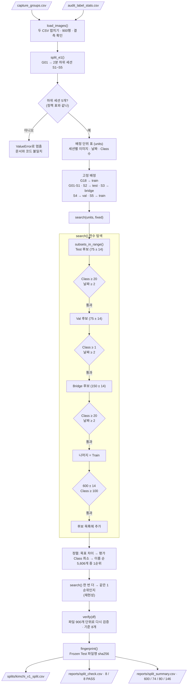

# `scripts/05_make_split.py` 코드 리뷰

> 3일차 선행 · 266줄 · 가이드 예시 3 (`split_builder`) · 16.1 · `docs/split_policy.md`

## 1. 한 줄 요약

`docs/split_policy.md`에서 팀이 정한 규칙대로 900장을 **Train / Val / Frozen Test / Bridge**에 배정합니다. 세션이 18개뿐이라 **가능한 조합을 전부 검사(전수 탐색)**하고, 고른 결과를 **다른 코드로 다시 검증**합니다.

## 2. 입력 · 출력 · 실행

| 구분 | 내용 |
|---|---|
| 입력 | `reports/capture_groups.csv` (04) · `reports/audit_label_stats.csv` (03) · 정책 상수 |
| 출력 | `splits/kimchi_v1_split.csv` · `reports/split_check.csv` · `reports/split_summary.csv` · 화면에 Frozen Test 지문 |
| 실행 | `python scripts/05_make_split.py` (약 10~20초) |
| 정상 결과 | 600 / 74 / 80 / 146 · 합격 기준 8 / 8 PASS · 지문 `4f9291849fe6` |

## 3. 구조

| 줄 | 이름 | 역할 |
|--:|---|---|
| 32~46 | 정책 상수 | `ROLES` · `TARGET` · `TOL` · `MIN_*` · `OBJECT_ONLY_GROUP` · `E1_*` |
| 52 | `load_images()` | 두 CSV 합치기 · 900행 · 결측 확인 |
| 65 | `split_e1(df)` | G01 → 2분 하위 세션 S1~S5 |
| 81 | `subsets_in_range(...)` | 이미지 수 합이 범위 안인 세션 조합 |
| 92 | `search(units, fixed)` | Test → Val → Bridge → Train 전수 탐색 · 정렬 |
| 148 | `verify(df)` | 파일 단위 합격 기준 검증 |
| 199 | `fingerprint(names)` | 파일명 목록 sha256 앞 12자리 |
| 205 | `main()` | 전체 순서 · 저장 · 출력 |

### 흐름 그림



탐색(가운데 상자)과 검증(`verify`)이 서로 다른 길로 계산한다는 점이 핵심입니다.

## 4. 핵심 코드 읽기

### 4.1 정책 상수 — 문서와 1:1

```python
ROLES = ["train", "val", "test", "bridge"]
TARGET = {"train": 600, "val": 75, "test": 75, "bridge": 150}   # split_policy 5장
TOL = 10                                                         # ±10장
MIN_EVAL, MIN_TRAIN, MIN_VAL, MIN_DATES = 20, 100, 1, 2          # 7장 합격 기준
OBJECT_ONLY_GROUP = "G18"                                        # 6.1 → Train
E1_GROUP, E1_GAP_MIN = "G01", 2                                  # 6.2 예외 E1
E1_ASSIGN = {1: "test", 2: "test", 3: "bridge", 4: "val", 5: "train"}
```

규칙을 바꾸려면 **문서부터 고치고 → 이 상수를 고칩니다.** 코드 안 여기저기에 숫자를 흩어 두지 않았습니다.

### 4.2 `split_e1` — 정책과 데이터가 어긋나면 멈춘다

```python
g = df[df["group"] == E1_GROUP]
gap = g["capture_time"].diff()
sub_no = (gap.isna() | (gap > pd.Timedelta(minutes=E1_GAP_MIN))).cumsum()   # capture_group과 같은 원리
if sorted(sub_no.unique()) != sorted(E1_ASSIGN):
    raise ValueError(f"{E1_GROUP} 하위 세션 수가 정책과 다릅니다: ...")
unit.loc[g.index] = [f"{E1_GROUP}-S{n}" for n in sub_no]
```

정책 표에는 S1~S5가 있습니다. 데이터가 바뀌어 하위 세션이 4개나 6개가 되면 **조용히 엉뚱하게 배정하지 않고** 멈춥니다.

### 4.3 `search` — 전수 탐색

```python
for test in subsets_in_range(free, size, *window("test")):          # Test 후보 (75 ± 14)
    if c_t.min() < MIN_EVAL or len(d_t) < MIN_DATES: continue       #   Class ≥ 20 · 날짜 ≥ 2
    for val in subsets_in_range(rest1, size, *window("val")):        # Val 후보 (75 ± 14)
        if c_v.min() < MIN_VAL or len(d_v) < MIN_DATES: continue
        for bridge in subsets_in_range(rest2, size, *window("bridge")):   # Bridge 후보 (150 ± 14)
            if c_b.min() < MIN_EVAL or len(d_b) < MIN_DATES: continue
            train = [n for n in rest2 if n not in bridge]            # 나머지 = Train
            if c_tr.min() < MIN_TRAIN or abs(n_tr - TARGET["train"]) > TOL: continue
            found.append({...})
found.sort(key=lambda x: (x["dev"], -x["eval_min"], x["test"], x["val"], x["bridge"]))
```

- **가지치기**: 조건이 엄격한 Test부터 고르고, 실패하면 `continue`로 그 아래를 아예 보지 않습니다 → 경우의 수가 크게 줄어듭니다.
- `window(role)` = 목표 ± 14에서 **이미 고정 배정된 장수(G01 조각 · G18)를 뺀 범위**
- **정렬 기준** (정책 8장): ① 목표와의 차이 합 작은 것 ② 평가 Class 최소 개수 큰 것(`-`로 내림차순) ③ 이름 순 → **무작위가 없어서 항상 같은 결과**
- 결과: 조건을 만족하는 조합 5,606개 중 1순위 선택

### 4.4 재현성 — 주장하지 않고 확인한다

```python
found, n_found = search(units, fixed)
found2, _ = search(units, fixed)
reproducible = best == found2[0]
```

### 4.5 `verify` — 탐색과 다른 방법으로 다시 확인

```python
dup = df["file_name"].duplicated().sum()                          # 1. 누락 · 중복
span = df.groupby("group")["role"].nunique()                      # 2. 한 세션이 몇 역할에 걸치나
leak = [g for g, n in span.items() if n > 1 and g != E1_GROUP]
by_role = df.groupby("role")[CLASS_COLS].sum()                    # 4 · 7 · 8. Class 최소
```

`search`는 **세션 단위** 표로 계산하고, `verify`는 **파일 900개 단위** 표로 다시 셉니다. 탐색 코드에 버그가 있어도 검증에서 잡히도록 **계산 경로를 일부러 다르게** 했습니다.

### 4.6 `fingerprint` — Frozen Test 봉인 도장

```python
text = "\n".join(sorted(names)).encode("utf-8")
return hashlib.sha256(text).hexdigest()[:12]
```

정렬 후 해시 → 순서와 상관없이 **같은 80장이면 같은 지문**. 8일차 평가 직전에 다시 계산해서 Test가 바뀌지 않았음을 증명합니다.

## 5. 연결된 파일

| 관계 | 파일 |
|---|---|
| 규칙 | `docs/split_policy.md` (5 · 6 · 7 · 8장) |
| 입력 | `capture_groups.csv` (← `04`) · `audit_label_stats.csv` (← `03`) |
| import | 없음 (pandas · 표준 라이브러리만) → 앞 단계 코드가 바뀌어도 CSV가 같으면 결과가 같음 |
| 다음 단계 | (3일차) `manifests/split_manifest.csv` · YOLO 폴더 구성 |
