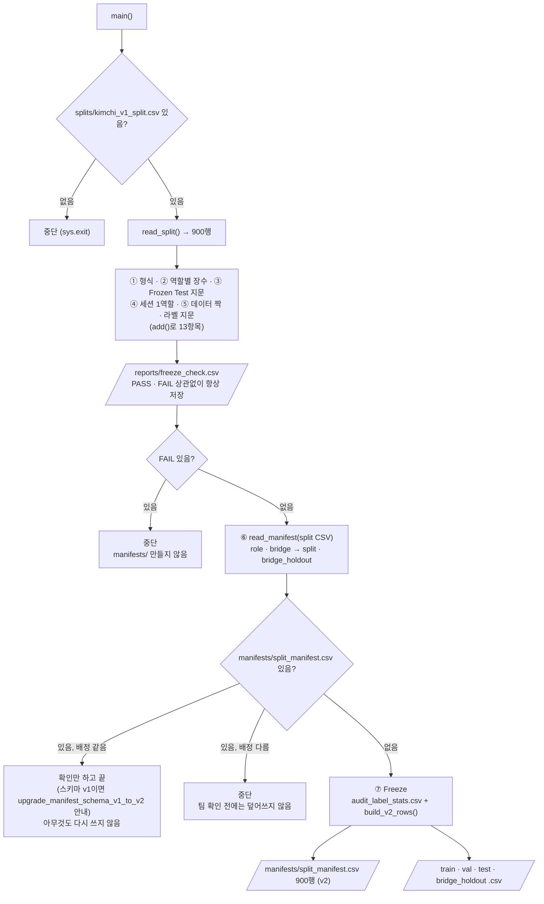

# `scripts/06_freeze_split.py` 코드 리뷰

> 3일차 · 149줄 · 가이드 16.1 · split_policy.md 1 · 8장 · README 9장

## 1. 한 줄 요약

`splits/kimchi_v1_split.csv`(900행)를 **13개 항목으로 검사**하고, 하나도 빠짐없이 PASS일 때만 `manifests/`에 확정본(스키마 v2)을 만들어 **얼립니다(Freeze)**. 하나라도 FAIL이면 아무 파일도 쓰지 않고, 이미 얼려 둔 것은 다시 쓰지 않습니다.

## 2. 입력 · 출력 · 실행

| 구분 | 파일 |
|---|---|
| 입력 | `splits/kimchi_v1_split.csv` + `data/subject7_final/images` · `labels` + `reports/audit_label_stats.csv` (⑦ Freeze에서만) |
| 출력 (항상) | `reports/freeze_check.csv` (item · expected · actual · result) |
| 출력 (전부 PASS일 때만) | `manifests/split_manifest.csv` (900행 · 스키마 v2) · `train.csv` · `val.csv` · `test.csv` · `bridge_holdout.csv` |

10/13에 처음 Freeze 한 `manifests/`는 v1(3칸)이었고, `upgrade_manifest_schema_v1_to_v2.py`로 v2로 올렸습니다(배정 변경 0).

```bash
python scripts/06_freeze_split.py   # prj08 폴더에서 실행 · 옵션 없음
```

## 3. 구조

| 줄 | 내용 |
|--:|---|
| 17~20 | `import` (`pathlib` · `csv` · `hashlib` · `sys`) |
| 22~26 | `PROJECT_ROOT` 경로 설정 + `from src.manifest import read_manifest · assignment · build_v2_rows · write_manifest_set · SPLIT_FILES` |
| 31~36 | 경로: `SPLIT_CSV` · `SRC_IMG` · `SRC_LBL` · `MANIFEST_DIR` · `STATS_CSV` · `CHECK_CSV` |
| 41~45 | 기준값: `LABEL_FP` · `FROZEN_TEST_FP` · `EXPECTED_COUNTS` · `TOTAL` · `FIELDS` |
| 49~61 | `fingerprint()` · `label_fingerprint()` (지문 계산) |
| 64~66 | `read_split()` (v1 split CSV 읽기) |
| 69~145 | `main()`: 검사 ①~⑤ → 저장 → 중단 판단 → ⑥ 이미 Freeze? → ⑦ Freeze |

### 흐름 그림



검사에 쓰는 숫자는 모두 문서에서 옮겨 적은 값이라, **실행 결과가 아니라 문서가 기준**입니다.

## 4. 핵심 코드 읽기

### 4.1 기준값 — 결과를 보고 고치지 않는다

```python
LABEL_FP = "5c2b4fc2c3e6"           # kimchi_v1 라벨 지문 (README 6.1 명령과 같은 계산)
FROZEN_TEST_FP = "4f9291849fe6"     # Frozen Test 지문 (split_policy.md 8장)
EXPECTED_COUNTS = {"train": 600, "val": 74, "test": 80, "bridge": 146}   # 배정 결과 (8장)
TOTAL = 900
FIELDS = ["file_name", "capture_group", "role"]   # 입력 splits/kimchi_v1_split.csv 의 칸 (05 결과 · v1)
```

- 값의 출처는 `split_policy.md` 1 · 8장과 README 9장입니다. 코드에서 계산한 값을 기준으로 삼지 않습니다.
- 역할별 장수 600 / 74 / 80 / 146은 04단계 목표(train 600 / val 75 / test 75 / bridge 150, ±10장) 안에 들어 있습니다.
- 라벨 지문 `5c2b4fc2c3e6`은 02단계 Audit의 기준 데이터(`kimchi_v1`)와 같은 값입니다.
- `FIELDS`와 `EXPECTED_COUNTS`의 `"bridge"`는 **입력 split CSV(05 결과 · v1)** 의 이름입니다. 그래서 ①~⑤ 검사는 `role` 칸과 `"bridge"` 값을 그대로 씁니다. `split` · `bridge_holdout` 이름은 ⑥에서 `read_manifest()`를 거친 뒤에만 나옵니다(4.5).

### 4.2 라벨 지문 — `cat | sha256sum`과 같은 값

```python
def label_fingerprint(label_dir: Path) -> str:
    h = hashlib.sha256()
    for p in sorted(label_dir.glob("*.txt"), key=lambda p: p.name.encode("utf-8")):
        h.update(p.read_bytes())                     # cat 처럼 파일 내용을 순서대로 이어 붙임
    return h.hexdigest()[:12]
```

- README의 `LC_ALL=C cat labels/*.txt | sha256sum`과 **같은 결과**가 나오게 만든 함수입니다.
- `LC_ALL=C`는 파일 이름을 **바이트 순서**로 정렬하므로, Python에서도 이름을 `bytes`로 바꿔 정렬합니다.
- 반면 `fingerprint()`는 파일명 목록을 정렬해 이어 붙인 문자열의 지문이며, `05_make_split.py`와 같은 방식입니다. Frozen Test 지문(③)이 이쪽입니다. `src/manifest.py`에도 같은 계산의 `fingerprint()`가 있습니다(upgrade_manifest_schema_v1_to_v2는 그쪽을 씁니다).

### 4.3 검사를 모아 담는 `add()`

```python
checks = []                                             # (item, expected, actual)

def add(item, expected, actual):
    checks.append({"item": item, "expected": expected, "actual": actual,
                   "result": "PASS" if str(expected) == str(actual) else "FAIL"})
```

`str()`로 바꿔서 비교하기 때문에 숫자(`900`)와 문자(`"900"`)를 따로 신경 쓰지 않아도 됩니다. 검사 13항목은 다음과 같습니다.

| 번호 | 항목 | 내용 |
|:--:|---|---|
| ① | `columns` · `rows` · `duplicate_file_name` · `unknown_role` | 칸 이름 · 900행 · 중복 0 · 모르는 역할 0 |
| ② | `count_train` · `count_val` · `count_test` · `count_bridge` | 역할별 장수 |
| ③ | `test_fingerprint` | Frozen Test 지문 |
| ④ | `group_in_multiple_roles` | 한 세션이 두 역할 이상에 걸친 개수 0 |
| ⑤ | `not_on_disk` · `not_in_split` · `label_fingerprint` | split ↔ 실제 이미지 900장 · 라벨 지문 |

④는 한 `capture_group`이 Train과 Test에 나뉘어 들어가는 **Leakage**를 막는 검사입니다. ①~⑤는 모두 `read_split()`으로 읽은 v1 split CSV(`role` 칸) 기준입니다.

### 4.4 전부 통과해야만 Freeze

```python
CHECK_CSV.parent.mkdir(exist_ok=True)
with open(CHECK_CSV, "w", encoding="utf-8-sig", newline="") as f:
    ...                                             # PASS/FAIL 상관없이 항상 저장

if n_fail:
    sys.exit("\n[중단] FAIL 이 있어 Freeze 하지 않았습니다. manifests/ 는 만들지 않았습니다.")
```

- 검사 결과(`freeze_check.csv`)는 **실패해도 먼저 저장**해서 원인을 추적할 수 있게 합니다.
- `manifests/`는 그 뒤에 만들기 때문에, 중간에 멈춰도 **반쯤 만들어진 확정본**이 남지 않습니다.
- `freeze_check.csv`는 `utf-8-sig`와 `lineterminator="\n"`으로 써서 기존 CSV와 같은 형식을 유지합니다.

### 4.5 한 번 얼린 것은 다시 쓰지 않는다 — 스키마와 상관없이 배정만 비교

```python
full_path = MANIFEST_DIR / "split_manifest.csv"
split_rows, _ = read_manifest(SPLIT_CSV)                          # role/bridge → split/bridge_holdout
if full_path.exists():
    frozen, schema = read_manifest(full_path)
    if assignment(frozen) == assignment(split_rows):
        if schema == "v1":
            print("\n배정은 같지만 manifests/ 가 스키마 v1 입니다 → python scripts/archive/upgrade_manifest_schema_v1_to_v2.py")
        else:
            print("\n이미 Freeze 되어 있고 split 과 배정이 같습니다 (스키마 v2). 아무것도 다시 쓰지 않았습니다.")
        return
    sys.exit("\n[중단] 이미 Freeze 된 manifests/ 가 split 과 다릅니다. 팀 확인 전에는 덮어쓰지 않습니다.")
```

- `read_manifest()`는 `(행 목록, 스키마)`를 돌려줍니다. 칸 이름으로 스키마를 판단해서(v2는 `MANIFEST_FIELDS`와 정확히 같을 때, v1은 앞 3칸이 `file_name · capture_group · role`일 때) v1 split CSV · manifest v1 · v2를 **같은 모양(모든 행에 `split` 키)** 으로 읽습니다. v1의 `role` 값은 `split`으로, `"bridge"`는 `bridge_holdout`으로 바뀝니다. 어느 쪽도 아니면 `ValueError`로 멈춥니다.
- `assignment()`는 `(file_name, capture_group, split)`을 정렬한 목록입니다. 그래서 행 순서나 다른 칸과 상관없이 **"어느 사진이 어느 세션 · 어느 역할인가"** 만 비교하고, `manifests/`가 v1(3칸)이든 v2든 배정이 같으면 같은 Freeze로 봅니다.
- 배정이 같으면 **확인만 하고 끝**나서 여러 번 실행해도 안전합니다. 스키마가 v1이면 upgrade_manifest_schema_v1_to_v2 실행을 안내합니다.
- 다르면 **덮어쓰지 않고 중단**합니다. 확정본을 바꾸는 일은 코드가 아니라 팀 확인을 거치게 합니다.

### 4.6 Freeze — 확정본은 v2로 쓴다

```python
with open(STATS_CSV, encoding="utf-8-sig", newline="") as f:
    stats = {r["file_name"]: r for r in csv.DictReader(f)}
write_manifest_set(MANIFEST_DIR, build_v2_rows(split_rows, stats))   # 900행 · split 순서 그대로
```

- `reports/audit_label_stats.csv`(2일차 Audit 결과)를 파일명으로 찾을 수 있는 사전(`stats`)으로 만듭니다.
- `build_v2_rows()`는 배정(`file_name` · `capture_group` · `split`)은 그대로 두고 v2 9칸을 채웁니다. `image_path` · `label_path`는 `data/subject7_final/images|labels/<이름>` 규칙으로 만들고, `source_dataset` · `original_split` · `scene_type`은 `stats`에서, `dataset_version`은 `kimchi_v1`로 넣습니다.
- `stats`에 없는 파일이 있으면 `KeyError`가 나고, `audit_label_stats.csv` 자체가 없으면 파일 열기에서 멈춥니다. 둘 다 `write_manifest_set()`가 호출되기 전이라 **아무 파일도 쓰이지 않습니다.** (stats와 짝이 맞는지는 06이 따로 검사하지 않고, 07 · archive가 확인합니다.)
- `write_manifest_set()`은 `split_manifest.csv`와 `SPLIT_FILES`의 역할별 파일 4개를 한꺼번에 씁니다. 칸은 `MANIFEST_FIELDS` 순서, `utf-8-sig` · `lineterminator="\n"`(기존 CSV와 같은 형식), 행 순서는 입력 순서 그대로입니다. 그래서 06에는 manifest용 `DictWriter`가 없고, 06이 직접 쓰는 CSV는 `freeze_check.csv`뿐입니다.
- 끝에서 `split_manifest.csv`와 역할별 파일을 `read_split()`으로 다시 읽어 행 수를 출력해, Freeze 결과를 눈으로 확인합니다.

## 5. 연결된 파일

| 관계 | 파일 |
|---|---|
| 입력 (04단계 결과) | `splits/kimchi_v1_split.csv` |
| 입력 (2일차 Audit 결과) | `reports/audit_label_stats.csv` (⑦에서 v2 칸을 채움) |
| manifest 읽기 · 쓰기 | `src/manifest.py` (`read_manifest()` · `assignment()` · `build_v2_rows()` · `write_manifest_set()` · `SPLIT_FILES`) |
| v1 → v2 업그레이드 | `upgrade_manifest_schema_v1_to_v2.py` |
| 같은 지문 방식 | `05_make_split.py` (`fingerprint()`) |
| 실제 데이터 | `data/subject7_final/images` · `labels` |
| 기준값 출처 | `split_policy.md` 1 · 8장 · README 6.1 · 7 · 9장 |
| 결과를 쓰는 곳 | `manifests/split_manifest.csv` (스키마 v2) · `train.csv` · `val.csv` · `test.csv` · `bridge_holdout.csv` |
| 검사 기록 | `reports/freeze_check.csv` |
