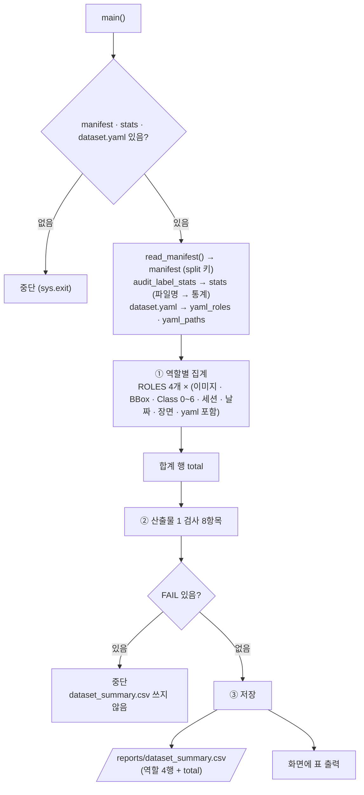

# `scripts/07_dataset_summary.py` 코드 리뷰

> 3일차 · 128줄 · 가이드 11.3 · 16.1 · Daily Gate 산출물 1

## 1. 한 줄 요약

Freeze 된 `manifests/split_manifest.csv`와 2일차 Audit 결과(`audit_label_stats.csv`)를 합쳐 **역할 4개 + 합계 1행짜리 Dataset Version 요약표**(`reports/dataset_summary.csv`)를 만듭니다. 3일차 Daily Gate의 산출물 1 항목 **8개를 먼저 검사하고, 모두 PASS일 때만** 파일을 씁니다. 이미지는 열지 않습니다.

## 2. 입력 · 출력 · 실행

| 구분 | 파일 |
|---|---|
| 입력 | `manifests/split_manifest.csv` (역할 배정 · 정답표) · `reports/audit_label_stats.csv` (이미지별 BBox · Class 수 · scene_type) · `configs/dataset.yaml` (YOLO가 실제로 읽는 역할) |
| 출력 (전부 PASS일 때만) | `reports/dataset_summary.csv` (역할 4행 + `total` 1행) |

```bash
python scripts/07_dataset_summary.py   # prj08 폴더에서 실행 · 옵션 없음
```

## 3. 구조

| 줄 | 내용 |
|--:|---|
| 16~20 | `import` (`pathlib` · `csv` · `sys` · `yaml`) |
| 22~26 | `PROJECT_ROOT` 경로 설정 + `from src.manifest import read_manifest · SPLITS · DATASET_VERSION` |
| 31~34 | 경로: `MANIFEST_CSV` · `STATS_CSV` · `DATASET_YAML` · `OUT_CSV` |
| 39~42 | 기준값: `ROLES` · `EXPECTED_TOTAL_IMAGES` · `EXPECTED_TOTAL_BBOX` · `CLASSES` |
| 45~47 | `read_csv()` (BOM 제거하고 읽기) |
| 50~124 | `main()`: 입력 확인 → ① 역할별 집계 → ② 검사 8항목 → ③ 저장 · 출력 |

### 흐름 그림



검사에 쓰는 숫자(900장 · BBox 4601)는 `audit_expected.md` v2에서 옮겨 적은 값이라, **실행 결과가 아니라 문서가 기준**입니다.

## 4. 핵심 코드 읽기

### 4.1 입력 읽기 — 스키마는 v2여야 한다

```python
manifest, schema = read_manifest(MANIFEST_CSV)                     # 항상 split 키 (v1 이면 role 을 변환)
stats = {r["file_name"]: r for r in read_csv(STATS_CSV)}          # 파일명 → 이미지별 통계
data_yaml = yaml.safe_load(DATASET_YAML.read_text(encoding="utf-8"))
yaml_roles = {k for k in ("train", "val", "test") if data_yaml.get(k)}   # yaml 이 가리키는 역할
yaml_paths = " ".join(str(data_yaml.get(k, "")) for k in ("train", "val", "test"))
```

- `read_manifest()`는 v1이든 v2든 같은 모양(모든 행에 `split` 키)으로 읽어 줍니다. v1의 `role` 값은 `split`으로, `"bridge"`는 `bridge_holdout`으로 바뀝니다. 그래서 스키마가 v2인지는 읽은 뒤 ②의 검사 항목(`schema`)으로 따로 확인합니다. 칸 구성을 알 수 없으면 `ValueError`로 멈춥니다.
- `stats`는 파일명을 열쇠로 하는 사전이라 manifest의 각 행에서 바로 찾아 쓸 수 있습니다.
- `yaml_roles`는 dataset.yaml에서 **값이 채워진 `train` · `val` · `test` 키**만 모은 것입니다.

### 4.2 역할별 집계

```python
for role in ROLES:
    files = [r for r in manifest if r["split"] == role]
    st = [stats[r["file_name"]] for r in files if r["file_name"] in stats]
    row = {
        "split": role,
        "images": len(files),
        "ratio_pct": round(len(files) / EXPECTED_TOTAL_IMAGES * 100, 1),
        "bbox": sum(int(s["n_bbox"]) for s in st),
        **{c: sum(int(s[c]) for s in st) for c in CLASSES},
        "capture_groups": len({r["capture_group"] for r in files}),
        "dates": " ".join(sorted({r["file_name"][:6] for r in files})),   # 파일명 앞 6자리 = 촬영일
        ...
        "in_dataset_yaml": "yes" if role in yaml_roles else "no",
    }
```

- `ROLES = SPLITS`라서 역할 이름(`train` · `val` · `test` · `bridge_holdout`)은 `src/manifest.py`와 같은 목록을 씁니다.
- `**{...}`는 사전을 펼쳐 넣는 문법이라, Class 0~6 합계 7칸이 한 줄로 만들어집니다.
- 촬영일은 파일명 앞 6자리(예: `250410`)를 모아 정렬한 값입니다.
- `in_dataset_yaml`은 Bridge Holdout이 `no`여야 정상입니다.
- `ratio_pct`는 900장 기준 비율이라, 검사에서 manifest가 900행이 아니면 FAIL이 납니다.

### 4.3 합계 행

```python
total = {"split": "total"}
for key in ["images", "ratio_pct", "bbox", *CLASSES, "capture_groups", "kimchi_with_target", "object_only"]:
    total[key] = round(sum(r[key] for r in rows), 1) if key == "ratio_pct" else sum(r[key] for r in rows)
total["dates"] = " ".join(sorted({d for r in rows for d in r["dates"].split()}))
total["in_dataset_yaml"] = "-"
```

- 비율은 소수 한 자리로 반올림해 합하고, 나머지 숫자는 그대로 더합니다.
- `capture_groups` 합계는 역할마다 세션이 겹치지 않아야 의미가 있습니다. 그 조건은 ②의 `group_roles` 검사가 확인합니다.
- 날짜는 합치면서 중복을 없앱니다.

### 4.4 Daily Gate 산출물 1 검사 — 8항목

```python
checks = [
    ("네 역할 수량의 합 = 900", EXPECTED_TOTAL_IMAGES, total["images"]),
    ("manifest 행 수 = 900", EXPECTED_TOTAL_IMAGES, len(manifest)),
    ("통계와 짝이 안 맞는 파일", 0, sum(r["file_name"] not in stats for r in manifest)),
    ("BBox 합계 = kimchi_v1", EXPECTED_TOTAL_BBOX, total["bbox"]),
    ("두 역할에 섞인 capture_group", 0, sum(len(v) > 1 for v in group_roles.values())),
    ("Bridge 가 dataset.yaml 에 포함", "no", "yes" if ("bridge" in yaml_roles or "bridge" in yaml_paths) else "no"),
    ("manifest 스키마 (가이드 16.1)", "v2", schema),
    ("Dataset Version", DATASET_VERSION, ",".join(sorted({r.get("dataset_version", "-") for r in manifest}))),
]
```

| 번호 | 항목 | 내용 |
|:--:|---|---|
| 1 | 네 역할 수량의 합 | 집계한 `images` 합계가 900 |
| 2 | manifest 행 수 | `len(manifest)`가 900 |
| 3 | 통계와 짝이 안 맞는 파일 | manifest에는 있는데 `audit_label_stats`에 없는 파일 0 |
| 4 | BBox 합계 | `kimchi_v1`의 4601 |
| 5 | 섞인 `capture_group` | 한 세션이 두 역할에 걸친 개수 0 |
| 6 | Bridge가 yaml에 포함 | `no` |
| 7 | manifest 스키마 | `v2` |
| 8 | Dataset Version | `src/manifest.py`의 `DATASET_VERSION`과 같음 |

- 06 · 09와 달리 `add()` 함수 대신 **(항목, 기대, 실제) 튜플 목록**을 돌며 PASS/FAIL을 가립니다. 결과를 CSV로 저장하지 않고 화면에만 출력합니다.
- 6번에서 `yaml_roles`는 `train` · `val` · `test` 키만 모으므로 `"bridge" in yaml_roles`는 항상 거짓입니다. 실제로 Bridge를 걸러내는 것은 **경로 문자열 검사**(`"bridge" in yaml_paths`)이며, `bridge_holdout` 폴더나 파일 이름이 경로에 있으면 잡힙니다.
- 7번 덕분에 v1 manifest를 가지고 있으면 요약표가 만들어지지 않고, `upgrade_manifest_schema_v1_to_v2.py`를 먼저 돌려야 합니다.
- `dataset_version` 칸은 v2에만 있습니다. v1을 읽으면 이 칸이 없어서 `r.get("dataset_version", "-")`가 `-`가 되고, 8번도 같이 FAIL이 납니다.

### 4.5 모두 PASS일 때만 저장

```python
n_fail = 0
for name, exp, act in checks:
    ok = str(exp) == str(act)
    n_fail += not ok
    print(f"  {'PASS' if ok else 'FAIL'}  {name:<28} 기대 {exp} / 실제 {act}")
if n_fail:
    sys.exit(f"\n[중단] FAIL {n_fail}건 → dataset_summary.csv 를 쓰지 않았습니다.")

with open(OUT_CSV, "w", encoding="utf-8-sig", newline="") as f:
    writer = csv.DictWriter(f, fieldnames=fields, lineterminator="\n")   # 기존 CSV 와 같은 형식
    writer.writerows([*rows, total])
```

- `n_fail += not ok`는 `True`가 1로 더해지는 성질을 이용한 카운터입니다.
- FAIL이 하나라도 있으면 **요약표를 아예 만들지 않아서**, 틀린 숫자가 담긴 산출물이 남지 않습니다.
- 06 · 08 · 09와 같은 CSV 형식(`utf-8-sig`, `lineterminator="\n"`)으로 씁니다.
- 마지막에 같은 표를 터미널에 줄 맞춰 출력합니다(`:>6` 같은 오른쪽 정렬 서식).

## 5. 연결된 파일

| 관계 | 파일 |
|---|---|
| 입력 (3일차 Freeze 결과) | `manifests/split_manifest.csv` (`06_freeze_split.py` · `archive`가 v2로 생성) |
| 입력 (2일차 Audit 결과) | `reports/audit_label_stats.csv` (`03_audit_subject7_final.py`가 생성) |
| 입력 (YOLO 설정) | `configs/dataset.yaml` |
| manifest 읽기 · 상수 | `src/manifest.py` (`read_manifest()` · `SPLITS` · `DATASET_VERSION`) |
| 기준값 출처 | `split_policy.md` · `audit_expected.md` v2 2장 · 가이드 11.3 · 16.1 |
| 결과를 쓰는 곳 | `reports/dataset_summary.csv` |
