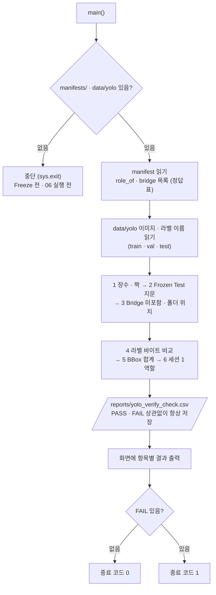

# `scripts/07_verify_yolo_dataset.py` 코드 리뷰

> 3일차 · 130줄 · manifests/ · split_policy.md 8장 · reports/split_summary.csv

## 1. 한 줄 요약

B가 06에서 만든 `data/yolo` 학습 폴더가 **Freeze 된 `manifests/`와 정확히 같은지** 19개 항목으로 확인하고, 항목별 기대값 · 실제값 · PASS/FAIL을 `reports/yolo_verify_check.csv`에 남깁니다. `data/yolo`는 **읽기만** 하고 고치지 않습니다.

## 2. 입력 · 출력 · 실행

| 구분 | 파일 |
|---|---|
| 입력 | `manifests/split_manifest.csv` (정답표) · `data/yolo/` (검사 대상) · `data/subject7_final/labels` (원본 라벨) |
| 출력 | `reports/yolo_verify_check.csv` (no · item · expected · actual · result) |
| 종료 코드 | 모두 PASS → `0` / 하나라도 FAIL → `1` |

```bash
python scripts/07_verify_yolo_dataset.py   # prj08 폴더에서 실행 · 옵션 없음
```

## 3. 구조

| 줄 | 내용 |
|--:|---|
| 15~18 | `import` (`pathlib` · `csv` · `hashlib` · `sys`) |
| 23~27 | 경로: `MANIFEST_CSV` · `SRC_LBL` · `YOLO_DIR` · `CHECK_CSV` |
| 32~35 | 기준값: `YOLO_ROLES` · `EXPECTED_IMAGES` · `EXPECTED_BBOX` · `FROZEN_TEST_FP` |
| 38~50 | `fingerprint()` · `file_hash()` · `count_bbox()` |
| 53~126 | `main()`: 0 전제 조건 → 1~6 검사 → 저장 · 출력 → 종료 코드 |

### 흐름 그림



05는 FAIL이면 `manifests/` 작성을 막았지만, 07은 아무것도 만들지 않고 **결과만 남기고 종료 코드로 알립니다**.

## 4. 핵심 코드 읽기

### 4.1 만든 사람과 검사하는 사람을 나눈다

```python
def fingerprint(names) -> str:
    """파일명 목록의 sha256 앞 12자리 (04 · 05 · 06 과 같은 계산)."""
    text = "\n".join(sorted(names)).encode("utf-8")
    return hashlib.sha256(text).hexdigest()[:12]
```

- 06(B)과 07(A)을 나눠서, 07은 **06의 코드를 import 하지 않습니다.**
- 그래서 같은 계산이어도 `fingerprint()`를 07 안에 **다시 적어 둡니다.** 06에 실수가 있어도 검사가 같이 틀리지 않게 하기 위해서입니다.
- 문제가 있으면 `data/yolo`를 직접 고치지 않고 **원인을 찾아 06을 다시 돌립니다.**

### 4.2 기준값 — 결과를 보고 고치지 않는다

```python
YOLO_ROLES = ["train", "val", "test"]                        # bridge 는 data/yolo 에 없어야 함
EXPECTED_IMAGES = {"train": 600, "val": 74, "test": 80}      # split_policy.md 8장
EXPECTED_BBOX = {"train": 2957, "val": 389, "test": 477}     # reports/split_summary.csv (2일차)
FROZEN_TEST_FP = "4f9291849fe6"                              # split_policy.md 8장
```

- 이미지 수와 지문은 `split_policy.md` 8장, BBox 합계는 2일차 `split_summary.csv`에서 옮겨 적은 값입니다.
- `YOLO_ROLES`에 `bridge`가 없는 것 자체가 기준입니다. Bridge는 학습 폴더에 **들어가면 안 됩니다.**
- BBox 합계 2957 + 389 + 477 = 3823은 Bridge를 뺀 값입니다.

### 4.3 manifest로 정답표 만들기

```python
role_of = {r["file_name"]: r["role"] for r in manifest}          # 파일명 → 역할 (정답표)
stem_role = {Path(k).stem: v for k, v in role_of.items()}
bridge = {k for k, v in role_of.items() if v == "bridge"}
```

- `role_of`는 "이 이미지는 어느 역할 폴더에 있어야 하는가"를 알려 주는 **정답표**입니다.
- `bridge`는 `data/yolo`에 있으면 안 되는 파일 이름 집합입니다. 항목 3에서 사용합니다.
- `stem_role`(확장자 뺀 이름 → 역할)은 이 파일 안에서는 아직 쓰이지 않습니다.

### 4.4 검사를 모아 담는 `add()` — 19항목

```python
def add(no, item, expected, actual):
    checks.append({"no": no, "item": item, "expected": expected, "actual": actual,
                   "result": "PASS" if str(expected) == str(actual) else "FAIL"})
```

05의 `add()`에 **묶음 번호(`no`)** 가 하나 더 붙은 형태입니다.

| 번호 | 항목 | 내용 | 개수 |
|:--:|---|---|:--:|
| 1 | `*_images` · `*_labels` · `*_unpaired` | 역할별 이미지 수 · 라벨 수 · 짝이 안 맞는 이름 0 | 9 |
| 2 | `test_fingerprint` | 복사된 test 폴더의 Frozen Test 지문 | 1 |
| 3 | `bridge_in_yolo` · `not_in_manifest` · `wrong_role_folder` · `extra_role_dirs` | Bridge 미포함 · manifest에 없는 이미지 · 엉뚱한 폴더 · 추가 폴더 | 4 |
| 4 | `label_changed_vs_source` | 원본 라벨과 바이트 단위 비교 | 1 |
| 5 | `*_bbox` | 역할별 BBox 합계 | 3 |
| 6 | `group_in_multiple_roles` | 한 세션이 두 역할에 걸친 개수 0 | 1 |

### 4.5 짝 맞추기와 폴더 위치 검사

```python
unpaired = {Path(n).stem for n in images[role]} ^ {Path(n).stem for n in labels[role]}
add(1, f"{role}_unpaired", 0, len(unpaired))                 # ^ = 한쪽에만 있는 이름

add(3, "wrong_role_folder", 0, sum(p.parent.name != role_of.get(p.name, p.parent.name) for p in all_jpg))
extra_dirs = sorted(p.name for p in (YOLO_DIR / "images").iterdir() if p.is_dir() and p.name not in YOLO_ROLES)
add(3, "extra_role_dirs", "-", ",".join(extra_dirs) or "-")      # bridge/ 같은 폴더가 있으면 FAIL
```

- `^`(대칭 차집합)는 이미지에만 있거나 라벨에만 있는 이름을 한 번에 모읍니다.
- `role_of.get(p.name, p.parent.name)`는 manifest에 없는 이미지를 이 항목에서는 **세지 않게** 합니다. 그 경우는 `not_in_manifest`가 따로 셉니다.
- `extra_role_dirs`는 `bridge/` 같은 폴더가 있으면 이름이 `actual`에 찍혀서 FAIL이 됩니다. 정상이면 `"-"`입니다.

### 4.6 라벨 내용을 바이트 단위로 비교

```python
for role in YOLO_ROLES:
    for name in labels[role]:
        src = SRC_LBL / name
        if not src.exists() or file_hash(src) != file_hash(YOLO_DIR / "labels" / role / name):
            changed += 1
add(4, "label_changed_vs_source", 0, changed)
```

- 복사 과정에서 라벨 내용이 바뀌지 않았는지 `sha256`으로 확인합니다.
- 원본에 파일이 없는 경우도 `changed`로 셉니다.
- 이 검사 덕분에 라벨은 02 Audit을 통과한 `kimchi_v1` 그대로라고 믿고 학습에 넘길 수 있습니다.

### 4.7 항상 저장하고, 결과는 종료 코드로

```python
CHECK_CSV.parent.mkdir(exist_ok=True)
with open(CHECK_CSV, "w", encoding="utf-8-sig", newline="") as f:
    ...                                             # PASS/FAIL 상관없이 항상 저장
n_fail = sum(c["result"] == "FAIL" for c in checks)
sys.exit(1 if n_fail else 0)
```

- 저장 형식(`utf-8-sig`, `lineterminator="\n"`)은 05와 같아서 기존 CSV와 맞습니다.
- 마지막에 `sys.exit(1 if n_fail else 0)`로 종료 코드를 정해서, 다른 스크립트나 자동 실행에서 **성공 · 실패를 바로 판단**할 수 있습니다.

## 5. 연결된 파일

| 관계 | 파일 |
|---|---|
| 검사 기준 (정답표) | `manifests/split_manifest.csv` (05가 Freeze) |
| 검사 대상 | `data/yolo/` (06이 만든 YOLO 학습 폴더) |
| 원본 라벨 | `data/subject7_final/labels` |
| 기준값 출처 | `split_policy.md` 8장 · `reports/split_summary.csv` (2일차) |
| 같은 지문 방식 | `04_make_split.py` · `05_freeze_split.py` · `06` (`fingerprint()`) |
| 결과를 쓰는 곳 | `reports/yolo_verify_check.csv` |
