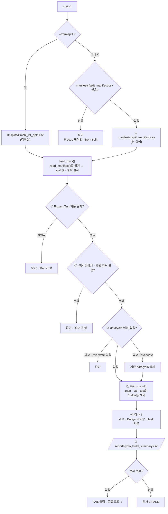

# `scripts/08_build_yolo_dataset.py` 코드 리뷰

> 3일차 · 182줄 · split_policy.md 8장 · README 9장

## 1. 한 줄 요약

Split 목록(CSV)에 적힌 대로 원본 이미지 · 라벨을 **`data/yolo/{images,labels}/{train,val,test}/`로 복사**해 YOLO 학습 폴더를 만듭니다. **Bridge Holdout은 아예 넣지 않고**, 지문 · 누락 검사를 모두 통과한 뒤에만 복사를 시작합니다.

## 2. 입력 · 출력 · 실행

| 모드 | 입력 | 출력 |
|---|---|---|
| `--from-split` (① 리허설 · Freeze 전) | `splits/kimchi_v1_split.csv` | `data/yolo/` · `reports/yolo_build_summary.csv` |
| `--overwrite` (② 본 실행 · Freeze 후) | `manifests/split_manifest.csv` | 같음 (`data/yolo/`가 이미 있으면 지우고 다시 만듦) |

공통 입력은 원본 `data/subject7_final/images` · `labels`입니다. `data/yolo/`는 Git에 올라가지 않습니다(NDA). 입력 CSV는 `read_manifest()`로 읽기 때문에 split CSV(v1) · manifest v1 · v2 어느 쪽이든 같은 모양으로 다룹니다.

```bash
python scripts/08_build_yolo_dataset.py --from-split    # ① 리허설 (Freeze 전)
python scripts/08_build_yolo_dataset.py --overwrite     # ② 본 실행 (Freeze 후)
```

## 3. 구조

| 줄 | 내용 |
|--:|---|
| 17~22 | `import` (`pathlib` · `argparse` · `csv` · `hashlib` · `shutil` · `sys`) |
| 24~28 | `PROJECT_ROOT` 경로 설정 + `from src.manifest import read_manifest, SPLITS` |
| 33~38 | 경로: `SRC_IMG` · `SRC_LBL` · `SPLIT_CSV` · `MANIFEST_CSV` · `OUT_DIR` · `SUMMARY_CSV` |
| 43~45 | 기준값: `YOLO_ROLES` · `ALL_ROLES` · `FROZEN_TEST_FP` |
| 48~74 | `fingerprint()` · `load_rows()` · `count_bbox()` |
| 77~178 | `main()`: ① 입력 → ② 검사 1 → ③ 검사 2 → ④ 폴더 준비 → ⑤ 복사 → ⑥ 검사 3 → ⑦ 저장 · 출력 |

### 흐름 그림



복사 전 검사(②③)에서 멈추면 **`data/yolo/`에는 손대지 않습니다.** 복사가 끝난 뒤의 검사(⑥)는 결과를 저장한 다음 종료 코드로 알립니다.

## 4. 핵심 코드 읽기

### 4.1 입력 고르기 — 리허설과 본 실행

```python
src_csv = SPLIT_CSV if args.from_split else MANIFEST_CSV
if not src_csv.exists():
    hint = "" if args.from_split else "\n       아직 Freeze 전이면 --from-split 으로 리허설하세요."
    sys.exit(f"[중단] 입력 파일이 없습니다: {src_csv}{hint}")
```

- 옵션 없이(또는 `--overwrite`만) 실행하면 Freeze 된 `manifests/`를 읽습니다. Freeze 전이면 파일이 없어서 안내 문구와 함께 멈춥니다.
- `--from-split`은 Freeze 전에 같은 코드를 **미리 돌려 보는 리허설**입니다. 06이 `manifests/`를 만든 뒤에는 같은 목록이므로 결과가 같아야 합니다.

### 4.2 복사 전에 검사 — 하나라도 FAIL이면 복사하지 않는다

```python
test_fp = fingerprint(by_role["test"])
if test_fp != FROZEN_TEST_FP:
    sys.exit(f"[중단] Frozen Test 지문 불일치: {test_fp} (기대 {FROZEN_TEST_FP})")

missing = []
for role in YOLO_ROLES:
    for name in by_role[role]:
        if not (SRC_IMG / name).exists():
            missing.append(f"images/{name}")
        if not (SRC_LBL / f"{Path(name).stem}.txt").exists():
            missing.append(f"labels/{Path(name).stem}.txt")
if missing:
    sys.exit(f"[중단] 원본 누락 {len(missing)}건 (예: {missing[:3]})")
```

- 검사 1은 Test 목록이 **Frozen Test 지문**(`4f9291849fe6`)과 같은지 확인합니다.
- 검사 2는 이미지와 라벨 쌍이 원본에 **전부 있는지** 미리 확인해서, 복사하다 중간에 멈춘 폴더가 남지 않게 합니다.
- `fingerprint()`는 `05_make_split.py`와 **완전히 같은 방식**이어야 하는 함수입니다. 계산이 다르면 지문 비교가 의미가 없습니다.

### 4.3 Bridge는 아예 넣지 않는다

```python
YOLO_ROLES = ["train", "val", "test"]       # data/yolo 에 넣는 역할 (bridge_holdout 제외)
ALL_ROLES = set(SPLITS)                     # train · val · test · bridge_holdout
...
by_role = {role: [r["file_name"] for r in rows if r["split"] == role] for role in ALL_ROLES}
```

- 복사 반복문은 `YOLO_ROLES`만 돕니다. Bridge Holdout은 `by_role["bridge_holdout"]`에 이름만 담아 두고 복사하지 않습니다.
- `ALL_ROLES`는 역할 이름을 이 파일에 따로 적지 않고 `src/manifest.py`의 `SPLITS`에서 가져옵니다. 칸 이름은 `split`, Bridge 값은 `bridge_holdout`입니다(4.7). `src/manifest.py`에는 `data/yolo`에 들어가는 세 역할을 뜻하는 `YOLO_SPLITS`도 있지만, 08은 `YOLO_ROLES`를 자기 파일에 따로 적어 둡니다.
- 교과 8에서 쓰면 안 되는 데이터를 **폴더에 두지 않아서 실수할 길을 막는** 설계입니다.
- ⑥에서 `copied & set(by_role["bridge_holdout"])`로 Bridge가 섞여 들어갔는지 한 번 더 확인합니다.

### 4.4 `--overwrite` — 지우기 전에 한 번 더 확인

```python
if OUT_DIR.exists() and any(OUT_DIR.iterdir()):
    if not args.overwrite:
        sys.exit(f"[중단] {OUT_DIR.relative_to(PROJECT_ROOT)} 가 이미 있습니다. 다시 만들려면 --overwrite")
    assert OUT_DIR.resolve() == (PROJECT_ROOT / "data" / "yolo").resolve()
    shutil.rmtree(OUT_DIR)
```

- `data/yolo/`가 비어 있지 않을 때만 확인하고, **`--overwrite` 없이는 덮어쓰지 않습니다.**
- `shutil.rmtree` 직전의 `assert`는 지우는 대상이 정확히 `prj08/data/yolo`인지 확인하는 **안전장치**입니다.

### 4.5 복사 — 원본은 그대로

```python
shutil.copy2(SRC_IMG / name, img_dir / name)                 # copy2: 수정 시각도 보존
shutil.copy2(SRC_LBL / f"{stem}.txt", lbl_dir / f"{stem}.txt")
n_bbox += count_bbox(lbl_dir / f"{stem}.txt")
```

- 복사(`copy2`)만 하고 이동이나 이름 변경은 하지 않아서 **원본은 읽기만** 합니다.
- 폴더 이름이 `images/<role>`, `labels/<role>`인 이유는 Ultralytics가 경로의 `images`를 `labels`로 바꿔 라벨을 찾기 때문입니다.
- `count_bbox()`는 라벨 파일에서 비어 있지 않은 줄 수를 세어 BBox 수로 씁니다.

### 4.6 복사 후 검사와 저장

```python
for s in summary:
    expected = len(by_role[s["role"]])
    if not (s["images"] == s["labels"] == expected):
        problems.append(f"{s['role']}: 이미지 {s['images']} / 라벨 {s['labels']} / 기대 {expected}")
...
if problems:
    ...
    sys.exit(1)
```

- 검사 3은 역할별 **이미지 수 = 라벨 수 = 목록의 장수**, Bridge 미포함, **복사된 Test 폴더의 지문**을 확인합니다.
- 결과(`yolo_build_summary.csv`: role · images · labels · bbox · fingerprint)는 **문제가 있어도 먼저 저장**하고, 그 뒤에 FAIL 목록과 종료 코드 `1`로 알립니다.
- 이 파일은 만든 쪽(B)의 자체 확인이고, 같은 폴더를 별도로 검증하는 것은 `09_verify_yolo_dataset.py`(A)입니다.
- 결과 CSV의 칸 이름 `role`은 `summary` 딕셔너리의 키이고, manifest의 `split` 칸과는 별개로 그대로입니다.

### 4.7 입력 CSV 읽기와 형식 검사

```python
try:
    rows, _ = read_manifest(csv_path)       # 모든 행에 split 키 (v1 의 role · bridge 는 split · bridge_holdout 로)
except (ValueError, KeyError) as e:
    sys.exit(f"[중단] {csv_path.name} 칸 구성이 다릅니다: {e}")

bad_roles = {r["split"] for r in rows} - ALL_ROLES
if bad_roles:
    sys.exit(f"[중단] 알 수 없는 split 값: {bad_roles}")
```

- `read_manifest()`가 칸 이름으로 스키마를 판단해(v2: `MANIFEST_FIELDS`와 정확히 같음 · v1: 앞 3칸이 `file_name · capture_group · role`) split CSV(v1) · manifest v1 · v2를 **같은 모양(모든 행에 `split` 키)** 으로 읽어 줍니다. v1의 `role` 값은 `split`으로, `"bridge"`는 `bridge_holdout`으로 바뀝니다. 맨 앞 BOM도 여기서 제거합니다(`utf-8-sig`).
- 어느 쪽도 아니면 `read_manifest()`가 `ValueError`(알 수 없는 칸 구성)를 내고, `load_rows()`가 이를 잡아 안내하고 멈춥니다. `KeyError`도 같이 잡지만 사실상 `ValueError`만 나옵니다. 예전처럼 이 파일에서 칸 이름 3개를 직접 확인하지 않습니다.
- `load_rows()`는 그다음 `ALL_ROLES` 밖의 `split` 값과 같은 `file_name`의 중복을 확인합니다.

## 5. 연결된 파일

| 관계 | 파일 |
|---|---|
| 입력 (Freeze 전 · 리허설) | `splits/kimchi_v1_split.csv` (04단계 결과) |
| 입력 (Freeze 후 · 본 실행) | `manifests/split_manifest.csv` (`06_freeze_split.py`가 생성) |
| manifest 읽기 | `src/manifest.py` (`read_manifest()` · `SPLITS`) |
| 원본 데이터 | `data/subject7_final/images` · `labels` (읽기만) |
| 기준값 출처 | `split_policy.md` 8장 · README 9장 |
| 같은 지문 방식 | `05_make_split.py` (`fingerprint()`) |
| 결과를 쓰는 곳 | `data/yolo/` (`configs/dataset.yaml`의 `path`) · `reports/yolo_build_summary.csv` |
| 결과를 검사하는 곳 | `09_verify_yolo_dataset.py` |
