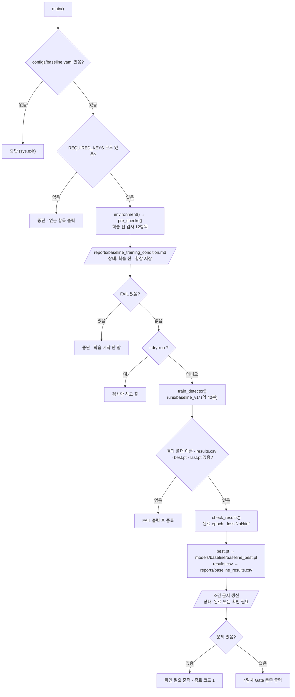

# `scripts/08_train_baseline.py` 코드 리뷰

> 4일차 · 300줄 · 가이드 17장 · 17.6 Daily Gate · 산출물 2

## 1. 한 줄 요약

팀 공통 **Baseline(YOLO11n) 학습**을 실행합니다. 학습 전 검사 12항목을 **모두 통과해야만 학습을 시작**하고, 끝나면 results.csv를 확인해 `best.pt`를 별도 보관하며, 실제 학습 조건을 `reports/baseline_training_condition.md`에 자동으로 기록합니다. 학습 숫자는 이 파일에 없고 `configs/baseline.yaml`에서 읽습니다. **Frozen Test는 평가하지 않습니다** (test 평가 코드가 이 파일에 없음).

## 2. 입력 · 출력 · 실행

| 모드 | 하는 일 | 걸리는 시간 |
|---|---|---|
| `--dry-run` | 학습 전 검사 + 조건 문서 미리 쓰기 (학습 안 함) | 몇 초 |
| 옵션 없음 | 검사 → 학습 → 결과 확인 · 보관 → 기록 | 약 40분 |

| 구분 | 파일 |
|---|---|
| 입력 | `configs/baseline.yaml` (학습 조건) · `configs/dataset.yaml` · `manifests/split_manifest.csv` · `train.csv` · `val.csv` · `data/yolo` (07 검증 PASS) · `data/subject7_final/labels` (라벨 지문용) |
| 출력 (항상) | `reports/baseline_training_condition.md` (dry-run이면 "학습 전 (dry-run)") |
| 출력 (학습 후) | `runs/baseline_v1/` (results.csv · weights · 그래프) · `models/baseline/baseline_best.pt` · `reports/baseline_results.csv` (results.csv 사본) · 조건 문서 갱신 |

`runs/` · `models/`는 Git에 올라가지 않습니다(NDA). 조건 문서와 `baseline_results.csv`(숫자만)는 Git에 올립니다.

```bash
python scripts/08_train_baseline.py --dry-run   # ① 학습 전 검사만
python scripts/08_train_baseline.py             # ② 검사 → 학습 → 기록
```

가이드 이름은 `06_train_baseline.py`이지만, 우리 06은 `06_build_yolo_dataset.py`라서 **08**을 씁니다.

## 3. 구조

| 줄 | 내용 |
|--:|---|
| 25~34 | `import` (`pathlib` · `datetime` · `argparse` · `csv` · `hashlib` · `math` · `platform` · `shutil` · `subprocess` · `sys`) |
| 36~38 | `PROJECT_ROOT` 경로 설정 |
| 40~42 | `import yaml` · `from src.manifest import read_manifest, fingerprint` · `from src.train_detector import train_detector, TRAIN_KEYS` |
| 47~56 | 경로: `BASELINE_YAML` · `DATASET_YAML` · `MANIFEST_DIR` · `LABEL_DIR` · `VERIFY_SCRIPT` · `RUNS_DIR` · `MODEL_OUT` · `CONDITION_MD` · `RESULTS_COPY` · `TRACKED_FOR_REPRO` |
| 58~59 | 기준값: `FROZEN_TEST_FP` · `REQUIRED_KEYS` |
| 62~82 | `sha12()` · `label_fingerprint()` · `git()` (보조 함수) |
| 85~101 | `environment()` (Python · PyTorch · CUDA · GPU · Ultralytics 기록) |
| 104~152 | `pre_checks()`: 학습 전 검사 ①~⑤ |
| 155~168 | `check_results()` (results.csv 확인) |
| 171~225 | `write_condition_md()` (조건 문서 작성) |
| 228~296 | `main()`: 설정 읽기 → 검사 → 조건 문서 → (dry-run이면 종료) → 학습 → 확인 · 보관 → 기록 |

### 흐름 그림



성능 해석은 이 파일의 일이 아닙니다. 오늘은 **"끝까지 학습됐는가 · NaN이 없는가 · 파일이 남았는가"** 만 확인하고, 성능은 5일차(`09_evaluate_baseline.py`)에서 봅니다.

## 4. 핵심 코드 읽기

### 4.1 학습 숫자는 `baseline.yaml`에서 읽는다

```python
cfg = yaml.safe_load(BASELINE_YAML.read_text(encoding="utf-8"))
missing = [k for k in REQUIRED_KEYS if k not in cfg]
if missing:
    sys.exit(f"[중단] configs/baseline.yaml 에 없는 항목: {missing}")
cfg["ultralytics_version"] = str(cfg["ultralytics_version"])
```

```python
REQUIRED_KEYS = ["name", "dataset_version", "label_fingerprint", "ultralytics_version", "model", *TRAIN_KEYS]
```

- Epoch · Batch · Image Size · Seed 같은 숫자는 코드에 적지 않고 **팀이 확정한 `baseline.yaml`**만 따릅니다. 코드와 조건이 어긋날 길을 막는 설계입니다.
- `TRAIN_KEYS`는 `src/train_detector.py`가 정한 학습 항목 12개(`epochs` · `patience` · `imgsz` · `batch` · `workers` · `optimizer` · `lr0` · `momentum` · `seed` · `deterministic` · `amp` · `pretrained`)이고, `baseline.yaml`의 칸 이름과 같습니다. `train_detector()`는 `cfg`에 없는 키를 조용히 건너뛰므로, 빠진 항목을 **학습 전에** 막는 것은 이 `REQUIRED_KEYS` 검사입니다.
- `optimizer` · `lr0` · `momentum`을 `auto`에 맡기지 않고 `baseline.yaml`에 값으로 적어 **고정**하는 이유는 3일차 Smoke Test에서 `optimizer=auto`가 `lr0=0.01`을 무시하고 `AdamW(lr=0.000909)`를 자동으로 골랐기 때문입니다(`smoke_test.md` 4장 ③). epoch 수가 바뀌면 자동 선택도 바뀌므로, 값을 직접 정해 두어야 학습 조건이 흔들리지 않습니다.
- `str(...)`로 바꾸는 이유는 YAML이 `8.4`처럼 쓰인 버전을 숫자(float)로 읽을 수 있어서, 환경에서 읽은 문자열 버전과 같은 형태로 맞추기 위해서입니다.

### 4.2 환경을 기록하고, 없는 패키지는 `-`로 둔다

```python
env = {"python": platform.python_version(), "torch": "-", "cuda": False, "gpu": "-", "ultralytics": "-"}
try:
    import torch
    env["torch"] = torch.__version__
    env["cuda"] = bool(torch.cuda.is_available())
    if env["cuda"]:
        env["gpu"] = torch.cuda.get_device_name(0)
except ImportError:
    pass
```

- `torch`나 `ultralytics`가 설치되어 있지 않아도 이 함수는 죽지 않고 `-`를 남깁니다. 그 뒤 검사에서 **FAIL로 드러나게** 하기 위해서입니다.
- 이 값은 검사(①)와 조건 문서의 "GPU · Ultralytics · PyTorch · Python" 칸에 그대로 들어갑니다(가이드 17.1).

### 4.3 학습 전 검사 — 12항목

```python
def add(item, expected, actual, ok=None):
    ok = (str(expected) == str(actual)) if ok is None else ok
    checks.append({"item": item, "expected": expected, "actual": actual, "result": "PASS" if ok else "FAIL"})
```

| 번호 | 항목 | 내용 | 개수 |
|:--:|---|---|:--:|
| ① | Ultralytics 버전 · CUDA | `baseline.yaml`의 팀 고정 버전과 같음 · GPU 학습 가능 | 2 |
| ② | `dataset.yaml` Class 수 · Bridge 없음 · manifest 스키마 · Dataset Version · 라벨 지문 | Class 7개 · `bridge` 없음 · `v2` · `kimchi_v1` · `5c2b4fc2c3e6` | 5 |
| ③ | 07 `data/yolo` 검증 | 07을 그대로 실행해 종료 코드 0 | 1 |
| ④ | 시작 가중치 있음 · `runs/<name>` 없음 · `baseline_best.pt` 없음 | 가중치가 있고, 이전 결과를 덮어쓰지 않음 | 3 |
| ⑤ | `configs` · `src` · `scripts` · `manifests` 커밋됨 | git 변경 없음 | 1 |

- 05 · 07의 `add()`에 `ok=` 매개변수가 하나 더 있습니다. **"같은가"로는 판단할 수 없는 항목**(종료 코드, dry-run의 경고)을 직접 PASS/FAIL로 넣기 위해서입니다.
- `--dry-run`도 ①의 CUDA 검사는 똑같이 적용되므로, GPU가 없는 환경에서는 dry-run도 FAIL로 멈춥니다.
- ②에서 `read_manifest()`로 읽은 `manifests/split_manifest.csv`로 Train · Val 장수와 Frozen Test 지문을 뽑고, `train.csv` · `val.csv`는 `sha12()`로 지문을 남깁니다. 이 값들은 `info`에 담겨 조건 문서의 "Train / Val Manifest" 칸이 됩니다.
- Test 지문은 **검사하지 않고 기록만** 합니다(`FROZEN_TEST_FP`는 "학습에 안 쓰는지 기록용" 주석). 학습에 쓰지 않는다는 것은 `dataset.yaml`에 Bridge가 없고 이 파일에 test 평가 코드가 없다는 사실로 보장합니다.

### 4.4 07을 그대로 실행해 데이터를 확인한다

```python
r = subprocess.run([sys.executable, str(VERIFY_SCRIPT)], cwd=PROJECT_ROOT, capture_output=True, text=True)
last = (r.stdout.strip().splitlines() or ["(출력 없음)"])[-1].strip()
add("07 data/yolo 검증", "종료 코드 0", f"종료 코드 {r.returncode} · {last}", ok=(r.returncode == 0))
```

- `data/yolo`가 manifest와 같은지 **07이 이미 검사하므로** 같은 코드를 다시 쓰지 않고 07을 별도 프로세스로 돌려 종료 코드만 봅니다.
- 07이 PASS이면 종료 코드 0, 하나라도 FAIL이면 1을 내도록 만든 것(07의 마지막 줄)을 여기서 활용하는 셈입니다.
- 화면에는 07 출력의 **마지막 줄**(PASS/FAIL 개수 요약)만 붙여 보여 줍니다.

### 4.5 재현성 — 커밋되지 않은 변경은 학습을 막는다

```python
dirty = git("status", "--porcelain", "--", *TRACKED_FOR_REPRO)
info["commit"] = git("rev-parse", "--short", "HEAD") or "-"
add("configs · src · scripts · manifests 커밋됨", "변경 없음", "변경 없음" if not dirty else f"미커밋 {len(dirty.splitlines())}개",
    ok=(not dirty) or dry_run)
if dirty and dry_run:
    checks[-1]["result"] = "WARN"            # dry-run 은 경고만 · 실제 학습 전에는 커밋해야 통과
```

- 학습 조건에 영향을 주는 폴더(`TRACKED_FOR_REPRO`)에 **커밋하지 않은 변경**이 있으면 실제 학습은 FAIL입니다. 조건 문서에 적는 커밋 번호로 같은 코드를 다시 찾을 수 있어야 하기 때문입니다.
- `--dry-run`은 PASS로 통과시킨 뒤 `WARN`으로 바꿉니다. 결과 개수는 `"FAIL"`만 세므로 경고는 학습 전 확인을 막지 않습니다.
- `git()`은 git이 없거나 실패해도 예외 대신 빈 문자열을 돌려줍니다. 그래서 커밋 번호는 `-`로 남고 이 검사는 "변경 없음"으로 보일 수 있으니, 기록된 커밋 칸을 함께 보면 좋습니다.

### 4.6 학습 호출과 결과 확인

```python
save_dir = train_detector(str(PROJECT_ROOT / cfg["model"]), str(DATASET_YAML), cfg, RUNS_DIR, cfg["name"])
...
res = check_results(results_csv, cfg["epochs"])
if res["nan_or_inf"]:
    problems.append(f"loss 에 NaN/inf {res['nan_or_inf']}개")
if res["rows"] < cfg["epochs"] and cfg["patience"] >= cfg["epochs"]:
    problems.append(f"완료 epoch {res['rows']} < {cfg['epochs']} (조기 종료 설정이 아닌데 덜 끝남)")
```

- 학습 자체는 `src/train_detector.py`의 `train_detector()`에 맡깁니다. 이 함수는 `cfg`에서 `TRAIN_KEYS`만 골라 `model.train()`에 넘기고(`train` · `val`만 사용 · test는 쓰지 않음), 실제 저장 위치(`model.trainer.save_dir`)를 돌려줍니다. `project`가 절대경로가 아니면 `ValueError`를 내므로 08은 `RUNS_DIR`를 절대경로로 넘깁니다.
- `exist_ok=False`라서 같은 이름의 폴더가 있으면 Ultralytics가 `baseline_v12`처럼 번호를 붙입니다. 그래서 08은 학습 **전**에 `runs/<name>` 없음(검사 ④)을 확인하고, 학습 **후**에 `save_dir.name`이 `cfg["name"]`과 같은지 다시 확인해 다르면 문제로 칩니다.
- `results.csv` · `best.pt` · `last.pt` 중 하나라도 없으면 그 자리에서 종료합니다.
- `check_results()`는 results.csv의 **loss 칸**(이름에 `loss`가 들어간 칸)을 모두 읽어 NaN · inf · 숫자가 아닌 값을 셉니다. 그리고 몇 epoch가 끝났는지 세어 둡니다.
- epoch가 모자란 것은 `patience >= epochs`일 때만 문제입니다. 조기 종료(patience)가 켜져 있으면 중간에 끝나는 것이 정상이기 때문입니다.

### 4.7 `best.pt` 보관과 조건 문서

```python
shutil.copy2(best, MODEL_OUT)                                   # 산출물 2: best.pt 별도 보관
shutil.copy2(results_csv, RESULTS_COPY)                         # 숫자만 → Git 에 남길 사본
run = {"start": ..., "end": ..., "minutes": ..., "best_sha": sha12(MODEL_OUT), **res}

write_condition_md(cfg, env, checks, info, "완료" if not problems else "확인 필요", run)
```

- 복사(`copy2`)만 하므로 `runs/` 안의 원본 `best.pt`와 `results.csv`는 그대로입니다. `models/baseline/baseline_best.pt`는 **별도 보관본**(산출물 2)입니다.
- `write_condition_md()`는 조건 문서를 4장으로 씁니다: **1 학습 조건 · 2 학습 전 검사 · 3 실행 기록 · 4 4일차 Daily Gate**. `run`이 없으면(학습 전) 3장은 "(학습 전 · `--dry-run` 결과)"로 비워 둡니다.
- 문서 맨 위 `**상태**`가 `완료`가 되어야 5일차 `09_evaluate_baseline.py`가 평가를 시작합니다. 09는 이 문서에서 **상태와 가중치 sha**를 읽습니다. 그래서 이 문서의 문구(`**상태**:` · `baseline_best.pt` · sha)를 바꾸면 09도 같이 고쳐야 합니다.
- 문제가 있으면 상태를 `확인 필요`로 쓰고 종료 코드 `1`로 끝납니다. 학습이 끝난 뒤라도 **"완료"를 문서에 쓰지 않는** 방식입니다.

## 5. 연결된 파일

| 관계 | 파일 |
|---|---|
| 학습 조건 (팀 확정값) | `configs/baseline.yaml` |
| 학습 함수 | `src/train_detector.py` (`train_detector()` · `TRAIN_KEYS`) |
| manifest 읽기 · 지문 | `src/manifest.py` (`read_manifest()` · `fingerprint()`) |
| 데이터 검증 (학습 전) | `07_verify_yolo_dataset.py` (종료 코드 0이어야 함) |
| 학습 데이터 | `configs/dataset.yaml` · `data/yolo/` (06이 생성) |
| 라벨 지문 | `data/subject7_final/labels` (`05_freeze_split.py`와 같은 계산) |
| 기준값 출처 | `split_policy.md` 8장 · 가이드 17장 (17.1 기록 항목 · 17.6 Gate) |
| 결과를 쓰는 곳 | `runs/baseline_v1/` · `models/baseline/baseline_best.pt` · `reports/baseline_training_condition.md` · `reports/baseline_results.csv` |
| 결과를 읽는 곳 | `09_evaluate_baseline.py` (조건 문서의 상태 · sha · Weight) |
