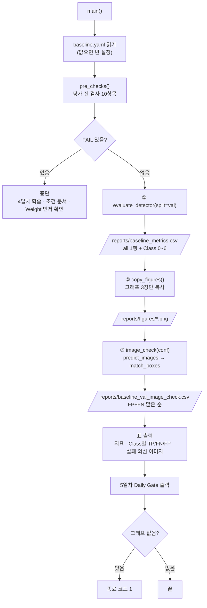

# `scripts/09_evaluate_baseline.py` 코드 리뷰

> 5일차 · 292줄 · 가이드 18장 · 18.5 Daily Gate · 산출물 2 · 5

## 1. 한 줄 요약

4일차 Baseline(`baseline_best.pt`)을 **Validation에서만 평가**해 전체 · Class별 P · R · mAP50 · mAP50-95를 `reports/baseline_metrics.csv`에 남기고, 학습곡선 · Confusion Matrix 그래프를 정리합니다. 이어서 Val 이미지를 예측해 **이미지별 TP · FP · FN**(`baseline_val_image_check.csv`)을 만들어 6일차 Failure Analysis의 입력으로 넘깁니다. Frozen Test와 Bridge Holdout은 쓰지 않습니다.

## 2. 입력 · 출력 · 실행

| 구분 | 파일 |
|---|---|
| 입력 | `models/baseline/baseline_best.pt` · `reports/baseline_training_condition.md` (상태 · sha) · `configs/baseline.yaml` · `configs/dataset.yaml` · `manifests/split_manifest.csv` · `val.csv` · `data/yolo/{images,labels}/val` · `runs/baseline_v1/results.png` |
| 출력 (Git) | `reports/baseline_metrics.csv` · `reports/figures/baseline_results.png` · `baseline_confusion_matrix.png` · `baseline_confusion_matrix_normalized.png` · `reports/baseline_val_image_check.csv` |
| 출력 (Git 제외 · NDA) | `runs/baseline_v1_val/` (Ultralytics 평가 결과) · `runs/predict/baseline_val_images/` (박스를 그린 Val 이미지) |

| 옵션 | 기본값 | 쓰이는 곳 |
|---|:--:|---|
| `--conf` | 0.25 | 예측 이미지 · 이미지별 FP/FN 집계 (평가 지표는 이 값과 무관) |

```bash
python scripts/09_evaluate_baseline.py              # 검사 → Val 평가 → 그림 정리 → Val 예측 · FP/FN
python scripts/09_evaluate_baseline.py --conf 0.25  # 예측 conf 지정 (기본값과 같음)
```

가이드 이름은 `07_evaluate_baseline.py` + `08_predict_images.py`이지만, 우리 07 · 08은 이미 쓰고 있어서 **09 하나로 묶었습니다.**

## 3. 구조

| 줄 | 내용 |
|--:|---|
| 27~34 | `import` (`pathlib` · `argparse` · `csv` · `hashlib` · `re` · `shutil` · `subprocess` · `sys`) |
| 36~38 | `PROJECT_ROOT` 경로 설정 |
| 40~42 | `import yaml` · `from src.manifest import read_manifest` · `from src.evaluate_detector import evaluate_detector, predict_images, match_boxes` |
| 47~58 | 경로: `BEST_PT` · `CONDITION_MD` · `BASELINE_YAML` · `DATASET_YAML` · `MANIFEST_DIR` · `VAL_IMAGES` · `VAL_LABELS` · `VERIFY_SCRIPT` · `RUNS_DIR` · `FIG_DIR` · `METRICS_CSV` · `IMAGE_CHECK_CSV` |
| 60~65 | 기준값: `SPLIT` · `VAL_RUN_NAME` · `PRED_RUN_NAME` · `IOU_MATCH` · `SMALL_PX` · `UNUSED_CLASSES` |
| 68~81 | `sha12()` · `condition_info()` (4일차 조건 문서에서 상태 · sha 읽기) |
| 84~118 | `pre_checks()`: 평가 전 검사 10항목 |
| 121~149 | `write_metrics()` (`baseline_metrics.csv`) |
| 152~164 | `copy_figures()` (그래프만 `reports/figures/`로 복사) |
| 167~181 | `read_gt()` · `is_small()` |
| 184~212 | `image_check()` (Val 예측 → 이미지별 TP · FP · FN) |
| 215~288 | `main()`: 검사 → ① Val 평가 → ② 그림 정리 → ③ 이미지별 FP/FN → 출력 → Daily Gate |

### 흐름 그림



평가 지표(①)와 이미지별 FP/FN(③)은 **서로 다른 예측 설정**으로 계산됩니다. 4.5에서 그 차이를 설명합니다.

## 4. 핵심 코드 읽기

### 4.1 4일차가 "완료"되어야 평가를 시작한다

```python
text = CONDITION_MD.read_text(encoding="utf-8") if CONDITION_MD.exists() else ""
state = re.search(r"\*\*상태\*\*: ([^·\n]+)", text)
sha = re.search(r"baseline_best\.pt` · sha `([0-9a-f]{12})`", text)
return {"state": state.group(1).strip() if state else "문서 없음", "sha": sha.group(1) if sha else "-"}
```

```python
add("4일차 학습 상태 (condition md)", "완료", info["state"])
add("Weight sha = 4일차 기록", info["sha"], sha12(BEST_PT) if BEST_PT.exists() else "-")
```

- 08이 쓴 조건 문서에서 **정규식으로 상태와 가중치 sha**를 읽습니다. 상태가 `완료`가 아니거나(`확인 필요` · `학습 전`) 문서가 없으면 평가하지 않습니다.
- 지금 `baseline_best.pt`의 sha가 **학습 직후 기록한 sha와 같은지** 확인합니다. 4일차 이후에 가중치 파일이 바뀌었다면 FAIL입니다.
- 이 정규식은 08이 쓰는 문서의 문구(`**상태**:` · `` `baseline_best.pt` · sha ` ``)에 의존합니다. 08의 문구를 바꾸면 09도 같이 고쳐야 합니다.

### 4.2 평가 전 검사 — 10항목

```python
add("Ultralytics 버전 (팀 고정)", str(cfg.get("ultralytics_version", "8.4.175")), ver)
...
add("dataset.yaml 에 Bridge 없음", "no", "yes" if "bridge" in yaml_text else "no")
add("평가 split", "val", SPLIT)
```

| 번호 | 항목 | 내용 |
|:--:|---|---|
| 1 | Ultralytics 버전 | 팀 고정 버전과 같음 |
| 2 | 4일차 학습 상태 | `완료` |
| 3 | Baseline Weight | `baseline_best.pt`가 있음 |
| 4 | Weight sha | 4일차 기록과 같음 |
| 5 | 학습곡선 원본 | `runs/<name>/results.png`가 있음 |
| 6 | `dataset.yaml`에 Bridge 없음 | `no` |
| 7 | 평가 split | `val` |
| 8 | manifest 스키마 | `v2` |
| 9 | Dataset Version | `kimchi_v1` |
| 10 | 07 `data/yolo` 검증 | 종료 코드 0 |

- 08의 검사와 같은 틀입니다. 8~10번에서 `read_manifest()`와 07 실행으로 **데이터가 학습 때와 같은지** 한 번 더 확인합니다.
- 7번은 `SPLIT`이 상수 `"val"`이라 항상 PASS입니다. 사실상 **"이 스크립트에서 split을 바꾸지 못하게 못 박아 둔" 표시**이고, `evaluate_detector()`에도 이 값이 넘어갑니다. 함수 안에서도 `val`만 통과시키므로 막는 곳이 두 겹입니다(4.3).
- `baseline.yaml`이 없으면 빈 사전을 쓰고 기본값(`8.4.175` · `kimchi_v1` · 640)으로 검사합니다. 08과 달리 설정 파일 없음 자체를 중단 사유로 삼지 않습니다.

### 4.3 Val만 평가한다

```python
SPLIT = "val"                     # 이 스크립트는 val 만 평가한다
...
metrics, val_dir = evaluate_detector(str(BEST_PT), str(DATASET_YAML), SPLIT, imgsz, batch, RUNS_DIR, VAL_RUN_NAME)
```

- `imgsz` · `batch`는 `baseline.yaml`에서 가져와 **학습 때와 같은 값**으로 평가합니다.
- `evaluate_detector()`(`src/evaluate_detector.py`)는 `ALLOWED_SPLITS = ("val",)` 밖의 split을 `ValueError`로 거부합니다. `test`는 `allow_test=True`를 **명시했을 때만**(8일차 Frozen Test 전용) 허용되는데, 09는 이 값을 넘기지 않으므로 Frozen Test는 이 파일에서 평가할 수 없습니다.
- `project`는 절대경로여야 하고(아니면 `ValueError`), 내부에서 `model.val(..., plots=True, exist_ok=True)`를 호출합니다. `exist_ok=True`라서 평가를 다시 돌리면 `runs/baseline_v1_val/`을 덮어씁니다. 평가는 다시 해도 같은 결과이기 때문입니다.
- 7일차 Improved 평가도 **같은 함수**를 쓰므로, 두 모델의 차이는 넘겨 준 가중치 하나뿐입니다.
- 결과 폴더는 `runs/baseline_v1_val/`(Git 제외)에 남고, 이 폴더에서 Confusion Matrix 그림을 가져갑니다.

### 4.4 지표 CSV — Instance가 0인 Class는 비워 두고 이유를 적는다

```python
p, r, m50, m = metrics.box.mean_results()
rows = [{**base, "class_id": "all", "class_name": "all", ..., "note": "Val 전체 (Ultralytics 기본 conf 0.001 · iou 0.7)"}]
index = {int(c): i for i, c in enumerate(metrics.ap_class_index)}
for cid in sorted(names):
    row = {**base, "class_id": cid, "class_name": names[cid], ...}
    if cid in index:
        cp, cr, c50, c = metrics.class_result(index[cid])
        row.update(precision=cp, recall=cr, map50=c50, map50_95=c, note="")
    else:
        row.update(precision="", recall="", map50="", map50_95="",
                   note=UNUSED_CLASSES.get(cid, "Val 에 Instance 0 → 해석 불가"))
```

- 첫 행은 Val 전체(`all`), 그다음이 Class 0~6입니다. 숫자는 `.4f` 문자열로 저장합니다.
- `metrics.ap_class_index`에는 **Val에 실제로 나온 Class**만 들어 있습니다. 그래서 `index`에 없는 Class(Instance 0)는 숫자를 비우고 이유를 `note`에 남깁니다.
- Class 4는 `UNUSED_CLASSES`에 이유(교과 7 `enabled: false`)가 적혀 있어, 같은 빈 칸이라도 **"쓰지 않는 Class"와 "Val에 없는 Class"가 구분**됩니다.
- 각 행에는 `weight_sha` · `dataset_version` · `split` · `imgsz`가 같이 들어가서, 이 숫자가 **어느 가중치 · 어느 데이터로 낸 것인지** 파일만 보고 알 수 있습니다.

### 4.5 이미지별 TP · FP · FN — 지표와는 다른 설정

```python
for name, size, preds in predict_images(str(BEST_PT), VAL_IMAGES, conf, imgsz, RUNS_DIR / "predict", PRED_RUN_NAME):
    gts = read_gt(Path(name).stem)
    m = match_boxes(gts, preds, IOU_MATCH)
    ...
    for i, g in enumerate(gts):
        per_class[g[0]]["gt"] += 1
        per_class[g[0]]["fn" if i in m["fn_idx"] else "tp"] += 1
```

- `predict_images()`는 Val 이미지를 **한 장씩** `(파일명, (너비, 높이), [(cls, conf, x, y, w, h), ...])`로 돌려주고(좌표는 0~1 YOLO 형식), 박스를 그린 이미지는 `runs/predict/baseline_val_images/`에 저장합니다(`exist_ok=True`).
- `read_gt()`는 정답 라벨(YOLO TXT)을 `(cls, x, y, w, h)` 목록으로 읽습니다. `match_boxes()`는 **점수 높은 예측부터** 같은 Class의 아직 안 쓰인 정답 중 IoU가 가장 높은 것(0.5 이상)과 짝짓고, 한 정답은 한 번만 씁니다. 짝이 있으면 TP, 짝이 없는 예측은 FP, 짝이 없는 정답은 FN입니다.
- `class_err`는 FP 중에서 **위치는 맞는데(IoU ≥ 0.5) Class만 틀린** 예측 개수입니다. FP 개수에 이미 들어 있으므로, `fp` 중 일부가 `class_err`입니다.
- `match_boxes()`는 계산만 하는 함수라 GPU나 화면 없이 테스트할 수 있습니다.
- 표의 `conf`는 **0.25**입니다. 반면 4.4의 지표(P · R · mAP)는 Ultralytics 평가 기본값 **conf 0.001**로 계산됩니다. 그래서 Class별 TP · FN · FP 개수로 P · R을 다시 계산해도 `baseline_metrics.csv`의 값과 **같지 않은 것이 정상**입니다.
- `val_rows`는 `read_manifest(MANIFEST_DIR / "val.csv")[0]`로 읽어 `scene_type` · `capture_group`을 붙입니다. 6일차에 "어느 세션 · 어떤 장면에서 틀리는가"를 보기 위해서입니다.
- 결과는 FP+FN이 **많은 이미지부터** 정렬해 `baseline_val_image_check.csv`에 저장합니다. 열은 `gt` · `pred` · `tp` · `fp` · `fn` · `class_err` · `small_gt` · `small_fn` · `class4_pred` · `max_conf` · `suspect`입니다.
- `suspect`는 FP나 FN이 하나라도 있으면 `yes`입니다. 화면에는 이 중 상위 10장만 출력합니다.

### 4.6 작은 객체 — 모델 입력 기준 32px 미만

```python
def is_small(box, size) -> bool:
    """모델 입력(긴 변 imgsz=640)으로 줄였을 때 32×32px 미만이면 작은 객체."""
    w_img, h_img = size
    scale = 640 / max(w_img, h_img)
    return (box[3] * w_img * scale) * (box[4] * h_img * scale) < SMALL_PX * SMALL_PX
```

- 라벨은 이미지 크기에 대한 **비율**(0~1)이므로, 먼저 원본 픽셀로 바꾼 뒤 긴 변이 640이 되도록 줄여 면적을 잽니다. 4K 이미지에서도 "모델이 실제로 보는 크기"로 판단하는 셈입니다.
- 기준은 COCO의 small 정의(32×32px 미만)를 따릅니다. 640은 코드에 직접 적혀 있어서, `baseline.yaml`의 `imgsz`를 바꿔도 이 함수는 그대로 640 기준입니다.
- 작은 객체 GT 개수와 그중 FN 개수를 `small_gt` · `small_fn`으로 세어, Gate에 `작은 객체 FN(n/m)`으로 출력합니다.

### 4.7 그래프만 복사하고, 사람이 확인할 칸은 남겨 둔다

```python
pairs = [(train_dir / "results.png", "baseline_results.png"),
         (val_dir / "confusion_matrix.png", "baseline_confusion_matrix.png"),
         (val_dir / "confusion_matrix_normalized.png", "baseline_confusion_matrix_normalized.png")]
```

```python
print("  ☐ 실제 Val Prediction 이미지 확인 ← 사람이 runs/predict/baseline_val_images/ 를 열어 보고 체크")
...
if missing:
    sys.exit(1)
```

- `reports/figures/`에는 **그래프 3장만** 복사합니다. 회사 이미지가 들어간 그림(`val_batch*.jpg` · 예측 이미지)은 NDA 때문에 `runs/`에만 남깁니다.
- 5일차 Daily Gate(가이드 18.5)를 화면에 출력합니다. 대부분은 파일이 있는지로 ✅ · ☐를 정하지만, **"실제 Val Prediction 이미지 확인"은 항상 ☐**입니다. 사람이 박스 그린 이미지를 열어 본 뒤 직접 체크해야 하는 항목이기 때문입니다.
- 그 외 몇 줄(Class별 성능 · 정상 김치 FP · Test/Bridge 미사용)은 코드에서 ✅로 고정되어 있어 **파일이 있는지 같은 확인은 하지 않습니다.** 종료 코드 1은 그래프가 없을 때만 나옵니다.
- 정상 김치(`normal_kimchi`)는 이 데이터에 0장이라, 정상 김치 FP는 확인할 수 없는 **한계로 출력해서 기록**합니다(README 16장). Class 4 예측은 데이터가 0건이므로 있으면 전부 FP 후보로 셉니다.

## 5. 연결된 파일

| 관계 | 파일 |
|---|---|
| 입력 (4일차 Baseline) | `models/baseline/baseline_best.pt` (`08_train_baseline.py`가 보관) |
| 입력 (4일차 조건 문서) | `reports/baseline_training_condition.md` (상태 · sha를 정규식으로 읽음) |
| 입력 (학습 조건) | `configs/baseline.yaml` · `configs/dataset.yaml` |
| 입력 (Val 데이터) | `manifests/val.csv` · `data/yolo/images/val` · `labels/val` (06이 생성 · 07이 검증) |
| 평가 · 예측 함수 | `src/evaluate_detector.py` (`evaluate_detector()` · `predict_images()` · `match_boxes()` · `iou_xywh()`) |
| manifest 읽기 | `src/manifest.py` (`read_manifest()`) |
| 데이터 검증 | `07_verify_yolo_dataset.py` (종료 코드 0이어야 함) |
| 기준값 출처 | 가이드 18장 (18.5 Daily Gate) · README 16장 (알려진 한계) |
| 결과를 쓰는 곳 | `reports/baseline_metrics.csv` · `reports/figures/` · `reports/baseline_val_image_check.csv` · `runs/baseline_v1_val/` · `runs/predict/baseline_val_images/` |
| 결과를 읽는 곳 | 6일차 Failure Analysis (`baseline_val_image_check.csv`) |
