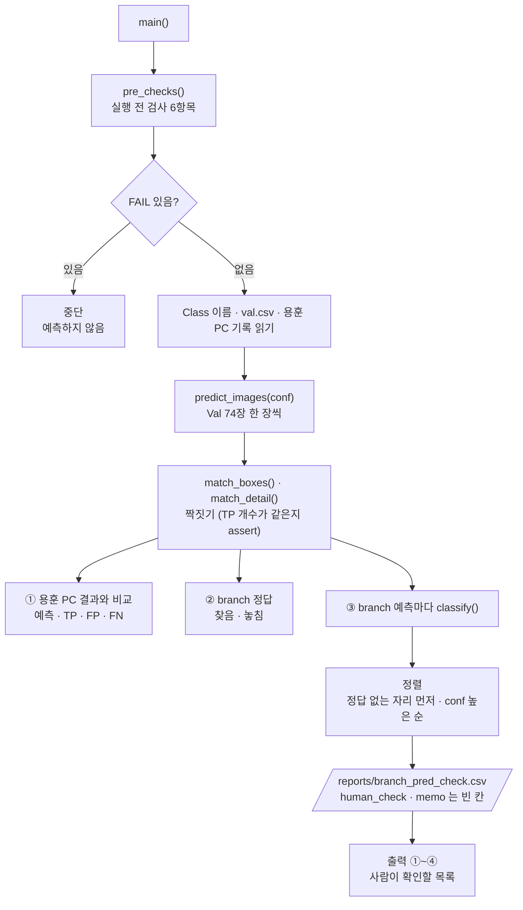

# `scripts/09a_branch_fp_check.py` 코드 리뷰

> 6일차 준비 · 275줄 · 가이드 19장 (Failure Analysis) · 가설 H3 (branch 오검출)

## 1. 한 줄 요약

Baseline이 Val에서 **branch(Class 2)라고 친 박스를 하나씩 정답과 대조**해 5가지(`TP` · `중복` · `다른 이물 위` · `위치 어긋남` · `정답 없는 자리`)로 나누고, 사람이 눈으로 확인할 칸(`human_check` · `memo`)을 붙여 `reports/branch_pred_check.csv`로 저장합니다. 5일차 09와 **같은 가중치 · 같은 데이터 · 같은 conf**로 예측하므로, 내 PC 결과가 용훈 PC의 5일차 결과와 같은지도 함께 확인합니다. Val만 쓰고 Frozen Test와 Bridge Holdout은 쓰지 않습니다.

## 2. 입력 · 출력 · 실행

| 구분 | 파일 |
|---|---|
| 입력 | `models/baseline/baseline_best.pt` · `reports/baseline_training_condition.md` (sha) · `configs/dataset.yaml` · `manifests/val.csv` · `data/yolo/{images,labels}/val` · `reports/baseline_val_image_check.csv` (5일차 09 결과 · 비교용) |
| 출력 (Git) | `reports/branch_pred_check.csv` (branch 예측 1개 = 1행 · 이미지 없음) |
| 출력 (Git 제외 · NDA) | `runs/predict/branch_check/` (박스를 그린 Val 이미지 · 사람 확인용 · 외부 공유 금지) |

| 옵션 | 기본값 | 쓰이는 곳 |
|---|:--:|---|
| `--conf` | 0.25 | 예측 conf (09와 같은 기준 · 바꾸면 용훈 PC 결과와 비교가 어긋남) |

```bash
python scripts/09a_branch_fp_check.py              # prj08 폴더 · venv 켠 뒤 · 기본 conf 0.25
```

분류 기준은 IoU 두 개(`0.5` · `0.1`)입니다.

| 분류 | branch 박스를 친 곳 | 사람 확인 |
|---|---|:--:|
| `TP` | branch 정답과 IoU ≥ 0.5로 짝지어짐 | 불필요 |
| `중복` | 이미 다른 branch 예측이 잡은 branch 정답 위에 또 그림 | 불필요 |
| `다른 이물 위` | 다른 Class 정답과 IoU ≥ 0.5 → Class 혼동 | 선택 |
| `위치 어긋남` | 어떤 정답과 0.1 ≤ IoU < 0.5 → 근처 이물을 대충 잡음 | 필요 |
| `정답 없는 자리` | 모든 정답과 IoU < 0.1 → 라벨 누락인지 김치를 착각한 건지 | 필요 (핵심) |

## 3. 구조

| 줄 | 내용 |
|--:|---|
| 1~27 | 설명 문서(docstring): 사용법 · 입력 · 결과 · 분류 기준 · 원칙 |
| 28~34 | `import` (`pathlib` · `argparse` · `csv` · `hashlib` · `re` · `subprocess` · `sys`) |
| 36~38 | `PROJECT_ROOT` 경로 설정 |
| 40~42 | `import yaml` · `from src.manifest import read_manifest` · `from src.evaluate_detector import predict_images, match_boxes, iou_xywh` |
| 47~57 | 경로: `BEST_PT` · `CONDITION_MD` · `DATASET_YAML` · `VAL_CSV` · `VAL_IMAGES` · `VAL_LABELS` · `VERIFY_SCRIPT` · `IMAGE_CHECK_CSV` · `OUT_CSV` · `RUNS_DIR` · `PRED_RUN_NAME` |
| 59~64 | 기준값: `BRANCH` · `IOU_MATCH` · `IOU_NEAR` · `IMGSZ` · `N_VAL` · `ULTRALYTICS_VERSION` |
| 67~80 | `sha12()` · `recorded_sha()` (4일차 조건 문서에서 가중치 sha 읽기) |
| 83~110 | `pre_checks()`: 실행 전 검사 6항목 |
| 113~120 | `read_gt()` (정답 라벨 TXT 읽기) |
| 123~138 | `match_detail()`: 예측마다 "짝지어진 정답 번호" 돌려주기 |
| 141~158 | `classify()`: branch 예측 하나 → 5가지 분류 |
| 161~271 | `main()`: 검사 → 예측 → ① 용훈 PC 비교 → ② branch 정답 → ③ 분류 → CSV 저장 → 출력 |
| 274~275 | `if __name__ == "__main__": main()` |

### 흐름 그림



09와 다른 점은 평가(`model.val`)를 하지 않고, **예측 결과를 branch 한 Class만 골라 정답과 하나씩 대조**한다는 것입니다.

## 4. 핵심 코드 읽기

### 4.1 실행 전 검사 — 6항목

```python
add("Ultralytics 버전 (팀 고정)", ULTRALYTICS_VERSION, ver)
add("Baseline Weight 위치", "models/baseline/baseline_best.pt", "있음" if BEST_PT.exists() else "없음", ok=BEST_PT.exists())
add("Weight sha = 4일차 기록", recorded_sha(), sha12(BEST_PT) if BEST_PT.exists() else "-")
```

| 번호 | 항목 | 내용 |
|:--:|---|---|
| 1 | Ultralytics 버전 | `8.4.175` (팀 고정) |
| 2 | Baseline Weight 위치 | `models/baseline/baseline_best.pt`가 있음 |
| 3 | Weight sha | 4일차 조건 문서에 적힌 sha와 같음 |
| 4 | `dataset.yaml` 2번 | `branch` |
| 5 | Val 이미지 수 | 74 |
| 6 | 07 `data/yolo` 검증 | 종료 코드 0 |

- 09의 10항목에서 이 스크립트에 필요한 것만 남긴 **축소판**입니다. 상태 `완료` · 학습곡선 · manifest 스키마 · Dataset Version은 보지 않습니다.
- 3번의 `recorded_sha()`는 09처럼 조건 문서에서 정규식(`` baseline_best\.pt` · sha `... ``)으로 읽습니다. 문서가 없거나 문구가 다르면 `"-"`가 되어 실제 sha와 맞지 않으므로 **FAIL**입니다. 가중치를 용훈 PC에서 받아 온 사람은 이 sha(`22f35d20a5ea`)가 같아야 같은 모델로 본다는 뜻입니다.
- 가중치는 `models/` 바로 아래가 아니라 **`models/baseline/` 안**에 있어야 합니다. 경로가 코드에 고정되어 있습니다.
- 6번은 07을 `subprocess.run`으로 실행해 종료 코드를 봅니다. `data/yolo`가 없거나 옛 것이면 여기서 FAIL이 납니다.
- 4번은 `names.get(BRANCH)`로 읽으므로 `dataset.yaml`의 Class 번호가 정수 키여야 합니다(지금은 `2: branch`).
- FAIL이 하나라도 있으면 `sys.exit(...)`로 **예측하지 않고 멈춥니다.**

### 4.2 짝짓기 — 예측마다 "어느 정답과 짝인가"

```python
def match_detail(gts, preds, iou_thr=IOU_MATCH) -> list:
    used, matched = set(), [None] * len(preds)
    for j in sorted(range(len(preds)), key=lambda j: -preds[j][1]):
        p, best_i, best_iou = preds[j], None, iou_thr
        for i, g in enumerate(gts):
            if i in used or g[0] != p[0]:
                continue
            v = iou_xywh(g[1:], p[2:])
            if v >= best_iou:
                best_i, best_iou = i, v
        if best_i is not None:
            used.add(best_i)
            matched[j] = best_i
    return matched
```

- `match_boxes()`는 TP · FP · FN **개수**만 돌려줍니다. 이 스크립트는 "이 예측은 몇 번째 정답과 짝인가"가 필요해서 **같은 규칙**을 따로 구현했습니다.
- 규칙은 09의 `match_boxes`와 같습니다: **점수 높은 예측부터** · **같은 Class**끼리 · **이미 쓴 정답은 건너뜀** · IoU가 0.5 이상인 것 중 가장 높은 정답과 짝.
- 결과 `matched[j]`는 짝이 있으면 정답 번호, 없으면 `None`입니다. 예측이 어느 Class든 모두 계산하지만, 같은 Class끼리만 짝을 짓기 때문에 branch 예측은 branch 정답하고만 경쟁합니다.
- 두 구현이 어긋나지 않도록 `main()`에서 `assert sum(x is not None for x in matched) == m["tp"]`로 **TP 개수가 `match_boxes`와 같은지** 매번 확인합니다. 다르면 "짝짓기 결과가 match_boxes 와 다릅니다"라며 멈춥니다.

### 4.3 branch 예측 하나를 5가지로 분류한다

```python
def classify(j, preds, gts, matched):
    if matched[j] is not None:
        return "TP", 1.0, "branch", "-"
    p = preds[j]
    if not gts:
        return "정답 없는 자리", 0.0, "-", "-"
    ious = [iou_xywh(g[1:], p[2:]) for g in gts]
    i = max(range(len(gts)), key=lambda k: ious[k])
    g_cls = gts[i][0]
    found = "yes" if i in matched else "no"
    if ious[i] >= IOU_MATCH:
        kind = "중복" if g_cls == BRANCH else "다른 이물 위"
    elif ious[i] >= IOU_NEAR:
        kind = "위치 어긋남"
    else:
        return "정답 없는 자리", ious[i], "-", "-"
    return kind, ious[i], g_cls, found
```

확인하는 순서는 이렇습니다.

1. **짝이 있으면 `TP`.** 이때 `best_iou`는 실제 IoU가 아니라 **고정값 `1.00`** 입니다. CSV의 TP 행 `best_iou`를 실제 겹침으로 읽으면 안 됩니다.
2. 이미지에 정답이 하나도 없으면 `정답 없는 자리`.
3. 짝이 없는 예측은 **Class와 상관없이** 모든 정답과 IoU를 구해 가장 많이 겹친 정답 `i`를 고릅니다.
4. 그 IoU가 **0.5 이상**이면: 그 정답이 branch면 `중복`(이미 더 높은 점수의 branch 예측이 그 정답을 가져감), 다른 Class면 `다른 이물 위`.
5. **0.1 이상 0.5 미만**이면 `위치 어긋남`. 이때 겹친 정답이 branch일 수도 있습니다(박스가 branch 정답에서 벗어난 경우).
6. 0.1 미만이면 `정답 없는 자리`. 이때만 겹친 정답이 사실상 없다고 보고 **`overlap_gt_class`를 비웁니다.** `best_iou`는 실제 값(예: `0.00`)이 남습니다.

반환하는 네 값 중 `found`(`gt_found_by_other`)는 "그 정답을 올바른 Class의 다른 예측이 이미 맞혔는가"입니다. `no`이면 그 정답은 놓친 정답(FN)이라, 잘못된 branch 박스가 **놓친 정답의 자리를 대신 차지한 것**으로 읽을 수 있습니다.

### 4.4 이미지 한 장에서 하는 세 가지

```python
for name, (w_img, h_img), preds in predict_images(str(BEST_PT), VAL_IMAGES, args.conf, IMGSZ, RUNS_DIR / "predict", PRED_RUN_NAME):
    gts = read_gt(Path(name).stem)
    m = match_boxes(gts, preds, IOU_MATCH)
    matched = match_detail(gts, preds, IOU_MATCH)
```

**① 용훈 PC 결과와 같은가**

```python
mine = (len(preds), m["tp"], m["fp"], m["fn"])
if r0 is None or mine != (int(r0["pred"]), int(r0["tp"]), int(r0["fp"]), int(r0["fn"])):
    diff.append(...)
```

- 5일차 `baseline_val_image_check.csv`(Git)의 이미지별 `pred · tp · fp · fn`과 **내 PC 값이 같은지** 이미지마다 비교합니다. 가중치 · 라이브러리 버전 · 데이터 중 하나라도 다르면 여기서 `다름`이 나옵니다.
- 기록에 그 이미지가 없으면(`r0 is None`)도 `다름`으로 셉니다. 화면에는 `다름` 상위 10장만 보여줍니다.
- `다름 0`이어야 이 PC의 분류 결과를 용훈 PC 결과와 같은 것으로 믿을 수 있습니다. 다름이 1 이상이면 사람 확인을 시작하지 않습니다.

**② branch 정답을 찾았는가**

```python
for i, g in enumerate(gts):
    if g[0] == BRANCH:
        branch_gt["gt"] += 1
        branch_gt["found"] += i in matched
```

- Val의 branch 정답 개수와 그중 **짝이 있는 개수**를 셉니다. 이 값은 "branch 경보기는 진짜 불을 놓치지 않았다"(Recall)를 확인하는 숫자입니다.

**③ branch 예측 한 줄 만들기**

```python
"x1": round((x - w / 2) * w_img), "y1": round((y - h / 2) * h_img),
"x2": round((x + w / 2) * w_img), "y2": round((y + h / 2) * h_img),
"size_640": f"{w * w_img * scale:.0f}x{h * h_img * scale:.0f}",
"human_check": "", "memo": "",
```

- 예측 좌표는 0~1 비율(YOLO 형식, 중심 x·y와 폭·높이)이라, **원본 사진 픽셀의 왼쪽 위 · 오른쪽 아래**로 바꿉니다. 라벨링 프로그램에서 그 위치를 찾아가기 위한 좌표입니다.
- `size_640`은 긴 변을 640으로 줄였을 때의 박스 크기입니다(예: `14x24`). 모델이 실제로 본 크기이고, 작은 객체 문제(H1)와 비교할 때 씁니다.
- `human_check`와 `memo`는 **빈 칸**으로 저장합니다. 채우는 사람은 김하민 님이고, 스크립트는 값을 검사하지 않습니다.

### 4.5 정렬 · 저장 · 출력

```python
order = {"정답 없는 자리": 0, "위치 어긋남": 1, "다른 이물 위": 2, "중복": 3, "TP": 4}
rows.sort(key=lambda r: (order[r["kind"]], -float(r["conf"])))
```

- **사람이 봐야 하는 분류를 위로, 그 안에서는 conf가 높은 순**으로 정렬하고 `no`(1부터)를 붙입니다. 확인 순서도 이 번호 순서입니다.
- 열은 17개입니다: `no` · `file_name` · `source_dataset` · `scene_type` · `capture_group` · `conf` · `kind` · `best_iou` · `overlap_gt_class` · `gt_found_by_other` · `x1` · `y1` · `x2` · `y2` · `size_640` · `human_check` · `memo`.
- 저장은 `utf-8-sig`(엑셀에서도 한글이 안 깨지게) · 줄바꿈 `\n`입니다.
- 화면 출력은 ① 용훈 PC 비교 · ② branch 정답 · ③ 분류별 개수 · ④ **사람이 확인할 목록**(`정답 없는 자리` + `위치 어긋남`만 · conf 높은 순) 순서입니다. `다른 이물 위`는 개수와 **실제 정답 Class별 개수**(`plastic_stone_metal 3 · insect 1`처럼)만 보여주고 목록에는 넣지 않습니다.
- 이 화면 출력 텍스트는 팀에 공유해도 되지만(파일명 · 좌표 · 숫자뿐), `runs/predict/branch_check/`의 박스 그린 이미지는 NDA라 공유하지 않습니다.

> **주의 · 다시 돌리면 덮어씁니다.** `OUT_CSV`를 `"w"`로 열기 때문에, 사람 확인(`human_check` · `memo`)을 채운 뒤에 스크립트를 다시 돌리면 **채운 내용이 사라집니다.** 확인을 시작한 뒤에는 돌리지 않습니다.

### 4.6 교차 확인 — 09의 `baseline_class_check.csv`와 맞는지

09가 만드는 `reports/baseline_class_check.csv`(conf 0.25 · IoU 0.5)의 **branch 행**과 이 스크립트의 CSV는 같은 예측을 다른 방식으로 센 것이라 서로 맞아야 합니다.

| 09 `baseline_class_check.csv` (branch 행) | 이 스크립트의 `branch_pred_check.csv` |
|---|---|
| `tp` | `kind == "TP"`인 행 수 |
| `fp` | `kind != "TP"`인 행 수 (`중복`도 FP로 셉니다) |
| `tp + fp` | 전체 행 수 (= branch 예측 개수) |

- 5일차 결과 기준으로 branch는 `tp 8 · fp 30`이고, 이 스크립트도 branch 예측 38개 = TP 8 + 나머지 30으로 나옵니다. 두 값이 다르면 짝짓기 규칙이 어긋난 것이므로 `assert`가 먼저 잡지만, 마지막에 이 표로 한 번 더 확인할 수 있습니다.

### 4.7 지켜지는 원칙

- **Val만 씁니다.** `VAL_IMAGES` · `VAL_LABELS` 경로가 상수로 고정돼 있습니다. 09처럼 `evaluate_detector()`의 split 거부 장치(`allow_test`)는 거치지 않으므로, 막는 곳은 **경로 상수 하나**입니다. 이 경로를 바꾸면 안 됩니다.
- **`src/`를 고치지 않고 가져다 씁니다.** 5일차 리뷰가 끝난 `predict_images` · `match_boxes` · `iou_xywh`를 그대로 import합니다.
- **`data/yolo`는 읽기만 합니다.** 쓰는 곳은 `reports/branch_pred_check.csv`와 `runs/predict/branch_check/` 둘뿐입니다.

## 5. 연결된 파일

| 관계 | 파일 |
|---|---|
| 입력 (4일차 Baseline) | `models/baseline/baseline_best.pt` (`08_train_baseline.py`가 보관 · 용훈 PC에서 받아 `models/baseline/`에 둠) |
| 입력 (4일차 조건 문서) | `reports/baseline_training_condition.md` (sha를 정규식으로 읽음) |
| 입력 (5일차 결과 · 비교용) | `reports/baseline_val_image_check.csv` (`09_evaluate_baseline.py`가 만듦 · Git) |
| 입력 (Val 데이터) | `manifests/val.csv` · `data/yolo/images/val` · `labels/val` (06이 생성 · 07이 검증) · `configs/dataset.yaml` (Class 이름) |
| 예측 · 짝짓기 함수 | `src/evaluate_detector.py` (`predict_images()` · `match_boxes()` · `iou_xywh()`) |
| manifest 읽기 | `src/manifest.py` (`read_manifest()`) |
| 데이터 검증 | `07_verify_yolo_dataset.py` (종료 코드 0이어야 함) |
| 교차 확인 | `reports/baseline_class_check.csv` (09가 만듦 · branch 행의 `tp` · `fp`) |
| 기준값 출처 | 가이드 19장 (Failure Analysis) · README 16장 (알려진 한계) |
| 결과를 쓰는 곳 | `reports/branch_pred_check.csv` · `runs/predict/branch_check/` |
| 결과를 읽는 곳 | 6일차 `reports/failure_analysis.csv` (H3 행 · 근거 파일) · `reports/issue_log.md` (라벨 누락이 나온 경우) |
