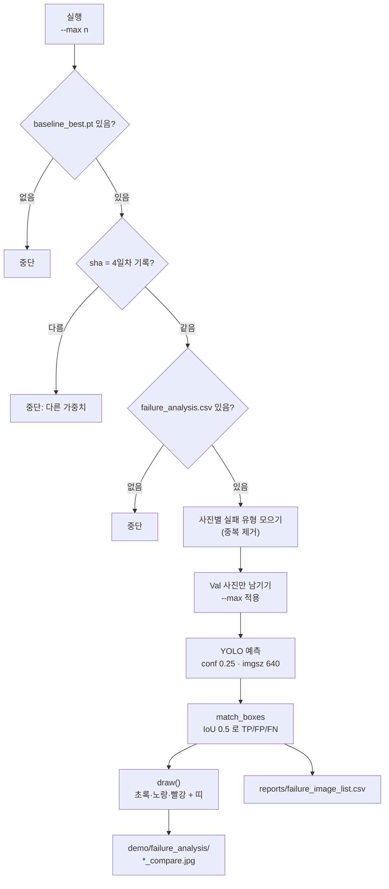

# `scripts/09b_failure_images.py` 코드 리뷰

> 6일차 · 184줄 · 가이드 19.A · 19.6 (대표 실패 사례 GT vs Prediction 비교 이미지)

---

## 1. 한 줄 요약

**`failure_analysis.csv`에 적힌 Val 사진마다 정답(초록·노랑)과 Baseline 예측(빨강)을 한 장에 겹쳐 그려 `demo/failure_analysis/`에 저장하고, 어떤 사진을 그렸는지 숫자 목록(`failure_image_list.csv`)을 남기는 스크립트.**

---

## 2. 입력·출력·실행

| 구분 | 경로 | 내용 | Git |
|---|---|---|---|
| 입력 | `reports/failure_analysis.csv` | 6일차 대표 실패 사례 (`image`, `failure_type` 칸) | O |
| 입력 | `models/baseline/baseline_best.pt` | 4일차 Baseline 가중치 | X |
| 입력 | `reports/baseline_training_condition.md` | 가중치 sha 대조용 기록 | O |
| 입력 | `manifests/val.csv` | Val 사진 목록 (Val만 그리기 위한 필터) | O |
| 입력 | `data/yolo/{images,labels}/val` | Val 사진 · 정답 라벨 | X |
| 출력 | `demo/failure_analysis/<사진>_compare.jpg` | GT + 예측 겹친 그림 (NDA · 외부 공유 금지) | X |
| 출력 | `reports/failure_image_list.csv` | 그린 사진 목록 · TP/FP/FN 숫자만 | O |

**실행 명령** (prj08 폴더 · venv 켠 뒤)

```bash
python scripts/09b_failure_images.py            # failure_analysis.csv 의 사진 전부 (중복 제거)
python scripts/09b_failure_images.py --max 10   # 앞에서부터 10장만
```

**그림 읽는 법**

| 색 | 의미 | 글자 위치 |
|---|---|---|
| 초록 굵은 선 | 정답(GT) 중 모델이 맞힌 것 | 박스 위 `GT Class` |
| 노랑 굵은 선 | 정답(GT) 중 모델이 놓친 것 (FN) | 박스 위 `MISSED Class` |
| 빨강 선 | 모델 예측 (conf ≥ 0.25) | 박스 아래 `Class 확신도` |
| 맨 위 띠 | 파일명 · 실패 유형 · TP / FP / FN | — |

---

## 3. 구조

| 줄 범위 | 부분 | 하는 일 |
|---|---|---|
| 1–26 | docstring | 사용법 · 입력 · 결과 · 그림 읽는 법 · 원칙 |
| 27–40 | import | 표준 라이브러리 · PIL · `src.manifest` · `src.evaluate_detector.match_boxes` |
| 42–55 | 상수 | 경로 8개 · Class 이름 7개 · `CONF/IMGSZ/IOU` · 색 · 저장 크기 |
| 58–63 | `sha12()` | 가중치 파일 sha256 앞 12자리 |
| 66–76 | `font()` | DejaVu 글꼴 → 없으면 기본 글꼴 |
| 79–85 | `read_gt()` | Val 라벨 txt → `(class, x, y, w, h)` 목록 |
| 88–91 | `to_px()` | YOLO 정규화 좌표 → 픽셀 좌표 |
| 94–118 | `draw()` | 정답 · 예측 박스 그리기 + 맨 위 띠 + 긴 변 1920 축소 |
| 121–134 | `main()` 검사 | 가중치 존재 · sha 일치 · CSV 존재 확인 |
| 136–151 | `main()` 목록 정리 | 중복 사진 합치기 · Val만 남기기 · `--max` |
| 153–173 | `main()` 예측 · 그리기 | YOLO 예측 → 짝짓기 → 그림 저장 |
| 175–180 | `main()` 목록 저장 | `failure_image_list.csv` 작성 · 안내 출력 |
| 183–184 | 진입점 | `main()` 실행 |



---

## 4. 핵심 코드 읽기

### 4.1 가중치가 "그 Baseline"인지 sha로 확인

```python
text = CONDITION_MD.read_text(encoding="utf-8") if CONDITION_MD.exists() else ""
m = re.search(r"baseline_best\.pt` · sha `([0-9a-f]{12})`", text)
...
if not m or sha12(BEST_PT) != m.group(1):
    sys.exit("[중단] baseline_best.pt sha 가 4일차 기록과 다릅니다 (다른 가중치)")
```

- 4일차 08 스크립트가 `baseline_training_condition.md`에 남긴 sha를 정규식으로 꺼내, 지금 파일의 sha와 비교합니다.
- 파일 이름이 같아도 내용이 바뀌었으면 멈춥니다 → **5일차 평가 · 6일차 분석과 같은 모델로 그림을 그린다**는 보장.

### 4.2 같은 사진이 여러 행이면 한 장으로 합치기

```python
order, types = [], {}
for r in rows:
    name = r["image"].strip()
    if name not in types:
        order.append(name)
        types[name] = []
    if r["failure_type"] not in types[name]:
        types[name].append(r["failure_type"])
...
order = [n for n in order if n in val_names]
```

- `order`는 처음 나온 순서를 지키고, `types`는 사진별 실패 유형을 모읍니다 (예: `small_miss + class_confusion`).
- `val_names`에 없는 사진은 건너뛰고 따로 출력 → **Failure Analysis는 Validation만** (가이드 19.2).

### 4.3 예측 결과를 정답과 같은 모양으로 바꾸기

```python
preds = [(int(c), float(s), *map(float, b))
         for c, s, b in zip(r.boxes.cls.tolist(), r.boxes.conf.tolist(), r.boxes.xywhn.tolist())]
gts = read_gt(Path(name).stem)
mb = match_boxes(gts, preds, IOU)
```

- 예측은 `(class, conf, x, y, w, h)`, 정답은 `(class, x, y, w, h)` — 둘 다 **0~1 정규화 좌표(`xywhn`)** 라서 바로 비교 가능.
- 짝짓기는 5일차 09와 **같은 `match_boxes`** 를 씁니다 → 그림의 TP/FP/FN이 `baseline_val_image_check.csv` 숫자와 같아야 정상.
- `stream=True`로 한 장씩 받아 메모리를 아낍니다.

### 4.4 정답 박스와 예측 박스가 겹쳐도 둘 다 보이게

```python
lw = max(3, w // 700)        # 선 굵기: 사진 크기에 맞춰
pad = lw * 2                 # 정답 박스를 바깥으로 조금 키움
d.rectangle([x1 - pad, y1 - pad, x2 + pad, y2 + pad], outline=color, width=lw + 2)
...
d.text((x1, y2 + 2), f"{NAMES.get(p[0], p[0])} {p[1]:.2f}", fill=PRED_COLOR, font=f)
```

- 정답은 `pad`만큼 크게 · 더 굵게, 예측은 원래 크기 · 가늘게 → 딱 맞힌 경우에도 초록 테두리 안에 빨강이 보입니다.
- 글자는 정답 = 박스 **위**, 예측 = 박스 **아래** → 서로 안 겹침.
- `MISSED`는 `fn_idx`(짝을 못 찾은 정답 번호)로 판단합니다.

### 4.5 4K 사진을 가볍게 저장

```python
scale = SAVE_LONG_SIDE / max(canvas.size)
if scale < 1:
    canvas = canvas.resize((int(canvas.width * scale), int(canvas.height * scale)))
```

- 띠를 붙인 뒤 긴 변을 1920으로 줄입니다. 박스는 원본 크기에서 그렸으므로 위치가 어긋나지 않습니다.

> **주의**: 그릴 사진이 0장이면(`order`가 비면) 마지막 `csv.DictWriter(..., fieldnames=list(out_rows[0]))`에서 `IndexError`가 납니다. `if not out_rows: sys.exit(...)` 한 줄을 넣으면 안내 메시지로 끝낼 수 있습니다.

---

## 5. 연결된 파일

| 파일 | 관계 | 설명 |
|---|---|---|
| `scripts/08_train_baseline.py` | 앞 단계 | `baseline_best.pt`와 sha가 적힌 `baseline_training_condition.md`를 만듦 |
| `scripts/09_evaluate_baseline.py` | 같은 기준 | conf 0.25 · imgsz 640 · IoU 0.5 기준을 그대로 맞춤 |
| `reports/failure_analysis.csv` | 입력 | 6일차에 사람이 고른 대표 실패 사례 |
| `src/evaluate_detector.py` | 함수 사용 | `match_boxes()` — 09와 같은 짝짓기 |
| `src/manifest.py` | 함수 사용 | `read_manifest()` — Val 목록 읽기 |
| `demo/failure_analysis/` | 출력 | 비교 그림 (Git 제외 · Discord · Figma 금지) |
| `reports/failure_image_list.csv` | 출력 | 그린 목록 · 숫자 (6일차 Gate ② 근거) |
| `scripts/11_evaluate_experiment.py` | 뒤 단계 | 같은 대표 실패 사진의 FN · FP를 Baseline vs 실험으로 비교 |
