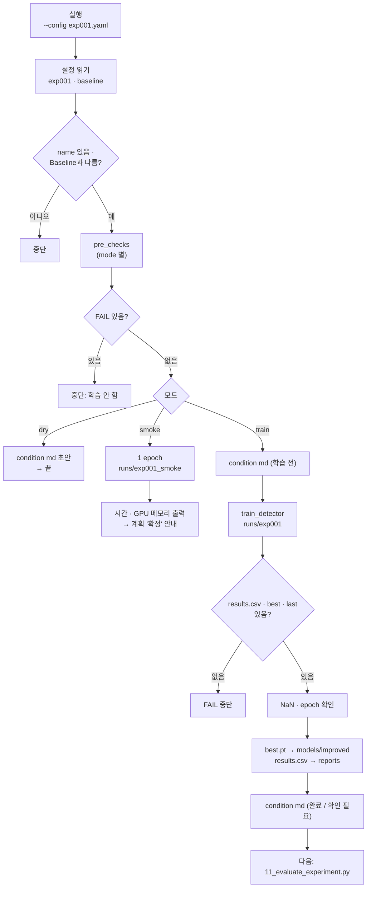

# `scripts/10_train_experiment.py` 코드 리뷰

> 7일차 · 245줄 · 가이드 20장 (20.3 계획 확정 · 산출물 4 Improved Weight)

---

## 1. 한 줄 요약

**Baseline과 학습 설정이 "정확히 하나"만 다른 실험 설정(`exp001.yaml`)인지 검사한 뒤, Baseline과 같은 학습 함수로 Smoke(1 epoch) · Dry-run · 본 학습을 실행하고 best.pt · results.csv · 학습 조건 문서를 남기는 스크립트.**

---

## 2. 입력·출력·실행

| 구분 | 경로 | 내용 | Git |
|---|---|---|---|
| 입력 | `configs/baseline.yaml` · `configs/exp001.yaml` | 학습 설정 — 차이가 정확히 1개여야 함 | O |
| 입력 | `reports/improvement_experiment.md` | 계획 문서 — `**상태: 확정**` + 변수 · 값 (본 학습만) | O |
| 입력 | `configs/dataset.yaml` · `manifests/split_manifest.csv` · `data/yolo` | Baseline과 같은 데이터 (07 검증 PASS) | 일부 |
| 출력 | `runs/exp001/` | Ultralytics 학습 결과 | X |
| 출력 | `models/improved/exp001_best.pt` | best.pt 별도 보관 (산출물 4) | X |
| 출력 | `reports/exp001_training_condition.md` | 바꾼 것 · 학습 전 검사 · 실행 기록 | O |
| 출력 | `reports/exp001_results.csv` | `runs/exp001/results.csv` 사본 | O |

**실행 명령** (prj08 폴더 · venv 켠 뒤 · 순서대로)

```bash
python scripts/10_train_experiment.py --config configs/exp001.yaml --smoke     # ① 1 epoch 시험 (기록 안 남김)
python scripts/10_train_experiment.py --config configs/exp001.yaml --dry-run   # ② 학습 전 검사만
python scripts/10_train_experiment.py --config configs/exp001.yaml             # ③ 본 학습 → 기록
```

| 모드 | 검사 | 학습 | 남는 것 |
|---|---|---|---|
| `--smoke` | 계획 문서 · 덮어쓰기 검사 **제외** | 1 epoch → `runs/exp001_smoke` | 화면 출력만 |
| `--dry-run` | 전부 | 안 함 | condition md 초안 |
| (없음) 본 학습 | 전부 · 미커밋도 FAIL | epochs 전부 → `runs/exp001` | best.pt · results.csv · condition md |

---

## 3. 구조

| 줄 범위 | 부분 | 하는 일 |
|---|---|---|
| 1–25 | docstring | 사용법 · 입력 · 결과 · 원칙 |
| 26–41 | import | 표준 라이브러리 · yaml · `read_manifest` · `train_detector, TRAIN_KEYS` |
| 43–46 | 08 불러오기 | `08_train_baseline.py`를 모듈 `t08`로 로드 (도우미 재사용) |
| 48–55 | 상수 | 경로 7개 · `GPU_GB = 12.0` |
| 58–61 | `changed_keys()` | Baseline과 다른 학습 설정 목록 |
| 64–106 | `pre_checks()` | 학습 전 검사 (환경 · 데이터 · 한 변수 · 계획 문서 · 덮어쓰기 · 커밋) |
| 109–136 | `write_condition_md()` | `exp001_training_condition.md` 작성 |
| 139–144 | `gpu_peak_gb()` | GPU 최대 메모리 (GB) |
| 147–163 | `main()` 준비 | 인자 · 모드 결정 · 설정 읽기 · 이름 확인 |
| 165–177 | `main()` 검사 | 검사 출력 · FAIL 시 중단 · dry-run 종료 |
| 179–202 | `main()` ① Smoke | 1 epoch · OOM 처리 · 시간 · 메모리 출력 |
| 204–224 | `main()` ② 본 학습 | 학습 · 결과 파일 · NaN · epoch 확인 |
| 226–241 | `main()` 보관 · 기록 | best.pt · results.csv 복사 · md 완료 · 다음 안내 |
| 244–245 | 진입점 | `main()` 실행 |



---

## 4. 핵심 코드 읽기

### 4.1 08의 도우미를 그대로 가져오기

```python
_spec = importlib.util.spec_from_file_location("train08", PROJECT_ROOT / "scripts" / "08_train_baseline.py")
t08 = importlib.util.module_from_spec(_spec)
_spec.loader.exec_module(t08)
```

- 파일 이름이 숫자로 시작해서 `import 08_train_baseline`이 안 되므로 `importlib`로 경로를 지정해 불러옵니다.
- `t08.label_fingerprint` · `t08.git` · `t08.environment` · `t08.check_results` · `t08.sha12`를 재사용 → **Baseline과 같은 계산 · 코드 중복 없음**.
- `08`의 `main()`은 `if __name__ == "__main__"` 안에 있어서 불러와도 학습이 돌지 않습니다.

### 4.2 한 변수 원칙 — 다른 설정이 정확히 1개인지

```python
def changed_keys(base: dict, exp: dict) -> list[tuple]:
    keys = [*TRAIN_KEYS, "model"]
    return [(k, base.get(k), exp.get(k)) for k in keys if base.get(k) != exp.get(k)]
...
diff = changed_keys(base, cfg)
add("Baseline 과 다른 학습 설정 = 정확히 1개", "1개",
    " · ".join(f"{k} {a} → {b}" for k, a, b in diff) or "없음 (Baseline 과 같음)", ok=(len(diff) == 1))
```

- 비교 대상은 `train_detector`가 **실제로 Ultralytics에 넘기는 키(`TRAIN_KEYS`) + `model`** 뿐입니다. `name` · `reason` 같은 설명용 키는 달라도 상관없음.
- 0개(Baseline과 같음)도, 2개 이상도 FAIL → 결과 차이를 **그 변수 하나 때문**이라고 말할 수 있게 해 줍니다.

### 4.3 계획 문서가 학습 전에 확정됐는지 (가이드 20.3)

```python
if mode != "smoke":
    plan = PLAN_MD.read_text(encoding="utf-8") if PLAN_MD.exists() else ""
    key, _, new = diff[0] if len(diff) == 1 else ("-", None, "-")
    ok = ("**상태: 확정**" in plan) and (f"`{key}`" in plan) and (str(new) in plan)
```

- 문서에 `**상태: 확정**` + 바꿀 변수 이름(백틱) + 새 값이 모두 있어야 PASS.
- Smoke는 "확정 전에 메모리 · 시간을 보는 단계"라서 이 검사와 덮어쓰기 검사를 건너뜁니다.

### 4.4 미커밋은 본 학습에서만 FAIL

```python
dirty = t08.git("status", "--porcelain", "--", *t08.TRACKED_FOR_REPRO)
add("configs · src · scripts · manifests 커밋됨", "변경 없음", ...,
    ok=not dirty, warn_ok=(mode != "train"))
```

- `warn_ok`가 참이면 실패해도 `WARN` → Smoke · Dry-run은 커밋 전에도 돌려볼 수 있고, **기록이 남는 본 학습만** 커밋된 코드로 하도록 강제합니다.

### 4.5 Smoke — 1 epoch로 시간 · 메모리 판단

```python
s_cfg = {**cfg, "epochs": 1, "patience": 1}
try:
    train_detector(str(PROJECT_ROOT / cfg["model"]), str(DATASET_YAML), s_cfg, RUNS_DIR, name)
except RuntimeError as e:
    if "out of memory" in str(e).lower():
        sys.exit(f"\n[OOM] GPU 메모리 부족 ...")
    raise
sec, gb = time.time() - t0, gpu_peak_gb()
```

- 설정을 복사해 epoch만 1로 바꾸고 `runs/exp001_smoke`에 학습 → 본 학습 폴더 · 모델 · 기록은 건드리지 않습니다.
- OOM이면 "imgsz 960 또는 batch 조정은 회의에서 · batch를 바꾸면 변수 2개"라고 안내.
- `max_memory_reserved`가 12GB − 1GB를 넘으면 ⚠ 경고.
- 이전 Smoke 폴더는 지우기 전에 `assert smoke_dir.resolve().parent == RUNS_DIR.resolve()`로 한 번 더 확인합니다.

> **참고**: `assert`는 `python -O`로 실행하면 꺼집니다. 지우기 안전장치를 확실히 하려면 `if ...: sys.exit(...)` 형태가 더 안전합니다.

### 4.6 본 학습 후 결과 확인과 보관

```python
for p in (results_csv, best, save_dir / "weights" / "last.pt"):
    if not p.exists():
        problems.append(...)
...
if res["rows"] < cfg["epochs"] and cfg["patience"] >= cfg["epochs"]:
    problems.append(f"완료 epoch {res['rows']} < {cfg['epochs']}")
...
shutil.copy2(best, out)
run = {..., "best_sha": t08.sha12(out), **res}
md = write_condition_md(cfg, base, env, checks, "완료" if not problems else "확인 필요", run)
```

- 파일이 없으면 즉시 FAIL. NaN/inf나 epoch 부족은 `problems`에 모아 **기록은 남기되 상태를 "확인 필요"** 로 하고 종료 코드 1.
- epoch 부족은 Early Stopping이 꺼진 경우(`patience >= epochs`)에만 문제로 봅니다.
- 여기서 남긴 `best_sha`를 11이 다시 읽어 "같은 가중치로 평가하는지" 확인합니다.

---

## 5. 연결된 파일

| 파일 | 관계 | 설명 |
|---|---|---|
| `configs/baseline.yaml` | 비교 기준 | Baseline 학습 설정 (차이 계산 대상) |
| `configs/exp001.yaml` | 입력 | 이번 실험 설정 (한 변수만 다름) |
| `reports/improvement_experiment.md` | 입력 | 계획 문서 — 확정돼야 본 학습 |
| `scripts/08_train_baseline.py` | 모듈로 사용 | 라벨 지문 · git · 환경 · results 확인 · sha 도우미 |
| `src/train_detector.py` | 함수 사용 | `train_detector()` · `TRAIN_KEYS` — Baseline과 같은 학습 함수 |
| `src/manifest.py` | 함수 사용 | `read_manifest()` — 스키마 v2 확인 |
| `scripts/07_verify_yolo_dataset.py` | 하위 실행 | data/yolo 검증 (종료 코드 0이어야 PASS) |
| `models/improved/exp001_best.pt` | 출력 | 산출물 4 (Git 제외) |
| `reports/exp001_training_condition.md` | 출력 | 학습 조건 · sha → 11이 읽음 |
| `scripts/11_evaluate_experiment.py` | 뒤 단계 | 같은 Val · 같은 채점 코드로 평가 |
