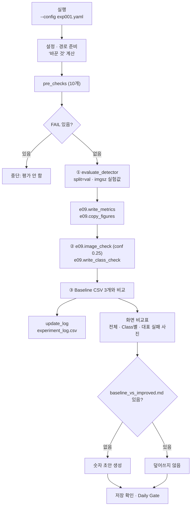

# `scripts/11_evaluate_experiment.py` 코드 리뷰

> 7일차 · 252줄 · 가이드 20.4 · 20.6 · 20.7 (산출물 5 실험 기록 · Baseline vs Improved)

---

## 1. 한 줄 요약

**10에서 학습한 개선 모델을 Baseline을 채점한 09의 함수 그대로 같은 Val 74장에서 평가하고, Baseline과 숫자를 나란히 비교해 `experiment_log.csv`와 `baseline_vs_improved.md` 초안을 만드는 스크립트.**

---

## 2. 입력·출력·실행

| 구분 | 경로 | 내용 | Git |
|---|---|---|---|
| 입력 | `configs/exp001.yaml` · `configs/baseline.yaml` | 실험 · 기준 설정 | O |
| 입력 | `models/improved/exp001_best.pt` | 10이 보관한 Improved Weight | X |
| 입력 | `reports/exp001_training_condition.md` | 학습 상태 · sha · 날짜 | O |
| 입력 | `reports/baseline_metrics.csv` · `baseline_class_check.csv` · `baseline_val_image_check.csv` | 비교 기준 (5일차 09 결과) | O |
| 입력 | `reports/failure_analysis.csv` | 6일차 대표 실패 사진 (있으면 비교) | O |
| 출력 | `reports/exp001_metrics.csv` | Val 전체 + Class별 P · R · mAP | O |
| 출력 | `reports/exp001_class_check.csv` | conf 0.25 Class별 GT · TP · FN · FP | O |
| 출력 | `reports/exp001_val_image_check.csv` | 이미지별 TP · FP · FN · 작은 객체 FN | O |
| 출력 | `reports/figures/exp001_*.png` | 학습곡선 · Confusion Matrix | O |
| 출력 | `reports/experiment_log.csv` | baseline_v1 · exp001 한 줄씩 (decision은 사람) | O |
| 출력 | `reports/baseline_vs_improved.md` | 처음 한 번만 숫자 초안 | O |
| 출력 | `runs/exp001_val/` · `runs/predict/exp001_val_images/` | 평가 원본 | X |

**실행 명령** (prj08 폴더 · 10 학습이 "완료"된 뒤)

```bash
python scripts/11_evaluate_experiment.py --config configs/exp001.yaml
```

---

## 3. 구조

| 줄 범위 | 부분 | 하는 일 |
|---|---|---|
| 1–18 | docstring | 사용법 · 핵심 원칙 · 결과 목록 |
| 19–34 | import | 표준 라이브러리 · yaml · `read_manifest` · `evaluate_detector` · `TRAIN_KEYS` |
| 36–39 | 09 불러오기 | `09_evaluate_baseline.py`를 모듈 `e09`로 로드 (채점 함수 재사용) |
| 41–50 | 상수 | 경로 · `CONF = 0.25` · `LOG_FIELDS` 19칸 |
| 53–55 | `read_csv()` | CSV → dict 목록 |
| 58–64 | `md_info()` | condition md에서 상태 · sha · 학습 날짜 추출 |
| 67–96 | `pre_checks()` | 평가 전 검사 10개 |
| 99–124 | `update_log()` | `experiment_log.csv` 갱신 (decision 칸 보존) |
| 127–131 | `fmt_delta()` | 변화량 `▲0.012 ✓` 형식 |
| 134–155 | `main()` 준비 · 검사 | 설정 · 경로 · "바꾼 것" 계산 · FAIL 시 중단 |
| 157–164 | `main()` ① Val 지표 | `evaluate_detector` · metrics.csv · 그림 복사 |
| 166–170 | `main()` ② conf 0.25 | 이미지별 · Class별 확인 |
| 172–205 | `main()` ③ 비교 | 로그 갱신 · 전체 / Class별 / 대표 실패 사진 비교 출력 |
| 207–232 | `main()` 비교 md | `baseline_vs_improved.md` 초안 (없을 때만) |
| 234–248 | `main()` 마무리 | 저장 확인 · 7일차 Daily Gate 체크리스트 |
| 251–252 | 진입점 | `main()` 실행 |



---

## 4. 핵심 코드 읽기

### 4.1 09의 채점 코드를 그대로 쓰기

```python
_spec = importlib.util.spec_from_file_location("eval09", PROJECT_ROOT / "scripts" / "09_evaluate_baseline.py")
e09 = importlib.util.module_from_spec(_spec)
_spec.loader.exec_module(e09)
```

- `e09.write_metrics` · `e09.copy_figures` · `e09.image_check` · `e09.write_class_check` · `e09.sha12` · `e09.VAL_IMAGES` · `e09.FIG_DIR`를 재사용합니다.
- 채점 방법(conf 0.25 · IoU 0.5 짝짓기 · 작은 객체 기준)이 **두 모델에서 완전히 같다** → 숫자 차이 = 모델 차이.
- 바뀌는 것은 가중치 파일(`best_pt=best`)과 그 모델이 학습한 `imgsz` 뿐.

### 4.2 학습 기록과 가중치를 문서에서 대조

```python
def md_info(md: Path, weight_name: str) -> dict:
    st = re.search(r"\*\*상태\*\*: ([^·\n]+)", text)
    sha = re.search(re.escape(weight_name) + r"` · sha `([0-9a-f]{12})`", text)
    date = re.search(r"학습 시작 · 종료 \| (\d{4}-\d{2}-\d{2})", text)
```

- 10이 쓴 `exp001_training_condition.md`에서 상태 · sha · 날짜를 꺼냅니다.
- `pre_checks`에서 상태가 `완료`이고 지금 파일 sha가 기록과 같아야 PASS → **"확인 필요"로 끝난 학습이나 바뀐 가중치는 평가하지 않음**.
- 같은 함수로 Baseline md에서도 sha · 날짜를 읽어 로그에 씁니다.

### 4.3 "바꾼 것"을 10과 같은 방법으로 계산

```python
changed = " · ".join(f"{k} {base.get(k)} → {cfg.get(k)}" for k in [*TRAIN_KEYS, "model"]
                     if base.get(k) != cfg.get(k)) or "-"
```

- 10의 `changed_keys()`와 같은 규칙(`TRAIN_KEYS + model`)이라, 로그 · 비교 md · 화면에 적히는 변수 설명이 학습 때 검사한 것과 일치합니다.

### 4.4 실험 로그 — 사람이 쓴 decision은 지우지 않기

```python
old = {r["experiment_id"]: r for r in read_csv(LOG_CSV)} if LOG_CSV.exists() else {}
...
"weight_sha": sha, "decision": old.get(eid, {}).get("decision") or default_decision}
...
rows = {**old}
rows[base["name"]] = row(..., "기준")
rows[cfg["name"]] = row(..., "")
```

- 기존 로그를 `experiment_id` 기준 dict로 읽고, baseline_v1과 이번 실험 줄만 새 숫자로 바꿉니다. 다른 실험 줄은 그대로.
- `decision`은 이미 적힌 값이 있으면 보존 → 다시 실행해도 회의 결정이 사라지지 않습니다.
- 가이드 20.4 필드(조건 · 바꾼 변수 · 이유 · Val 지표 · conf 0.25 Recall · FN · 작은 FN · sha)를 한 줄에 담습니다.

### 4.5 변화량 표시 — 낮을수록 좋은 지표 구분

```python
def fmt_delta(a, b, digits=3, lower_better=False):
    d = float(b) - float(a)
    good = (d < 0) if lower_better else (d > 0)
    mark = "▲" if d > 0 else ("▼" if d < 0 else "=")
    return f"{mark}{abs(d):.{digits}f}" + (" ✓" if good and d != 0 else "")
```

- P · R · mAP는 올라가면 ✓, FN · FP · 작은 객체 FN은 `lower_better=True`로 내려가면 ✓.
- 화살표는 방향, ✓는 "좋아졌는지" → 한눈에 개선 / 악화 구분.

### 4.6 대표 실패 사진 추적과 비교 md 초안

```python
seen = list(dict.fromkeys(r["image"].strip() for r in read_csv(fa)))
...
if not COMPARE_MD.exists():
    L = [f"# Baseline vs Improved ({name}) ...", "> **상태**: 초안 ...", ...]
    COMPARE_MD.write_text("\n".join(L), encoding="utf-8")
```

- `dict.fromkeys`로 순서를 지키며 중복 제거 → 6일차에 고른 사진들의 FN · FP가 실험 후 어떻게 바뀌었는지 출력.
- 비교 md는 **파일이 없을 때만** 1 · 2장(조건 · 지표) 숫자를 채우고, 3 · 4장(H1 · H2 · H3 패턴 해석 · Final Model 후보)은 빈칸으로 둡니다 → 사람이 쓴 해석을 덮어쓰지 않음.
- 결론 칸에 "Frozen Test를 보지 않고 결정"을 명시합니다.

> **참고**: `--config` 파일이 없으면 10과 달리 안내 없이 `FileNotFoundError`가 납니다. 10처럼 `if not exists: sys.exit(...)`를 넣으면 메시지가 친절해집니다. 또 `baseline_vs_improved.md`가 이미 있으면 exp002를 돌려도 갱신되지 않으니, 두 번째 실험부터는 파일 이름을 실험별로 나누는 것도 고려해 볼 만합니다.

---

## 5. 연결된 파일

| 파일 | 관계 | 설명 |
|---|---|---|
| `scripts/10_train_experiment.py` | 앞 단계 | `exp001_best.pt` · condition md(상태 · sha) 생성 |
| `scripts/09_evaluate_baseline.py` | 모듈로 사용 | Baseline 채점 함수 전부 재사용 · `VERIFY_SCRIPT` · `FIG_DIR` |
| `src/evaluate_detector.py` | 함수 사용 | `evaluate_detector()` — Ultralytics val |
| `src/train_detector.py` | 상수 사용 | `TRAIN_KEYS` — "바꾼 것" 계산 |
| `src/manifest.py` | 함수 사용 | `read_manifest()` — 스키마 v2 확인 |
| `scripts/07_verify_yolo_dataset.py` | 하위 실행 | data/yolo 검증 |
| `reports/baseline_*.csv` (3개) | 비교 기준 | 5일차 Baseline 결과 |
| `reports/failure_analysis.csv` | 입력 | 6일차 대표 실패 사진 추적 |
| `scripts/09b_failure_images.py` | 같은 사진 | 같은 대표 실패 사진을 Baseline 기준으로 그림 |
| `reports/experiment_log.csv` | 출력 | 산출물 5 (decision은 팀) |
| `reports/baseline_vs_improved.md` | 출력 | 비교 초안 → 팀이 해석 · Final Model 후보 결정 |
