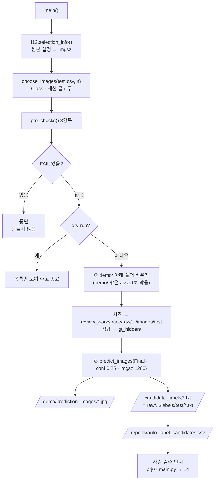

# `scripts/13_auto_label.py` 코드 리뷰

> 8일차 · 215줄 · 가이드 21.3 · 21.4 (Detection · Auto Label 후보) · 산출물 6

## 1. 한 줄 요약

Frozen Test 최종평가(12)가 **끝난 뒤에만** Test 사진 8장(기본)을 골라, Final Model로 ① 박스를 그린 Detection 이미지와 ② YOLO 형식 후보 라벨 TXT를 만들고, ③ 교과 7 라벨링 프로그램이 바로 열 수 있는 검수용 폴더를 준비합니다. Test 정답은 검수자에게 보이지 않도록 따로 보관하고(14가 비교에만 사용), Bridge Holdout 사진은 거부합니다.

## 2. 입력 · 출력 · 실행

| 구분 | 파일 |
|---|---|
| 입력 | `reports/final_model_selection.md` (12의 `selection_info()`로 읽음) · `models/final/final_best.pt` · `reports/final_metrics.csv` (12가 끝났다는 증거) · `configs/exp001.yaml` (imgsz) · `manifests/{train,val,test,bridge_holdout}.csv` · `data/yolo/{images,labels}/test` |
| 출력 (Git 제외 · NDA) | `demo/prediction_images/*.jpg` (시연 1) · `demo/auto_label/candidate_labels/*.txt` · `demo/auto_label/review_workspace/` (시연 2 · 교과 7 프로그램이 여는 폴더) · `demo/auto_label/gt_hidden/*.txt` (정답 · 비공개) |
| 출력 (Git) | `reports/auto_label_candidates.csv` (사진별 후보 BBox 수 · Class · 숨긴 정답 수) |

| 옵션 | 기본값 | 쓰이는 곳 |
|---|:--:|---|
| `--n` | 8 | 사진 장수 (1~10 · 가이드 권장 5~10) |
| `--dry-run` | 끔 | 검사 + 고른 사진 목록만 (아무것도 만들지 않음) |
| `--force-new` | 끔 | 이미 사람 검수를 시작한 폴더를 지우고 새로 만들기 (팀 확인 후에만) |

```bash
python scripts/13_auto_label.py --dry-run     # ① 검사 + 어떤 사진을 쓸지만
python scripts/13_auto_label.py               # ② Test 8장 → Detection · 후보 TXT · 검수 폴더
```

`review_workspace/` 안의 폴더 구조는 교과 7 프로그램이 기대하는 모양 그대로입니다.

| 폴더 | 내용 | 교과 7 프로그램에서 |
|---|---|---|
| `raw/auto_label/images/test/` | 검수할 사진 (복사본) | 작업 목록 |
| `raw/auto_label/labels/test/` | = 후보 TXT | "원본 라벨"로 불러옴 |
| `work/labels/` · `final/labels/` | (사람이 저장하면 생김) | 작업자 저장 · QA PASS |

## 3. 구조

| 줄 | 내용 |
|--:|---|
| 1~24 | 설명 문서(docstring): 사용법 · 가이드와 번호가 다른 이유 · 왜 Test 사진인가(21.3) · 결과 |
| 25~32 | `import` (`pathlib` · `datetime` · `argparse` · `csv` · `importlib.util` · `re` · `shutil` · `sys`) |
| 34~40 | `PROJECT_ROOT` · `import yaml` · `from src.manifest import read_manifest` · `from src.evaluate_detector import predict_images` |
| 43~50 | `_load()` → `f12` (12를 모듈로 불러 선택 문서 읽기 · sha · Final 경로를 같은 규칙으로) |
| 52~65 | 경로 · 상수: `demo/` 아래 폴더 5개 · `CAND_CSV` · `CONF = 0.25` · `N_DEFAULT = 8` · `CLASS_IDS` |
| 68~75 | `read_yolo()` (YOLO TXT → 박스 목록 · 파일 없으면 빈 목록) |
| 78~92 | `choose_images()`: Class · 촬영 세션이 골고루 섞이게 사진 고르기 |
| 95~124 | `pre_checks()`: 준비 검사 8항목 |
| 127~158 | `main()` 준비: 옵션 → 사진 고르기 → 검사 → 목록 출력 → FAIL이면 중단 · dry-run이면 종료 |
| 160~169 | ① `demo/` 폴더 비우고 다시 만들기 · 사진 복사 · 정답 따로 보관 |
| 171~187 | ② Final Model 예측 → Detection 이미지 · 후보 TXT 두 곳에 쓰기 |
| 189~211 | `auto_label_candidates.csv` 저장 · 저장 목록 · 사람 검수 안내 |
| 214~215 | `if __name__ == "__main__": main()` |

### 흐름 그림



이 스크립트는 **사람 검수 직전까지만** 합니다. 검수는 교과 7 프로그램에서 사람이 하고, 집계는 14가 합니다.

## 4. 핵심 코드 읽기

### 4.1 12를 모듈로 불러 같은 규칙 쓰기

```python
def _load(name: str, file: str):
    spec = importlib.util.spec_from_file_location(name, PROJECT_ROOT / "scripts" / file)
    ...
f12 = _load("final12", "12_evaluate_final_test.py")     # 선택 문서 읽기 · sha · Final 경로 (같은 규칙)
```

- `f12.selection_info()` · `f12.FINAL_PT` · `f12.TEST_IMAGES` · `f12.METRICS_CSV` · `f12.e09.sha12()`를 그대로 씁니다.
- "Final Model이 무엇인가"를 12와 **같은 코드로 읽기 때문에**, 12가 평가한 가중치와 다른 가중치로 Auto Label을 만들 수 없습니다.
- 12의 `main()`은 `if __name__ == "__main__"` 안에 있어서 불러와도 Test 평가가 다시 돌지 않습니다.

### 4.2 Test 사진은 최종평가 "뒤에만"

```python
add("Frozen Test 평가 끝남 (가이드 21.3 · Test 사진은 그 뒤에만)", "final_metrics.csv 있음",
    "final_metrics.csv 있음" if f12.METRICS_CSV.exists() else "없음 → 12 먼저", ok=f12.METRICS_CSV.exists())
...
bad = [c for c in chosen if split_of.get(c) != "test"]
add(f"고른 사진 {len(chosen)}장 = 전부 Frozen Test (Bridge · Train · Val 아님)", "전부 test", ...)
```

- 새 사진이 없을 때 가이드 21.3이 허용하는 방법(최종평가를 **모두 끝낸 뒤** Test 사진으로 흐름만 시연)을 코드 조건으로 옮겼습니다. 12의 1회 잠금 파일이 곧 "끝났다"는 신호입니다.
- 네 개의 manifest를 모두 읽어 사진마다 역할을 찾고, 하나라도 `test`가 아니면 FAIL → Bridge Holdout은 여기서 막힙니다.

### 4.3 사진 고르기 — 같은 입력이면 늘 같은 목록

```python
best = min((k for k in info if k not in chosen),
           key=lambda k: (-len(info[k][0] - covered), info[k][2] in groups, -len(info[k][0]), info[k][1], k))
```

한 장씩 고를 때 정렬 기준을 순서대로 비교합니다.

| 순서 | 기준 | 뜻 |
|:-:|---|---|
| ① | `-len(Class - covered)` | 아직 안 나온 Class를 많이 가진 사진 먼저 |
| ② | `세션 in groups` | 아직 안 쓴 촬영 세션 먼저 (`False`가 `True`보다 작음) |
| ③ | `-len(Class)` | Class 종류가 많은 사진 먼저 |
| ④ | 박스 수 | 박스가 적은 사진 먼저 (검수 시간이 짧게) |
| ⑤ | 파일명 | 동점이면 이름순 → **무작위가 없어 누가 돌려도 같은 8장** |

### 4.4 검수 기록 덮어쓰기 방지

```python
started = any((WS / s / "labels").glob("*.txt") for s in ("work", "final")) if WS.exists() else False
add("사람 검수 아직 시작 전 (덮어쓰기 방지)", "시작 전", ..., ok=(not started) or force_new)
...
for d in (WS, CAND_DIR, GT_DIR, DEMO / PRED_DIR_NAME):
    if d.exists():
        assert d.resolve().is_relative_to(DEMO.resolve())             # demo/ 밖은 절대 지우지 않음
        shutil.rmtree(d)
```

- 교과 7 프로그램이 `work/` · `final/`에 저장한 라벨이 하나라도 있으면 FAIL → 사람이 고친 결과를 실수로 날리지 않습니다. 정말 새로 만들 때만 `--force-new`.
- 지우기 전에 대상이 `demo/` 안인지 한 번 더 확인합니다.

> **참고**: `assert`는 `python -O`로 실행하면 꺼집니다(10 리뷰와 같은 이야기). 지우기 안전장치는 `if not ...: sys.exit(...)` 형태가 더 확실합니다.

### 4.5 후보 TXT — 확신도 없이 두 곳에

```python
lines = [f"{p[0]} {p[2]:.6f} {p[3]:.6f} {p[4]:.6f} {p[5]:.6f}" for p in preds]   # 확신도는 저장하지 않음
(CAND_DIR / f"{stem}.txt").write_text(text, encoding="utf-8")
(WS_LABELS / f"{stem}.txt").write_text(text, encoding="utf-8")   # 교과 7 프로그램이 '원본 라벨'로 불러올 파일
```

- `predict_images()`가 주는 예측은 `(class, conf, x, y, w, h)`인데, 라벨 파일에는 `conf`를 빼고 `class x y w h`만 씁니다 (`save_conf=False`와 같음) → 교과 7 프로그램이 **정답 라벨과 같은 형식**으로 읽습니다.
- `candidate_labels/`는 "AI가 처음 낸 그대로"의 보존본이고, `raw/.../labels/test/`는 프로그램이 불러갈 사본입니다. 사람이 고치면 `work/`에 따로 저장되므로 후보 원본은 그대로 남아 14가 비교할 수 있습니다.

### 4.6 정답은 숨겨서 따로

```python
shutil.copy2(f12.TEST_LABELS / (Path(c).stem + ".txt"), GT_DIR / (Path(c).stem + ".txt"))   # 정답은 따로
...
print("  ※ gt_hidden/ 의 정답은 검수 중에 열지 않습니다 (사람 검수를 정답에 맞추지 않기 위해).")
```

검수자가 정답을 보면 "AI 후보 → 사람 검수" 효과를 잴 수 없습니다. 정답은 검수 폴더 밖(`gt_hidden/`)에 두고 14에서 **참고 비교**로만 씁니다.

## 5. 연결된 파일

| 관계 | 파일 |
|---|---|
| 앞 단계 (반드시 먼저) | `scripts/12_evaluate_final_test.py` → `reports/final_metrics.csv` |
| 모듈로 불러 씀 | `scripts/12_evaluate_final_test.py` (`selection_info` · Final 경로 · sha) |
| 불러 쓰는 기능 | `src/evaluate_detector.py` (`predict_images`) · `src/manifest.py` (`read_manifest`) |
| Final Model 기준 | `reports/final_model_selection.md` · `configs/exp001.yaml` (imgsz 1280) |
| 사람 검수 도구 | `prj07/main.py` (교과 7 라벨링 프로그램 v4.1) → `review_workspace/work` · `final` |
| 뒤 단계 | `scripts/14_auto_label_review.py` (후보 vs 검수 집계) |
