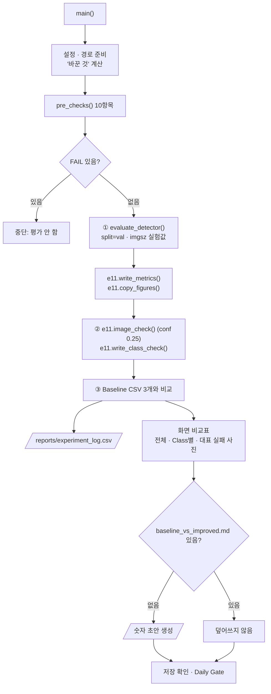

# `scripts/15_evaluate_experiment.py` 코드 리뷰

> 7일차 · 252줄 · 가이드 20.4 · 20.6 · 20.7 Daily Gate · 산출물 5 (실험 기록 · Baseline vs Improved)

## 1. 한 줄 요약

14에서 학습한 개선 모델을 **Baseline을 채점한 11의 함수 그대로** 같은 Val 74장에서 평가하고, Baseline과 숫자를 나란히 비교해 `reports/experiment_log.csv`를 갱신합니다. `reports/baseline_vs_improved.md`는 없을 때만 숫자 초안을 만들고, 해석 · 결정 칸은 팀이 씁니다. 바뀌는 것은 가중치 파일과 그 모델이 학습한 `imgsz`뿐이고, Test는 쓰지 않습니다.

## 2. 입력 · 출력 · 실행

| 구분 | 파일 |
|---|---|
| 입력 | `configs/exp001.yaml` · `configs/baseline.yaml` · `models/improved/exp001_best.pt` · `reports/exp001_training_condition.md` (상태 · sha · 날짜) · `configs/dataset.yaml` · `data/yolo/{images,labels}/val` |
| 비교 기준 입력 | `reports/baseline_metrics.csv` · `baseline_class_check.csv` · `baseline_val_image_check.csv` (5일차 11) · `reports/baseline_training_condition.md` · `reports/failure_analysis.csv` (있으면) |
| 출력 (Git) | `reports/exp001_metrics.csv` · `exp001_class_check.csv` · `exp001_val_image_check.csv` · `reports/figures/exp001_*.png` · `reports/experiment_log.csv` · `reports/baseline_vs_improved.md` (없을 때만 초안) |
| 출력 (Git 제외) | `runs/exp001_val/` · `runs/predict/exp001_val_images/` |

```bash
python scripts/15_evaluate_experiment.py --config configs/exp001.yaml     # 14 학습이 "완료"된 뒤
```

결과 (2026-10-15 · Val 74장): mAP50 0.622 → **0.756** · mAP50-95 0.462 → **0.641** · Recall(conf 0.25) 0.591 → **0.846** · FN 159 → 60 · FP 92 → 41 · 작은 객체 FN 153 → 57.

## 3. 구조

| 줄 | 내용 |
|--:|---|
| 1~18 | 설명 문서(docstring): 사용법 · 핵심 원칙 · 결과 목록 |
| 19~29 | `import` (`pathlib` · `argparse` · `csv` · `importlib.util` · `re` · `subprocess` · `sys`) · `PROJECT_ROOT` 경로 설정 |
| 31~34 | `import yaml` · `from src.manifest import read_manifest` · `from src.evaluate_detector import evaluate_detector` · `from src.train_detector import TRAIN_KEYS` |
| 36~39 | `11_evaluate_baseline.py`를 모듈 `e11`로 불러옴 (채점 함수 재사용) |
| 41~50 | 경로 · `CONF = 0.25` · `LOG_FIELDS` (실험 로그 19칸) |
| 53~64 | `read_csv()` · `md_info()` (조건 문서에서 상태 · sha · 학습 날짜 추출) |
| 67~96 | `pre_checks()`: 평가 전 검사 10항목 |
| 99~124 | `update_log()`: `experiment_log.csv` 갱신 (사람이 쓴 decision 보존) |
| 127~131 | `fmt_delta()`: 변화량 `▲0.134 ✓` 형식 |
| 134~155 | `main()` 준비: 설정 · 경로 · "바꾼 것" 계산 · 검사 · FAIL이면 중단 |
| 157~164 | ① Val 지표 (`evaluate_detector` · `e11.write_metrics` · `e11.copy_figures`) |
| 166~170 | ② conf 0.25 이미지별 · Class별 (`e11.image_check` · `e11.write_class_check`) |
| 172~205 | ③ Baseline 비교: 로그 갱신 · 전체 / Class별 / 6일차 대표 실패 사진 출력 |
| 207~232 | `baseline_vs_improved.md` 숫자 초안 (없을 때만) |
| 234~248 | 저장 확인 · 7일차 Daily Gate 체크리스트 |
| 251~252 | `if __name__ == "__main__": main()` |

### 흐름 그림



①②는 11과 **같은 함수**를 부르므로, Baseline과 exp001의 숫자 차이는 채점 방법이 아니라 모델 차이입니다.

## 4. 핵심 코드 읽기

### 4.1 11의 채점 코드를 그대로 쓰기

```python
_spec = importlib.util.spec_from_file_location("eval11", PROJECT_ROOT / "scripts" / "11_evaluate_baseline.py")
e11 = importlib.util.module_from_spec(_spec)
_spec.loader.exec_module(e11)
```

- `e11.write_metrics` · `e11.copy_figures` · `e11.image_check` · `e11.write_class_check` · `e11.sha12` · `e11.VAL_IMAGES` · `e11.FIG_DIR` · `e11.VERIFY_SCRIPT`를 재사용합니다.
- 채점 방법(conf 0.25 · IoU 0.5 짝짓기 · 작은 객체 640 기준 32px)이 **두 모델에서 완전히 같습니다**.
- 바뀌는 것은 가중치(`best_pt=best`)와 그 모델이 학습한 `imgsz`(1280)뿐입니다.

### 4.2 학습 기록과 가중치를 문서에서 대조

```python
def md_info(md: Path, weight_name: str) -> dict:
    st = re.search(r"\*\*상태\*\*: ([^·\n]+)", text)
    sha = re.search(re.escape(weight_name) + r"` · sha `([0-9a-f]{16})`", text)
    date = re.search(r"학습 시작 · 종료 \| (\d{4}-\d{2}-\d{2})", text)
```

- 14가 쓴 `exp001_training_condition.md`에서 상태 · sha · 날짜를 꺼냅니다.
- `pre_checks()`에서 상태가 `완료`이고 지금 파일 sha가 기록과 같아야 PASS → **"확인 필요"로 끝난 학습이나 바뀐 가중치는 평가하지 않습니다**.
- 같은 함수로 Baseline 조건 문서에서도 sha · 날짜를 읽어 로그에 씁니다.

### 4.3 "바꾼 것"을 14와 같은 방법으로 계산

```python
changed = " · ".join(f"{k} {base.get(k)} → {cfg.get(k)}" for k in [*TRAIN_KEYS, "model"]
                     if base.get(k) != cfg.get(k)) or "-"
```

14의 `changed_keys()`와 같은 규칙(`TRAIN_KEYS + model`)이라, 로그 · 비교 문서 · 화면에 적히는 변수 설명(`imgsz 640 → 1280`)이 학습 때 검사한 것과 일치합니다.

### 4.4 실험 로그 — 사람이 쓴 decision은 지우지 않기

```python
old = {r["experiment_id"]: r for r in read_csv(LOG_CSV)} if LOG_CSV.exists() else {}
...
"weight_sha": sha, "decision": old.get(eid, {}).get("decision") or default_decision}
...
rows = {**old}
rows[base["name"]] = row(..., "기준")
rows[cfg["name"]] = row(..., "")
```

- 기존 로그를 `experiment_id` 기준 dict로 읽고, baseline_v1과 이번 실험 줄만 새 숫자로 바꿉니다. 다른 실험 줄은 그대로 둡니다.
- `decision`은 이미 적힌 값이 있으면 보존 → 다시 실행해도 회의 결정이 사라지지 않습니다.
- 가이드 20.4 필드(조건 · 바꾼 변수 · 이유 · Val 지표 · conf 0.25 Recall · FN · 작은 객체 FN · sha)를 한 줄에 담습니다.

### 4.5 변화량 표시 — 낮을수록 좋은 지표 구분

```python
def fmt_delta(a, b, digits=3, lower_better=False):
    d = float(b) - float(a)
    good = (d < 0) if lower_better else (d > 0)
    mark = "▲" if d > 0 else ("▼" if d < 0 else "=")
    return f"{mark}{abs(d):.{digits}f}" + (" ✓" if good and d != 0 else "")
```

P · R · mAP는 올라가면 ✓, FN · FP · 작은 객체 FN은 `lower_better=True`로 내려가면 ✓입니다. 화살표는 방향, ✓는 "좋아졌는지"를 따로 보여 줍니다.

### 4.6 대표 실패 사진 추적과 비교 문서 초안

```python
seen = list(dict.fromkeys(r["image"].strip() for r in read_csv(fa)))
...
if not COMPARE_MD.exists():
    L = [f"# Baseline vs Improved ({name}) ...", "> **상태**: 초안 ...", ...]
    COMPARE_MD.write_text("\n".join(L), encoding="utf-8")
```

- `dict.fromkeys`로 순서를 지키며 중복을 없애고, 6일차에 고른 사진들의 FN · FP가 실험 후 어떻게 바뀌었는지 출력합니다.
- 비교 문서는 **파일이 없을 때만** 1 · 2장(조건 · 지표) 숫자를 채우고, 3 · 4장(H1 · H2 · H3 해석 · Final Model 후보)은 빈칸으로 둡니다 → 사람이 쓴 해석을 덮어쓰지 않습니다.

> **참고**: `--config` 파일이 없으면 14와 달리 안내 없이 `FileNotFoundError`가 납니다. 14처럼 `if not exists: sys.exit(...)`를 넣으면 메시지가 친절해집니다. 또 `baseline_vs_improved.md`가 이미 있으면 exp002를 돌려도 갱신되지 않으니, 두 번째 실험부터는 파일 이름을 실험별로 나누는 것도 고려해 볼 만합니다.

## 5. 연결된 파일

| 관계 | 파일 |
|---|---|
| 앞 단계 | `scripts/14_train_experiment.py` → `exp001_best.pt` · `exp001_training_condition.md` |
| 모듈로 불러 씀 | `scripts/11_evaluate_baseline.py` (채점 함수 · `VERIFY_SCRIPT` · `FIG_DIR`) |
| 불러 쓰는 기능 | `src/evaluate_detector.py` (`evaluate_detector`) · `src/train_detector.py` (`TRAIN_KEYS`) · `src/manifest.py` (`read_manifest`) |
| 하위 실행 | `scripts/09_verify_yolo_dataset.py` (종료 코드 0) |
| 비교 기준 | `reports/baseline_*.csv` 3개 (5일차) · `reports/failure_analysis.csv` (6일차 대표 사진) |
| 결과를 쓰는 곳 | `experiment_log.csv` (산출물 5) · `baseline_vs_improved.md` → `reports/final_model_selection.md` → `16_evaluate_final_test.py` |
