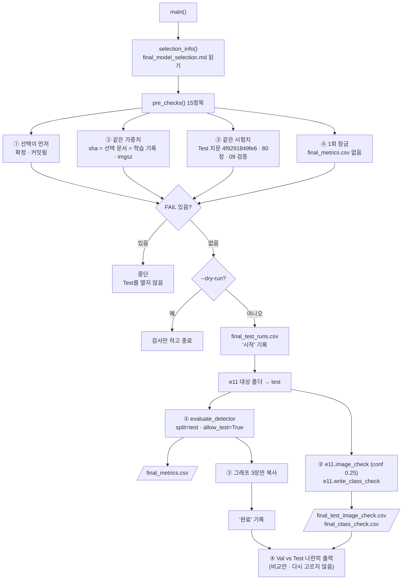

# `scripts/16_evaluate_final_test.py` 코드 리뷰

> 8일차 · 285줄 · 가이드 21.1 · 21.2 · 21.A (Frozen Test 최종평가 1회) · 21.6 Daily Gate · 산출물 5

## 1. 한 줄 요약

Validation으로 고른 Final Model(`models/final/final_best.pt`)을 **봉인해 둔 Frozen Test 80장에서 딱 한 번** 평가합니다. 평가 전에 "선택 문서가 먼저 커밋됐는지 · Final Weight가 고른 그 가중치인지 · 시험지가 3일차에 봉인한 그 Test인지"를 15항목으로 확인하고, 채점은 11의 함수를 그대로 써서 Val 숫자와 나란히 비교합니다. `reports/final_metrics.csv`가 이미 있으면 두 번째 실행을 거부합니다.

## 2. 입력 · 출력 · 실행

| 구분 | 파일 |
|---|---|
| 입력 | `reports/final_model_selection.md` (**상태: 확정** · Final sha · 원본 Weight · 원본 설정 · 커밋돼 있어야 함) · `models/final/final_best.pt` · `reports/<원본>_training_condition.md` (sha) · `configs/exp001.yaml` (imgsz) · `configs/dataset.yaml` · `manifests/split_manifest.csv` · `manifests/test.csv` · `data/yolo/{images,labels}/test` |
| 비교용 입력 | `reports/exp001_metrics.csv` · `reports/exp001_class_check.csv` (같은 모델의 Val 결과) |
| 출력 (Git) | `reports/final_metrics.csv` · `final_class_check.csv` · `final_test_image_check.csv` · `final_test_runs.csv` (1회 증거) · `reports/figures/final_test_confusion_matrix(_normalized).png` · `final_test_pr_curve.png` |
| 출력 (Git 제외 · NDA) | `runs/final_test/` · `runs/predict/final_test_images/` (회사 사진이 들어간 그림) |

| 옵션 | 기본값 | 쓰이는 곳 |
|---|:--:|---|
| `--dry-run` | 끔 | 평가 전 검사만 (Test를 열지 않음 · 미커밋은 WARN) |
| `--rerun-reason "이유"` | 빈 값 | 기술적 오류(전원 · OOM 등)로 결과를 못 남겼을 때만 · `issue_log`에 적고 팀 확인 후 |

```bash
python scripts/16_evaluate_final_test.py --dry-run     # ① 평가 전 검사만 (몇 초)
python scripts/16_evaluate_final_test.py               # ② Frozen Test 1회 평가 → 기록 (exp001 · imgsz 1280)
```

결과 (2026-10-15 · 0.2분): Frozen Test **mAP50 0.606 · mAP50-95 0.478** (Val 0.756 · 0.641) · conf 0.25 기준 Recall 0.660 · FN 151 · FP 168 (정답 477개).

## 3. 구조

| 줄 | 내용 |
|--:|---|
| 1~36 | 설명 문서(docstring): 사용법 · 가이드와 번호가 다른 이유 · 순서(21.A) · 입력 · 결과 · 원칙 |
| 37~45 | `import` (`pathlib` · `datetime` · `argparse` · `csv` · `importlib.util` · `re` · `shutil` · `subprocess` · `sys`) |
| 47~53 | `PROJECT_ROOT` · `import yaml` · `from src.manifest import read_manifest, fingerprint` · `from src.evaluate_detector import evaluate_detector` |
| 56~64 | `_load()` → `e11`(채점 함수) · `t10`(git · sha 도우미)를 모듈로 불러옴 |
| 66~81 | 경로 · 상수: `SELECTION_MD` · `FINAL_PT` · `TEST_IMAGES` · `TEST_LABELS` · 결과 CSV 4개 · `FROZEN_TEST_FP` · `CONF` · `RUN_NAME` |
| 84~93 | `selection_info()`: 선택 문서에서 상태 · Final sha · 원본 Weight · 원본 설정 읽기 |
| 96~150 | `pre_checks()`: 평가 전 검사 15항목 (① 선택 먼저 · ② 같은 가중치 · ③ 같은 시험지 · ④ 1회 잠금) |
| 153~171 | `log_run()` (실행 기록 한 줄 추가) · `rewrite()` · `read_csv()` |
| 174~195 | `main()` 준비: 옵션 → 선택 문서 · 원본 설정 읽기 → 검사 → FAIL이면 중단 · dry-run이면 종료 |
| 197~206 | 시작 기록 · 11 모듈의 대상 폴더를 test로 바꾸기 |
| 208~218 | ① 전체 · Class별 지표 (`evaluate_detector(..., allow_test=True)`) → `final_metrics.csv` |
| 220~229 | ② conf 0.25 이미지별 · Class별 (`e11.image_check` · `e11.write_class_check`) |
| 231~246 | ③ 그래프 3장만 복사 · 완료 기록 |
| 248~281 | ④ 같은 모델의 Val과 나란히 출력 · 저장 목록 · 8일차 Daily Gate |
| 284~285 | `if __name__ == "__main__": main()` |

### 흐름 그림



검사 ①~④는 순서가 의미입니다. **고르고(①) → 고른 것인지 확인하고(②) → 봉인된 시험지인지 확인하고(③) → 처음 보는 것인지 확인(④)** 한 뒤에만 Test를 엽니다.

## 4. 핵심 코드 읽기

### 4.1 선택 문서가 "Test 전에" 커밋됐는지

```python
rel = str(SELECTION_MD.relative_to(PROJECT_ROOT))
committed = bool(t10.git("log", "-1", "--format=%h", "--", rel)) and not t10.git("status", "--porcelain", "--", rel)
add("선택 문서가 커밋됨 (Test 전에 결정한 기록)", "커밋됨", "커밋됨" if committed else "미커밋 또는 수정됨", ok=committed)
```

- `git log`에 기록이 있고(한 번은 커밋됨) `git status`에 변경이 없어야(커밋 뒤 고치지 않음) PASS입니다.
- 가이드 21.A의 "Validation으로 선택 → 그다음 Frozen Test" 순서를 **말이 아니라 Git 기록으로 증명**합니다. 커밋 시각이 Test 평가 시각(`final_test_runs.csv`)보다 앞서게 됩니다.

### 4.2 같은 가중치인지 — sha 세 곳 대조

```python
sha = e11.sha12(FINAL_PT) if FINAL_PT.exists() else "-"
add("Final sha = 선택 문서", info["final_sha"], sha)
cond = REPORTS / f"{info['source']}_training_condition.md"
m = re.search(re.escape(f"{info['source']}_best.pt") + r"` · sha `([0-9a-f]{16})`", ...)
add(f"Final sha = {info['source']} 학습 기록", m.group(1) if m else "기록 없음", sha)
```

- `models/final/final_best.pt` = 선택 문서에 적은 sha = 14가 학습 직후 남긴 `exp001_training_condition.md`의 sha. 세 곳이 모두 `029c0e92e594`여야 합니다.
- 파일을 `improved/`에서 `final/`로 복사하는 동안 다른 파일이 섞여도 여기서 멈춥니다.
- `imgsz`도 원본 설정(`configs/exp001.yaml` → 1280)에서 읽습니다. 640으로 평가하면 작은 이물이 다시 작아져 실제보다 낮게 나오기 때문입니다.

### 4.3 시험지가 3일차에 봉인한 그 Frozen Test인지

```python
FROZEN_TEST_FP = "4f9291849fe6"                      # split_policy.md 8장
...
test_names = [r["file_name"] for r in manifest if r["split"] == "test"]
add("Frozen Test 지문 (3일차 봉인)", FROZEN_TEST_FP, fingerprint(test_names))
add("Test 이미지 수 = manifest", len(test_names), n_img)
```

- `src/manifest.py`의 `fingerprint()`로 Test 파일 목록의 지문을 다시 계산해 05에서 봉인한 값과 비교합니다.
- 이어서 09를 별도 프로세스로 실행해(종료 코드 0) `data/yolo/test`가 manifest와 바이트까지 같은지 확인합니다.

### 4.4 1회 잠금과 실행 기록

```python
done = METRICS_CSV.exists()
add("Frozen Test 1회 잠금 (final_metrics.csv 없음)", "없음", ...,
    ok=(not done) or bool(rerun_reason))
...
log_run({"time": ..., "event": "시작", "weight_sha": sha, "source": info["source"], "imgsz": imgsz,
         "code": code, "reason": args.rerun_reason or "최초 1회"})
```

- 결과 파일이 있으면 FAIL → 같은 Test를 보며 반복 튜닝하는 것을 코드로 막습니다.
- 예외는 `--rerun-reason`뿐이고, 그 이유가 `final_test_runs.csv`에 그대로 남습니다.
- `log_run()`은 덮어쓰지 않고 **추가(a 모드)** 합니다. 처음 만들 때만 `utf-8-sig`(엑셀용 BOM)로 제목 줄을 쓰고, 이후에는 BOM 없이 이어 씁니다. "시작 · 완료" 두 줄이 **몇 번 열었는지의 증거**입니다.

### 4.5 11의 채점 함수를 test에 그대로 쓰기

```python
# 11 의 채점 함수를 그대로 쓰되, 대상 폴더 · split 표시만 test 로 바꾼다 (채점 규칙은 그대로)
e11.SPLIT, e11.VAL_IMAGES, e11.VAL_LABELS = "test", TEST_IMAGES, TEST_LABELS
...
metrics, test_dir = evaluate_detector(str(FINAL_PT), str(DATASET_YAML), "test", imgsz, batch,
                                      RUNS_DIR, RUN_NAME, allow_test=True)
```

- 11은 `val` 전용이라 폴더 상수가 Val로 고정돼 있습니다. 여기서는 **불러온 모듈의 상수만 test로 바꿔서** conf 0.25 · IoU 0.5 · 작은 객체 기준 · 짝짓기 코드를 한 줄도 다시 쓰지 않습니다.
- `evaluate_detector()`는 기본으로 `val`만 허용하고, `test`는 `allow_test=True`를 명시해야 열립니다. 이 스크립트가 프로젝트에서 **유일하게** 그 문을 여는 곳입니다.
- 11의 `image_check()`는 `val.csv`에서 `scene_type` · `capture_group`을 채우므로, 여기서 `test.csv`로 다시 채워 `rewrite()`합니다.

> **참고**: 모듈 상수를 바꾸는 방식은 이 프로세스 안에서만 효과가 있어 09 파일 자체는 바뀌지 않습니다. 다만 11 쪽 함수가 상수를 "호출할 때" 읽는다는 전제에 기대므로, 11을 고칠 때 이 전제를 깨지 않도록 11 리뷰에도 한 줄 남겨 두면 안전합니다.

### 4.6 그래프만 복사 — 회사 사진은 Git에 올리지 않음

```python
for src, dst in [("confusion_matrix.png", "final_test_confusion_matrix.png"),
                 ("confusion_matrix_normalized.png", "final_test_confusion_matrix_normalized.png"),
                 ("BoxPR_curve.png", "final_test_pr_curve.png")]:
```

`runs/final_test/`에는 박스를 그린 Test 사진(`val_batch*` 등)도 생기지만, 숫자 그래프 3장만 `reports/figures/`로 옮깁니다.

### 4.7 Val과 나란히 — 비교만, 다시 고르지 않음

```python
v_all = next((r for r in read_csv(REPORTS / f"{info['source']}_metrics.csv") if r["class_id"] == "all"), {})
...
print("\n다음: 숫자를 README 14장에 옮겨 적고 커밋 · 낮게 나온 Class 가 있으면 '한계'로 기록 (다시 학습하지 않음)")
```

같은 모델(exp001)의 Val 74장 결과와 Test 80장 결과를 한 표로 보여 줍니다. Test가 낮게 나와도(mAP50 0.756 → 0.606) Final Model을 바꾸지 않고 **한계로 기록**하는 것이 규칙입니다.

## 5. 연결된 파일

| 관계 | 파일 |
|---|---|
| 선택 근거 (먼저 커밋) | `reports/final_model_selection.md` ← `reports/baseline_vs_improved.md` · `reports/experiment_log.csv` |
| 평가 대상 | `models/final/final_best.pt` (= `models/improved/exp001_best.pt` · 14가 학습) |
| 모듈로 불러 씀 | `scripts/11_evaluate_baseline.py` (채점 함수) · `scripts/10_train_baseline.py` (git · sha) |
| 불러 쓰는 기능 | `src/evaluate_detector.py` (`evaluate_detector` · `allow_test`) · `src/manifest.py` (`read_manifest` · `fingerprint`) |
| 하위 실행 | `scripts/09_verify_yolo_dataset.py` (종료 코드 0) |
| 봉인 기준 | `docs/split_policy.md` 8장 (Test 지문 `4f9291849fe6`) |
| 결과를 쓰는 곳 | `final_metrics.csv` → `17_auto_label.py` (이 파일이 있어야 Test 사진을 쓸 수 있음) · README 14장 · 교과 14 Handoff |
