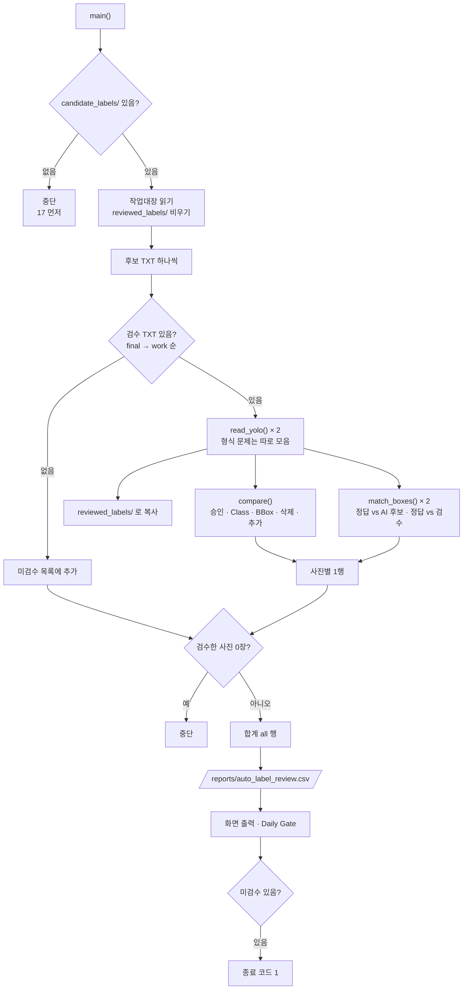

# `scripts/18_auto_label_review.py` 코드 리뷰

> 8일차 · 172줄 · 가이드 21.5 (Human Review 결과 집계) · 산출물 6

## 1. 한 줄 요약

17이 만든 **AI 후보 라벨**과 교과 7 라벨링 프로그램에서 **사람이 검수해 저장한 라벨**을 사진마다 박스 1:1로 짝지어, 후보 박스가 "그대로 승인 · Class 수정 · BBox 수정 · 삭제"됐는지, 사람이 "누락 추가"한 박스는 몇 개인지 셉니다. 검수 라벨은 가이드 21.5 경로(`reviewed_labels/`)로 모으고, 숨겨 둔 정답과 비교해 "AI 후보만" vs "사람 검수 후"가 정답을 얼마나 맞히는지도 참고로 보여 줍니다.

## 2. 입력 · 출력 · 실행

| 구분 | 파일 |
|---|---|
| 입력 (Git 제외) | `demo/auto_label/candidate_labels/*.txt` (17 · AI 후보) · `demo/auto_label/review_workspace/{final,work}/labels/*.txt` (사람 검수 · final 우선) · `review_workspace/manifests/dataset_manifest.csv` (교과 7 작업대장 · status · worker · review_reason) · `demo/auto_label/gt_hidden/*.txt` (정답 · 참고만) |
| 출력 (Git 제외) | `demo/auto_label/reviewed_labels/*.txt` (사람이 검수 · 승인한 라벨) |
| 출력 (Git) | `reports/auto_label_review.csv` (사진별 1행 + 합계 `all` 행 · 숫자만) |

```bash
python scripts/18_auto_label_review.py      # 교과 7 프로그램으로 검수를 끝낸 뒤 · 옵션 없음
```

후보 박스 하나를 이렇게 분류합니다 (짝짓기는 Class와 상관없이 IoU 큰 순 · 1:1).

| 분류 | 조건 | 사람이 한 일 |
|---|---|---|
| 승인 `approved` | 같은 Class · IoU ≥ 0.95 | 그대로 둠 |
| Class 수정 `class_changed` | IoU ≥ 0.5 · Class가 바뀜 | Class만 (또는 위치도) 고침 |
| BBox 수정 `bbox_changed` | 같은 Class · 0.5 ≤ IoU < 0.95 | 박스 위치 · 크기 고침 |
| 삭제 `deleted` | 짝 없음 (후보 쪽) | 오검출을 지움 |
| 누락 추가 `added` | 짝 없음 (검수 쪽) | AI가 놓친 이물을 새로 그림 |

결과 (2026-10-15 · 8장 · 후보 43개): 승인 31 · Class 수정 2 · BBox 수정 3 · 삭제 7 · 누락 추가 7 · REVIEW 0장 → 검수 후 43개. 참고로 정답 46개 중 AI 후보만 33개 일치 → 사람 검수 후 36개.

## 3. 구조

| 줄 | 내용 |
|--:|---|
| 1~24 | 설명 문서(docstring): 사용법 · 입력 · 결과 · 분류 기준 |
| 25~32 | `import` (`pathlib` · `csv` · `shutil` · `sys`) · `PROJECT_ROOT` 경로 설정 |
| 34 | `from src.evaluate_detector import iou_xywh, match_boxes` |
| 36~44 | 경로 · 기준값: `demo/auto_label/` 아래 폴더 · `OUT_CSV` · `APPROVE_IOU = 0.95` · `MATCH_IOU = 0.5` · `VALID_CLASSES` |
| 47~62 | `read_yolo()`: TXT 읽기 + 형식 · Class · 좌표 범위 검사 (문제 줄은 목록으로 따로) |
| 65~86 | `compare()`: 후보 ↔ 검수 1:1 짝짓기 → 5가지로 세기 |
| 89~93 | `read_manifest_rows()`: 교과 7 작업대장 읽기 (없으면 빈 dict) |
| 96~105 | `main()` 준비: 후보 폴더 확인 · 작업대장 읽기 · `reviewed_labels/` 비우기 |
| 107~130 | 사진마다: 검수 파일 찾기(final → work) → 복사 → `compare()` → 정답과 참고 비교 → 1행 |
| 132~143 | 검수 0장이면 중단 · 합계 `all` 행 · CSV 저장 |
| 145~168 | 화면 출력 (비율 · 참고 비교 · TXT 문제) · 8일차 Daily Gate · 미검수 있으면 종료 코드 1 |
| 171~172 | `if __name__ == "__main__": main()` |

### 흐름 그림



## 4. 핵심 코드 읽기

### 4.1 후보 ↔ 검수 짝짓기 — Class와 상관없이 IoU 큰 순

```python
pairs = sorted(((iou_xywh(c[1:], r[1:]), i, j) for i, c in enumerate(cands) for j, r in enumerate(reviewed)),
               reverse=True)
for v, i, j in pairs:
    if v < MATCH_IOU:
        break
    if i in used_c or j in used_r:
        continue
    used_c.add(i)
    used_r.add(j)
    if cands[i][0] != reviewed[j][0]:
        out["class_changed"] += 1
    elif v >= APPROVE_IOU:
        out["approved"] += 1
    else:
        out["bbox_changed"] += 1
out["deleted"] = len(cands) - len(used_c)
out["added"] = len(reviewed) - len(used_r)
```

- 모든 (후보, 검수) 조합의 IoU를 구해 큰 순으로 정렬하고, 이미 짝지은 박스는 건너뜁니다 → **욕심쟁이(greedy) 1:1 짝짓기**.
- 정답 비교용 `match_boxes()`와 달리 **Class를 보지 않고** 짝짓습니다. 같은 자리에서 Class만 바뀐 박스를 "삭제 1 + 추가 1"이 아니라 "Class 수정 1"로 세기 위해서입니다.
- 짝 없는 후보 = 사람이 지운 것, 짝 없는 검수 박스 = 사람이 새로 그린 것.

### 4.2 승인 기준이 IoU 1.0이 아니라 0.95인 이유

```python
APPROVE_IOU, MATCH_IOU = 0.95, 0.5
```

후보 TXT는 소수점 6자리로 저장되고, 교과 7 프로그램이 불러와 다시 저장하면서 좌표가 아주 조금 달라질 수 있습니다. 손대지 않은 박스가 "BBox 수정"으로 잘못 세지지 않도록 0.95 이상이면 그대로 승인으로 봅니다.

### 4.3 검수 파일 찾기 — QA PASS(final)가 있으면 우선

```python
src = next((p for p in (WS / "final" / "labels" / f"{stem}.txt", WS / "work" / "labels" / f"{stem}.txt") if p.exists()), None)
meta = next((r for k, r in book.items() if Path(k).stem == stem), {})
if src is None:
    not_reviewed.append(stem)
    continue
```

- 교과 7 흐름(작업자 저장 → `work/` · 검수자 QA PASS → `final/`)을 그대로 따릅니다. 어느 쪽에서 왔는지는 `saved_from` 칸에 남습니다.
- 작업대장의 `file_name`은 `.jpg`라서 확장자를 뺀 `stem`으로 맞춥니다.
- 검수 안 한 사진은 건너뛰고 목록에 모았다가 마지막에 **종료 코드 1**로 알려 줍니다 → Gate의 "Human Review"를 ☐로 표시.

### 4.4 사람이 저장한 TXT도 검사

```python
if len(p) != 5 or c not in VALID_CLASSES or not all(0 <= v <= 1 for v in xywh):
    errors.append(f"{path.name}:{i} 형식 · Class · 좌표 범위")
    continue
```

- 칸 수 5개 · Class가 `{0, 1, 2, 3, 5, 6}`(4 고무장갑 제외) · 좌표 0~1인지 확인합니다. 문제 줄은 집계에서 빼고 화면에 `⚠ TXT 형식 문제`로 보여 줍니다.
- 17의 `read_yolo()`는 AI가 만든 파일만 읽어서 검사가 없지만, 여기는 **사람 손을 거친 파일**이라 2일차 Audit과 같은 기준으로 다시 봅니다.

> **참고**: `c, *xywh = int(p[0]), *map(float, p[1:])`는 칸 수를 보기 전에 숫자 변환을 먼저 해서, 칸이 4개처럼 모자라도 숫자만 맞으면 다음 줄의 `len(p) != 5`에서 걸립니다. 동작은 맞지만 칸 수 검사를 먼저 하면 오류 메시지가 더 정확해집니다.

### 4.5 정답과 참고 비교 — AI만 vs 사람 검수 후

```python
m_ai = match_boxes(gt, [(c[0], 1.0, *c[1:]) for c in cands], MATCH_IOU)
m_hu = match_boxes(gt, [(c[0], 1.0, *c[1:]) for c in reviewed], MATCH_IOU)
```

- `match_boxes()`는 예측 형식 `(class, conf, x, y, w, h)`를 받으므로, 라벨에 없는 확신도 자리에 `1.0`을 넣어 모양을 맞춥니다.
- 11과 **같은 짝짓기**(같은 Class · IoU 0.5)라서 `ai_tp`는 conf 0.25 Test 결과와 같은 방식의 숫자입니다. "사람 검수가 정답에 얼마나 더 가까워졌나"(33 → 36 / 46)를 보여 주지만, 검수 중에는 정답을 보지 않았으므로 **참고값**입니다.

### 4.6 합계 행 · 비율

```python
tot = {k: sum(r[k] for r in rows) for k in keys}
rows.append({"image": "all", "reviewer": "-", "status": f"REVIEW {n_review}", ..., **tot})
pct = (lambda a: f"{a / c * 100:.0f}%" if c else "-")
```

CSV 마지막 줄 `all`에 모든 숫자의 합을 넣어, 다른 문서(README 15장 · 발표)에서 한 줄만 보면 되게 합니다. 비율은 **AI 후보 수를 분모**로 계산합니다 (승인 31 / 43 = 72%).

## 5. 연결된 파일

| 관계 | 파일 |
|---|---|
| 앞 단계 | `scripts/17_auto_label.py` → `candidate_labels/` · `review_workspace/` · `gt_hidden/` |
| 사람 검수 도구 | `prj07/main.py` (교과 7 라벨링 프로그램) → `review_workspace/work` · `final` · `manifests/dataset_manifest.csv` |
| 불러 쓰는 기능 | `src/evaluate_detector.py` (`iou_xywh` · `match_boxes`) |
| 결과를 쓰는 곳 | `reports/auto_label_review.csv` → README 15장 · 발표 · 교과 14 Handoff |
| 검수 라벨 보관 | `demo/auto_label/reviewed_labels/` (Git 제외 · 가이드 21.5 경로) |
