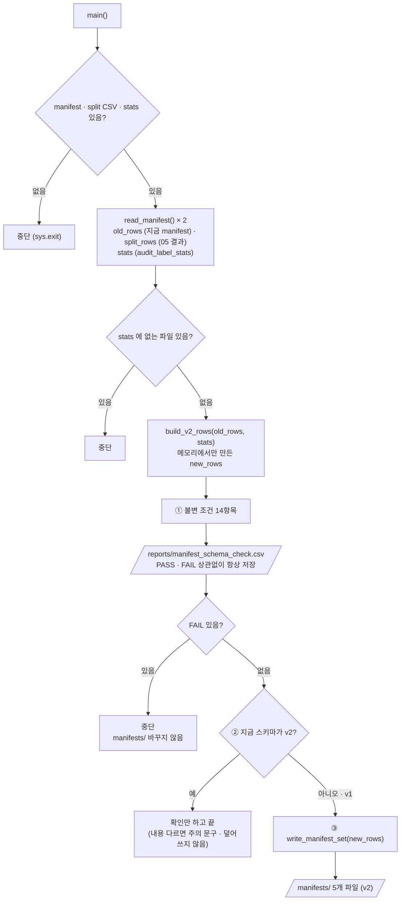

# `scripts/archive/upgrade_manifest_schema_v1_to_v2.py` 코드 리뷰

> 3일차 · 117줄 · 가이드 16.1 · split_policy.md 8장 · audit_expected.md v2

## 1. 한 줄 요약

10/13에 v1(3칸)으로 얼려 둔 `manifests/`를 가이드 16.1의 **v2 스키마로 올립니다.** 칸만 추가하고 이름만 맞출 뿐 **900장의 역할 배정은 한 장도 바꾸지 않습니다.** 새 manifest를 메모리에서 먼저 만들어 **불변 조건 14개를 검사하고, 모두 PASS일 때만** 파일을 씁니다. 이미 v2이면 다시 쓰지 않고 확인만 합니다.

## 2. 입력 · 출력 · 실행

| 구분 | 파일 |
|---|---|
| 입력 | `manifests/split_manifest.csv` (지금 manifest) · `splits/kimchi_v1_split.csv` (05 결과 · 비교용) · `reports/audit_label_stats.csv` (새 칸을 채울 값) |
| 출력 (항상) | `reports/manifest_schema_check.csv` (item · expected · actual · result) |
| 출력 (v1이고 전부 PASS일 때만) | `manifests/split_manifest.csv` · `train.csv` · `val.csv` · `test.csv` · `bridge_holdout.csv` (v2) |

```bash
python scripts/archive/upgrade_manifest_schema_v1_to_v2.py   # prj08 폴더에서 실행 · 옵션 없음
```

## 3. 구조

| 줄 | 내용 |
|--:|---|
| 21~23 | `import` (`pathlib` · `csv` · `sys`) |
| 25~27 | `PROJECT_ROOT` 경로 설정 |
| 29~30 | `from src.manifest import MANIFEST_FIELDS · SPLITS · DATASET_VERSION · read_manifest · assignment · build_v2_rows · write_manifest_set · fingerprint` |
| 32~35 | 경로: `MANIFEST_DIR` · `SPLIT_CSV` · `STATS_CSV` · `CHECK_CSV` |
| 38~41 | 기준값: `EXPECTED_COUNTS` · `FROZEN_TEST_FP` · `TOTAL` · `SCENE_TOTALS` |
| 44~113 | `main()`: 입력 읽기 → 새 manifest 만들기 → ① 불변 조건 검사 → ② 이미 v2? → ③ v1 → v2 쓰기 |

### 흐름 그림



검사에 쓰는 숫자는 `split_policy.md` 8장과 `audit_expected.md` v2에서 옮겨 적은 값이라, **실행 결과가 아니라 문서가 기준**입니다.

## 4. 핵심 코드 읽기

### 4.1 입력 세 가지를 읽고, 짝이 안 맞으면 멈춘다

```python
old_rows, schema = read_manifest(full_path)
split_rows, _ = read_manifest(SPLIT_CSV)
with open(STATS_CSV, encoding="utf-8-sig", newline="") as f:
    stats = {r["file_name"]: r for r in csv.DictReader(f)}

missing_stats = [r["file_name"] for r in old_rows if r["file_name"] not in stats]
if missing_stats:
    sys.exit(f"[중단] audit_label_stats 에 없는 파일 {len(missing_stats)}개 (예: {missing_stats[:2]})")
```

- 같은 `read_manifest()`로 **지금 manifest**와 **05 결과 split CSV**를 모두 읽습니다. 둘 다 `split` 키를 가진 같은 모양으로 오기 때문에 뒤에서 그대로 비교할 수 있습니다.
- `schema`는 지금 manifest가 v1인지 v2인지 알려 줍니다. ②에서 쓰입니다. 칸 구성을 알 수 없으면 `read_manifest()`가 `ValueError`를 내고, upgrade_manifest_schema_v1_to_v2는 이를 따로 잡지 않아 오류 메시지와 함께 종료됩니다.
- `stats`에 없는 파일이 있으면 새 칸(`source_dataset` · `original_split` · `scene_type`)을 채울 수 없으므로 **만들기 전에** 멈춥니다.

### 4.2 새 manifest는 메모리에서 먼저 만든다

```python
new_rows = build_v2_rows(old_rows, stats)            # 행 순서 · 배정 그대로, 칸만 채움
```

- 파일을 쓰기 전에 `new_rows`를 완성해서 검사합니다. 검사에 실패해도 **디스크의 manifests/는 그대로**입니다.
- 행 순서와 배정은 `old_rows` 그대로이고, 칸만 채웁니다. 06이 처음 Freeze 할 때 쓰는 함수(`build_v2_rows`)와 같은 것이라, 새로 얼리든 업그레이드하든 같은 v2가 나옵니다.
- `build_v2_rows()`는 `image_path` · `label_path`를 `data/subject7_final/images|labels/<이름>` 규칙으로 만들고, `source_dataset` · `original_split` · `scene_type`은 `stats`에서, `dataset_version`은 `DATASET_VERSION`으로 채웁니다. 그래서 4.4의 `path_matches_file_name`은 이 규칙이 지켜졌는지 확인하는 검사이기도 합니다.

### 4.3 불변 조건 14항목

```python
add("rows", TOTAL, len(new_rows))
add("assignment_same_as_old_manifest", "yes", "yes" if assignment(new_rows) == assignment(old_rows) else "no")
add("assignment_same_as_split_csv", "yes", "yes" if assignment(new_rows) == assignment(split_rows) else "no")
add("unknown_split_value", 0, sum(r["split"] not in SPLITS for r in new_rows))
```

| 번호 | 항목 | 내용 | 개수 |
|:--:|---|---|:--:|
| 1 | `rows` | 900행 | 1 |
| 2 | `assignment_same_as_old_manifest` · `assignment_same_as_split_csv` | 배정이 지금 manifest · 05 결과와 같음 | 2 |
| 3 | `unknown_split_value` | 모르는 `split` 값 0 | 1 |
| 4 | `count_train` · `count_val` · `count_test` · `count_bridge_holdout` | 역할별 장수 600 / 74 / 80 / 146 | 4 |
| 5 | `test_fingerprint` | Frozen Test 지문 `4f9291849fe6` | 1 |
| 6 | `group_in_multiple_splits` | 한 세션이 두 역할에 걸친 개수 0 | 1 |
| 7 | `scene_kimchi_with_target` · `scene_object_only` | 장면별 750 / 150 | 2 |
| 8 | `dataset_version` | `kimchi_v1` (`DATASET_VERSION`) | 1 |
| 9 | `path_matches_file_name` | `image_path` · `label_path`가 `file_name`과 맞지 않는 행 0 | 1 |

- 06의 검사와 달리 **역할 이름이 처음부터 `bridge_holdout`**입니다(`EXPECTED_COUNTS` 키). 입력이 모두 `read_manifest()`를 거친 `split` 키 기준이기 때문입니다.
- 이 스크립트에서 중요한 것은 2번입니다. `assignment()`가 "누가 어느 역할인가"만 뽑아 주므로, 칸을 늘리는 과정에서 배정이 바뀌지 않았음을 **두 가지 기준(지금 manifest · 05 결과)** 으로 확인합니다.
- `fingerprint()`는 이 파일 안에 정의하지 않고 `src/manifest.py`에서 가져옵니다. 05 · 06 · 08 · 09에서 같은 계산을 각자 적어 두던 것과 다른 점입니다.

### 4.4 경로가 파일 이름과 맞는지

```python
add("path_matches_file_name", 0,
    sum(not (r["image_path"].endswith("/" + r["file_name"])
             and Path(r["label_path"]).stem == Path(r["file_name"]).stem) for r in new_rows))
```

- v2에서 새로 생긴 `image_path` · `label_path` 칸이 **실제 `file_name`과 맞는지**만 확인합니다.
- 이미지 경로는 `/파일이름`으로 끝나야 하고, 라벨 경로는 확장자를 뺀 이름이 같아야 합니다. 맞지 않는 행의 개수가 0이어야 PASS입니다.
- 파일이 디스크에 있는지는 보지 않습니다. 그 확인은 06(⑤)과 09의 몫입니다.

### 4.5 검사 결과는 항상 저장하고, FAIL이면 멈춘다

```python
CHECK_CSV.parent.mkdir(exist_ok=True)
with open(CHECK_CSV, "w", encoding="utf-8-sig", newline="") as f:
    writer = csv.DictWriter(f, fieldnames=["item", "expected", "actual", "result"], lineterminator="\n")
    ...                                             # PASS/FAIL 상관없이 항상 저장
if n_fail:
    sys.exit("\n[중단] FAIL 이 있어 manifests/ 를 바꾸지 않았습니다.")
```

- 06의 `freeze_check.csv`와 같은 방식입니다. **먼저 저장하고**, 그 뒤에 멈춰서 원인을 추적할 수 있게 합니다.
- 이 단계까지는 `manifests/`에 손대지 않았습니다.

### 4.6 이미 v2이면 다시 쓰지 않는다

```python
if schema == "v2":
    same = [{k: r[k] for k in MANIFEST_FIELDS} for r in old_rows] == new_rows
    print("\n이미 v2 입니다. " + ("내용도 같아서 아무것도 다시 쓰지 않았습니다." if same
                                else "[주의] 내용이 다릅니다 → 팀 확인 전에는 덮어쓰지 않습니다."))
    return
```

- v2에서는 **어떤 경우에도 쓰지 않습니다.** 내용이 같으면 확인만 하고, 다르면 주의 문구만 출력하고 끝납니다.
- 이 비교는 `MANIFEST_FIELDS`에 있는 칸만 뽑아 `new_rows`와 견줍니다. 그래서 한 번 업그레이드한 manifest에서 upgrade_manifest_schema_v1_to_v2를 여러 번 돌려도 안전합니다.
- 06의 ⑥과 같은 원칙(얼린 것은 다시 쓰지 않는다)이지만, 06은 **배정**만 비교하고 upgrade_manifest_schema_v1_to_v2는 **칸 내용까지** 비교합니다.

### 4.7 v1 → v2 쓰기

```python
write_manifest_set(MANIFEST_DIR, new_rows)
print("\n=== manifests/ v1 → v2 완료 (배정 변경 0) ===")
for name in ["split_manifest.csv", "train.csv", "val.csv", "test.csv", "bridge_holdout.csv"]:
    rows, sch = read_manifest(MANIFEST_DIR / name)
    print(f"  manifests/{name:<22} {len(rows):>4}행 · {sch}")
```

- 쓰기 자체는 `write_manifest_set()`가 합니다. 06의 ⑦과 **같은 함수**라서, `split_manifest.csv`와 역할별 파일 4개를 `MANIFEST_FIELDS` 순서 · `utf-8-sig` · `lineterminator="\n"`으로, 입력 순서 그대로 씁니다.
- 쓰고 나서 5개 파일을 `read_manifest()`로 다시 읽어 **행 수와 스키마**를 출력합니다. 눈으로 `v2`가 찍혔는지 확인하는 단계입니다.
- 06은 `SPLIT_FILES.values()`로 파일 이름을 가져오지만, upgrade_manifest_schema_v1_to_v2는 5개 이름을 직접 적어 둡니다.

## 5. 연결된 파일

| 관계 | 파일 |
|---|---|
| 입력 (지금 manifest) | `manifests/split_manifest.csv` (06이 v1으로 Freeze) |
| 입력 (04단계 결과) | `splits/kimchi_v1_split.csv` |
| 입력 (2일차 Audit 결과) | `reports/audit_label_stats.csv` |
| manifest 읽기 · 쓰기 | `src/manifest.py` (`read_manifest()` · `assignment()` · `build_v2_rows()` · `write_manifest_set()` · `fingerprint()` · `MANIFEST_FIELDS` · `SPLITS` · `DATASET_VERSION`) |
| 같은 함수를 쓰는 곳 | `06_freeze_split.py` (v2로 처음 Freeze) |
| 기준값 출처 | `split_policy.md` 8장 · `audit_expected.md` v2 3장 · 가이드 16.1 |
| 결과를 쓰는 곳 | `manifests/split_manifest.csv` · `train.csv` · `val.csv` · `test.csv` · `bridge_holdout.csv` · `reports/manifest_schema_check.csv` |
| 결과를 읽는 곳 | `07_dataset_summary.py` · `08_build_yolo_dataset.py` · `09_verify_yolo_dataset.py` · `10` · `11` |
