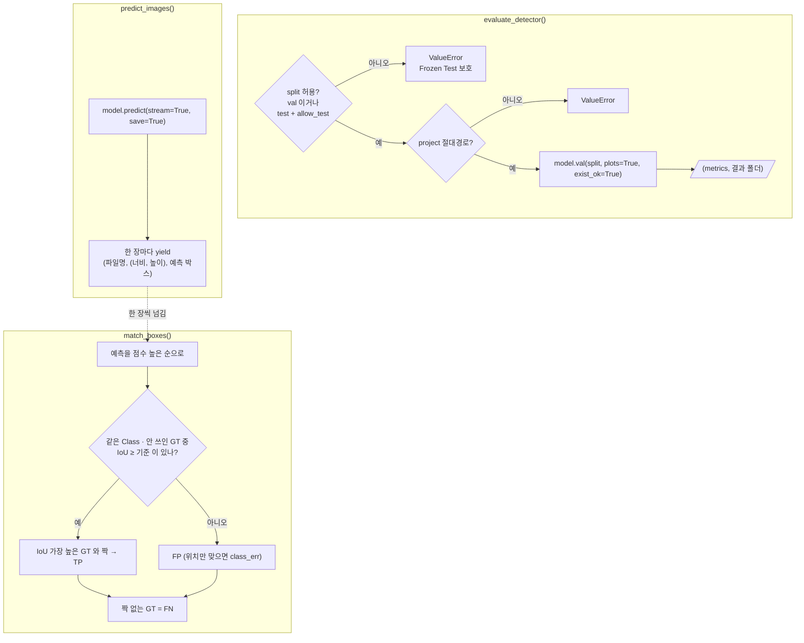

# `src/evaluate_detector.py` 코드 리뷰

> 5일차 · 94줄 · 가이드 18.1 · 21.2

## 1. 한 줄 요약

YOLO **평가 · 예측 공통 기능** 3개(+ 보조 함수 1개)를 모아 둔 파일입니다. Validation 지표와 Confusion Matrix를 만들고(`evaluate_detector`), 이미지 폴더를 한 장씩 예측하고(`predict_images`), 한 장의 정답과 예측을 짝지어 TP · FP · FN을 셉니다(`match_boxes`). 5일차 Baseline 평가와 7일차 Improved 평가가 **같은 함수**를 쓰므로 두 모델의 차이는 넘겨 준 가중치 하나뿐이어야 합니다. 여기서는 **계산만** 하고 검사 · 파일 정리 · 기록은 `scripts/`가 맡습니다. **Frozen Test는 기본으로 막혀 있습니다.**

## 2. 입력 · 출력 · 실행

이 파일은 직접 실행하지 않고, `scripts/`가 가져다 씁니다.

| 함수 | 입력 | 돌려주는 값 |
|---|---|---|
| `evaluate_detector()` | 가중치 · 데이터 yaml · `split` · `imgsz` · `batch` · `project` · `name` | `(metrics, 결과 폴더 Path)` |
| `predict_images()` | 가중치 · 이미지 폴더 · `conf` · `imgsz` · `project` · `name` | 한 장씩 `(파일명, (너비, 높이), [예측 박스])` |
| `iou_xywh()` | 박스 2개 (중심 · 크기, 0~1) | IoU (0~1) |
| `match_boxes()` | 한 장의 정답(GT) · 예측 · IoU 기준(기본 0.5) | `tp` · `fp` · `fn` · `class_err` · `fn_idx` · `fp_cls` |

```python
from src.evaluate_detector import evaluate_detector, predict_images, match_boxes                  # 11
metrics, val_dir = evaluate_detector(str(BEST_PT), str(DATASET_YAML), SPLIT, imgsz, batch, RUNS_DIR, VAL_RUN_NAME)
```

## 3. 구조

| 줄 | 내용 |
|--:|---|
| 12 | `import` (`pathlib`) |
| 14~15 | `ALLOWED_SPLITS = ("val",)` |
| 18~33 | `evaluate_detector()`: split · 경로 검사 → `model.val()` → `(metrics, 폴더)` |
| 36~51 | `predict_images()`: 경로 검사 → `model.predict()` → 한 장씩 `yield` |
| 54~61 | `iou_xywh()` (박스 두 개의 IoU) |
| 64~94 | `match_boxes()` (정답 · 예측 짝짓기) |

### 흐름 그림



`evaluate_detector()`의 지표와 `predict_images()` + `match_boxes()`의 TP · FP · FN은 **서로 다른 계산**입니다. 앞은 Ultralytics가 평가 기본 설정으로 계산하고, 뒤는 이 파일의 단순 짝짓기입니다.

## 4. 핵심 코드 읽기

### 4.1 Frozen Test 보호 — 허용 목록 + 명시적 열쇠

```python
# Frozen Test 는 Final Model 을 고른 뒤 8일차에 한 번만 (가이드 21.2)
ALLOWED_SPLITS = ("val",)

if split not in ALLOWED_SPLITS and not (split == "test" and allow_test):
    raise ValueError(f"평가 split 은 val 만 허용합니다 (Frozen Test 보호): {split}")
```

- 기본은 `val`만 통과합니다. `test`는 **`allow_test=True`를 직접 적어 넘겨야** 열리고, 8일차 Frozen Test 평가에서만 쓰도록 만든 열쇠입니다.
- 조건이 `split == "test" and allow_test`라서 `allow_test=True`를 줘도 **`test` 외의 split(`bridge_holdout` 등)은 여전히 막힙니다.**
- 11은 `allow_test`를 넘기지 않고 `SPLIT = "val"`로 고정합니다. 즉 11 안의 확인(검사 7번)과 이 함수의 거부, **두 겹**이 Frozen Test를 지킵니다.
- 이 검사는 split **이름**만 봅니다. `data_yaml` 안에 test 경로가 적혀 있는지는 보지 않으므로, yaml 점검은 10 · 11의 검사(`dataset.yaml`에 Bridge 없음)가 맡습니다.

### 4.2 `model.val()` — 지표와 그림을 한꺼번에

```python
from ultralytics import YOLO                      # 검사를 통과한 뒤에만 import (검사 · 테스트 때는 불필요)

model = YOLO(model_path)
metrics = model.val(data=data_yaml, split=split, imgsz=imgsz, batch=batch, plots=True,
                    project=str(project), name=name, exist_ok=True)   # 평가는 다시 해도 같은 결과 → 덮어쓰기 허용
return metrics, Path(metrics.save_dir)
```

- 두 검사(split · 절대경로)를 **통과한 뒤에** `ultralytics`를 불러옵니다. 검사에서 막히면 무거운 import를 하지 않습니다.
- `plots=True`라서 Confusion Matrix 같은 그림이 결과 폴더에 만들어집니다. 11의 `copy_figures()`가 여기서 그래프만 `reports/figures/`로 복사합니다.
- `exist_ok=True`는 학습(`train_detector`)의 `exist_ok=False`와 반대입니다. 평가는 다시 돌려도 **같은 결과**이므로 같은 폴더(`runs/baseline_v1_val/`)에 덮어써도 문제가 없다는 판단이 주석에 적혀 있습니다.
- 돌려주는 `metrics`는 Ultralytics의 결과 객체입니다. 11은 여기서 `box.mean_results()` · `class_result()` · `ap_class_index` · `nt_per_class` · `nt_per_image` · `names`를 꺼내 `baseline_metrics.csv`를 만듭니다.
- 폴더는 `Path(metrics.save_dir)`로 **실제 저장 위치**를 돌려줍니다. 학습 함수와 같은 방식입니다.

### 4.3 `predict_images()` — 한 장씩 돌려주는 제너레이터

```python
for r in model.predict(source=str(source), conf=conf, imgsz=imgsz, save=True, stream=True, verbose=False,
                       project=str(project), name=name, exist_ok=True):
    h, w = r.orig_shape
    boxes = [(int(c), float(s), *map(float, b))
             for c, s, b in zip(r.boxes.cls.tolist(), r.boxes.conf.tolist(), r.boxes.xywhn.tolist())]
    yield Path(r.path).name, (w, h), boxes
```

- `yield`가 있어서 이 함수는 **제너레이터**입니다. 이미지를 전부 메모리에 올리지 않고 한 장 예측할 때마다 한 장분을 돌려주며(`stream=True`), 박스를 그린 이미지는 `save=True`로 `project/name`에 저장됩니다.
- 한 장분 결과는 `(파일명, (너비, 높이), [(cls, conf, x, y, w, h), ...])`입니다. 좌표는 `xywhn`이라 **이미지 크기에 대한 0~1 비율**이고, `r.orig_shape`는 `(높이, 너비)` 순서인데 `(w, h)`로 뒤집어 돌려줍니다.
- `zip`으로 Class · 점수 · 박스를 같은 위치끼리 묶어 `(Class, conf, x, y, w, h)` 튜플로 만듭니다. `*map(float, b)`는 박스 4개 값을 펼쳐 넣는 문법입니다.
- 제너레이터는 **처음 한 장을 꺼낼 때** 본문이 실행됩니다. 그래서 절대경로 검사(`ValueError`)도 함수를 부르는 순간이 아니라 `for`가 시작될 때 터집니다. 11은 `image_check()`의 반복문에서 바로 꺼내므로 영향이 없습니다.
- 예측 이미지에는 회사 이미지가 들어가므로 `project`는 Git에서 제외한 폴더(`runs/predict/`)여야 합니다.

### 4.4 `iou_xywh()` — 0~1 좌표로 계산해도 IoU는 같다

```python
ax1, ay1, ax2, ay2 = a[0] - a[2] / 2, a[1] - a[3] / 2, a[0] + a[2] / 2, a[1] + a[3] / 2
...
iw, ih = max(0.0, min(ax2, bx2) - max(ax1, bx1)), max(0.0, min(ay2, by2) - max(ay1, by1))
inter = iw * ih
union = a[2] * a[3] + b[2] * b[3] - inter
return inter / union if union > 0 else 0.0
```

- 중심 `(x, y)`와 크기 `(w, h)`를 **좌상단 · 우하단 좌표**로 바꾸고, 겹치는 가로 · 세로 길이(`iw` · `ih`)를 곱해 겹친 넓이를 구합니다. IoU는 `겹친 넓이 / 합친 넓이`입니다.
- `max(0.0, ...)`는 **겹치지 않는 박스**의 음수 길이를 0으로 바꿔 넓이가 0이 되게 합니다.
- docstring대로 가로 · 세로를 **따로 늘려도 IoU는 같으므로** 원본 픽셀로 바꾸지 않고 0~1 좌표로 그대로 계산합니다. 4K 이미지를 다룰 때도 계산이 간단합니다.
- `union > 0` 확인은 크기가 0인 박스가 들어와도 0으로 나누지 않게 하는 방어입니다.

### 4.5 `match_boxes()` — 점수 높은 예측부터 짝짓기

```python
used, tp, class_err, fp_cls = set(), 0, 0, []
for p in sorted(preds, key=lambda p: -p[1]):
    best_i, best_iou = None, iou_thr
    for i, g in enumerate(gts):
        if i in used or g[0] != p[0]:
            continue
        v = iou_xywh(g[1:], p[2:])
        if v >= best_iou:
            best_i, best_iou = i, v
    if best_i is not None:
        used.add(best_i)
        tp += 1
        continue
    fp_cls.append(p[0])
    if any(iou_xywh(g[1:], p[2:]) >= iou_thr for i, g in enumerate(gts) if i not in used and g[0] != p[0]):
        class_err += 1
fn_idx = [i for i in range(len(gts)) if i not in used]
return {"tp": tp, "fp": len(fp_cls), "fn": len(fn_idx), "class_err": class_err, "fn_idx": fn_idx, "fp_cls": fp_cls}
```

- 입력은 `gts = [(cls, x, y, w, h), ...]`와 `preds = [(cls, conf, x, y, w, h), ...]`입니다. 그래서 박스 부분은 `g[1:]`와 `p[2:]`로 잘라 `iou_xywh()`에 넘깁니다.
- **점수(conf)가 높은 예측부터** 처리합니다(`sorted(..., key=lambda p: -p[1])`). 각 예측은 **같은 Class이면서 아직 안 쓰인 정답** 중 IoU가 기준(기본 0.5) 이상이고 **가장 높은 것** 하나와 짝이 되며, 한 정답은 한 번만 쓰입니다(`used`).
- 짝이 생기면 TP이고, 짝이 없으면 **FP**입니다. 같은 정답을 두 번째로 맞힌 중복 예측도 `used` 때문에 FP가 됩니다.
- `class_err`는 FP 중에서 **다른 Class의 아직 안 쓰인 정답과 위치(IoU)는 맞는** 예측의 개수입니다. 별도로 더해지는 숫자가 아니라 **FP에 이미 포함**되어 있습니다.
- 끝까지 짝이 없는 정답이 **FN**이고(`fn_idx`는 그 정답의 번호), `fp_cls`는 FP 예측의 Class 목록이라 11이 Class별 FP를 집계하는 데 씁니다.
- 이 파일의 계산은 Ultralytics `val`의 평가와 **별개**이고 GPU · 화면 없이 테스트할 수 있습니다. 11의 Class별 TP · FN · FP로 P · R을 다시 계산해도 `baseline_metrics.csv`와 같지 않은 이유가 이것입니다(예측 conf 0.25 vs 평가 기본 0.001).

## 5. 연결된 파일

| 관계 | 파일 |
|---|---|
| 부르는 곳 | `11_evaluate_baseline.py` (`evaluate_detector()` · `predict_images()` · `match_boxes()`) · 7일차 Improved 평가 · 8일차 Frozen Test 평가(`allow_test=True`) |
| 같은 모양의 짝 | `src/train_detector.py` (학습 공통 기능) |
| 평가 가중치 | `models/baseline/baseline_best.pt` (`10_train_baseline.py`가 보관) |
| 평가 데이터 | `configs/dataset.yaml` · `data/yolo/images/val` · `labels/val` |
| 정답 라벨 읽기 | `11_evaluate_baseline.py`의 `read_gt()` (이 파일에는 없음) |
| 결과를 쓰는 곳 | `runs/baseline_v1_val/` (지표 · Confusion Matrix) · `runs/predict/baseline_val_images/` (예측 이미지 · 둘 다 Git 제외) |
| 기준 문서 | 가이드 18.1 · 21.2 (Frozen Test는 8일차에 한 번만) |
