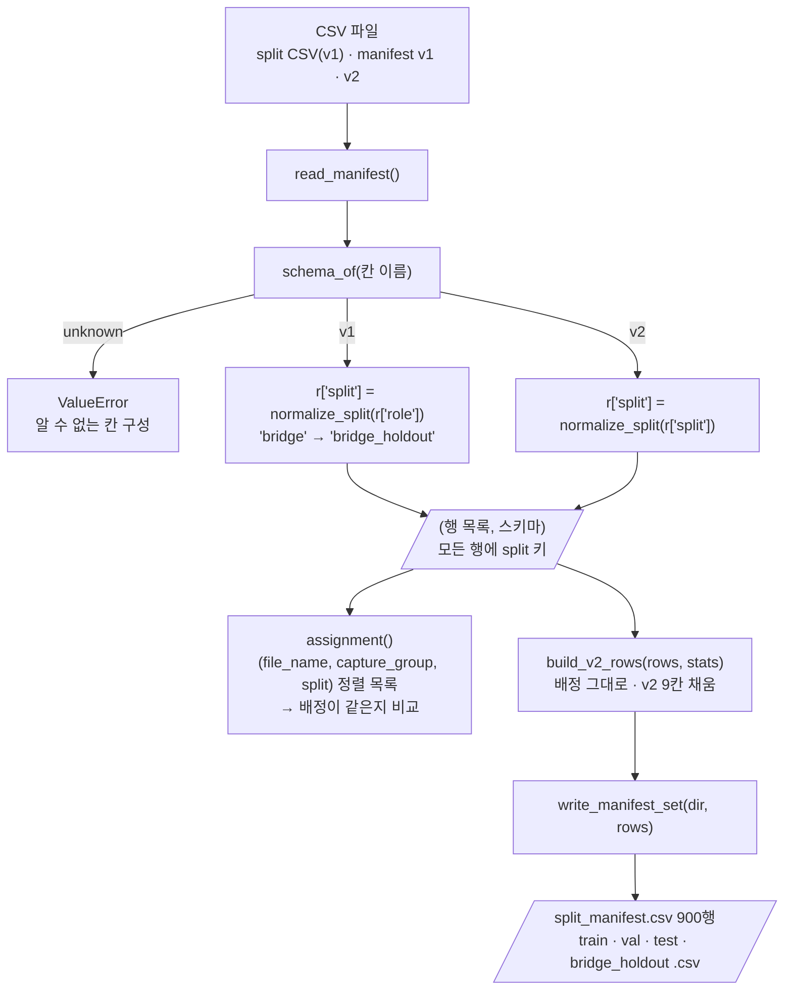

# `src/manifest.py` 코드 리뷰

> 3일차 · 103줄 · 가이드 16.1 · 11.3

## 1. 한 줄 요약

Split Manifest(`manifests/*.csv`)를 **읽고 · 비교하고 · v2로 채우고 · 쓰는** 공통 기능입니다. v1(3칸) · v2(9칸) · `splits/kimchi_v1_split.csv`를 모두 읽어서 **항상 `split` 키와 `bridge_holdout` 값으로 맞춰** 돌려주기 때문에, 05 · 05a · 05b · 06 · 07 · 08 · 09가 스키마를 신경 쓰지 않고 같은 코드로 manifest를 다룹니다.

## 2. 입력 · 출력 · 실행

이 파일은 직접 실행하지 않고, `scripts/`가 가져다 씁니다.

| 함수 · 상수 | 하는 일 | 쓰는 곳 |
|---|---|---|
| `read_manifest(path)` | CSV를 읽어 `(행 목록, 스키마)` 반환 | 05 · 05a · 05b · 06 · 07 · 08 · 09 |
| `assignment(rows)` | 배정 비교용 목록 `(file_name, capture_group, split)` | 05 · 05b |
| `build_v2_rows(rows, stats)` | 배정은 그대로 두고 v2 9칸을 채움 | 05 · 05b |
| `write_manifest_set(dir, rows)` | `split_manifest.csv` + 역할별 4개를 v2로 씀 | 05 · 05b |
| `fingerprint(names)` | 파일명 목록의 sha256 앞 12자리 | 05b · 08 |
| `SPLITS` · `DATASET_VERSION` | 역할 이름 4개 · `kimchi_v1` | 05a · 05b · 06 |
| `MANIFEST_FIELDS` · `SPLIT_FILES` | v2 칸 9개(순서 포함) · 역할별 파일 이름 | 05 · 05b |

```python
from src.manifest import read_manifest, assignment, build_v2_rows, write_manifest_set, SPLIT_FILES   # 05
rows, schema = read_manifest(MANIFEST_DIR / "split_manifest.csv")                                  # 항상 split 키
```

## 3. 구조

| 줄 | 내용 |
|--:|---|
| 13~15 | `import` (`pathlib` · `csv` · `hashlib`) |
| 17~20 | 상수: `DATASET_VERSION` · `SPLITS` · `YOLO_SPLITS` · `LEGACY_VALUES` |
| 22~25 | `MANIFEST_FIELDS` (v2 칸 9개) · `SPLIT_FILES` (역할 → 파일 이름) |
| 27~28 | `IMAGE_DIR` · `LABEL_DIR` (v2 경로 규칙) |
| 31~33 | `normalize_split()` (v1 값 → v2 값) |
| 36~43 | `schema_of()` (칸 이름으로 v1 · v2 판단) |
| 46~57 | `read_manifest()` (읽기 · 스키마 판단 · `split` 키 맞추기) |
| 60~62 | `assignment()` (배정 비교용 목록) |
| 65~82 | `build_v2_rows()` (v2 칸 채우기) |
| 85~97 | `write_manifest_set()` (5개 파일 쓰기) |
| 100~103 | `fingerprint()` (파일명 목록 지문) |

### 흐름 그림



이 파일은 **읽기 · 비교 · 변환 · 쓰기만** 합니다. "이미 Freeze 된 것은 다시 쓰지 않는다" 같은 판단은 부르는 쪽(05 · 05b)이 맡습니다.

## 4. 핵심 코드 읽기

### 4.1 상수 — 역할 이름 · 칸 · 경로를 한 곳에서 정한다

```python
DATASET_VERSION = "kimchi_v1"
SPLITS = ["train", "val", "test", "bridge_holdout"]          # 가이드 11.3 의 split 값
YOLO_SPLITS = ["train", "val", "test"]                       # data/yolo · dataset.yaml 에 들어가는 역할
LEGACY_VALUES = {"bridge": "bridge_holdout"}                 # v1 값 → v2 값

MANIFEST_FIELDS = ["file_name", "image_path", "label_path", "source_dataset", "original_split",
                   "scene_type", "capture_group", "split", "dataset_version"]
SPLIT_FILES = {"train": "train.csv", "val": "val.csv", "test": "test.csv",
               "bridge_holdout": "bridge_holdout.csv"}

IMAGE_DIR = "data/subject7_final/images"                     # 프로젝트 루트(prj08) 기준 상대경로
LABEL_DIR = "data/subject7_final/labels"
```

- `SPLITS`는 05a(`ROLES = SPLITS`)와 06(`ALL_ROLES = set(SPLITS)`)이 가져가서, 역할 이름을 각 스크립트에 따로 적지 않게 합니다.
- `MANIFEST_FIELDS`는 **순서가 곧 CSV의 칸 순서**입니다. 쓰기(4.7)와 v2 판별(4.3)이 이 목록 하나를 기준으로 합니다.
- `YOLO_SPLITS`는 같은 뜻의 목록을 06 · 07이 `YOLO_ROLES`로 각자 적고 있어서, 올려 주신 스크립트 중에는 이 상수를 가져다 쓰는 곳이 없습니다.
- 경로 두 개는 `/`로 쓴 **문자열**입니다. `Path`가 아니라서 OS가 달라도 CSV에 같은 글자가 들어갑니다.

### 4.2 v1 값을 v2 값으로 — 모르는 값은 그대로

```python
def normalize_split(value: str) -> str:
    """'bridge' 같은 v1 값을 v2 값으로 바꾼다. 모르는 값이면 그대로 둔다 (검사에서 걸리도록)."""
    return LEGACY_VALUES.get(value, value)
```

- `dict.get(열쇠, 기본값)`에 **자기 자신**을 기본값으로 넘기는 패턴입니다. `"bridge"`만 `bridge_holdout`으로 바뀌고 나머지는 그대로 나옵니다.
- 모르는 값을 고치거나 버리지 않고 두는 이유는, 그 값이 뒤에서 **검사에 걸리게** 하기 위해서입니다. 05의 `unknown_role` · 05b의 `unknown_split_value` · 06의 "알 수 없는 split 값"이 그 검사입니다.

### 4.3 스키마 판단 — 칸 이름만 본다

```python
def schema_of(columns) -> str:
    cols = list(columns)
    if cols == MANIFEST_FIELDS:
        return "v2"
    if cols[:3] == ["file_name", "capture_group", "role"]:
        return "v1"
    return "unknown"
```

- **v2는 칸 이름과 순서가 `MANIFEST_FIELDS`와 정확히 같을 때만** v2입니다. 칸 하나가 빠지거나 순서가 바뀌면 v2가 아닙니다.
- **v1은 앞 3칸만** 봅니다(`cols[:3]`). 뒤에 칸이 더 있어도 v1로 판단하고, 04가 만든 `splits/kimchi_v1_split.csv`도 이 모양이라 v1로 읽힙니다.
- 둘 다 아니면 `unknown`이고, 이 값을 받은 `read_manifest()`가 오류를 냅니다.

### 4.4 `read_manifest()` — 읽고, 판단하고, `split` 키를 맞춘다

```python
with open(path, encoding="utf-8-sig", newline="") as f:          # utf-8-sig: 맨 앞 BOM 제거
    reader = csv.DictReader(f)
    rows = list(reader)
    schema = schema_of(reader.fieldnames or [])
if schema == "unknown":
    raise ValueError(f"{path.name}: 알 수 없는 칸 구성 {reader.fieldnames}")
for r in rows:
    r["split"] = normalize_split(r["split"] if schema == "v2" else r["role"])
return rows, schema
```

- `utf-8-sig`로 읽어서 맨 앞 BOM을 없앱니다. 05 · 05b · 06이 쓰는 CSV 형식(BOM)과 짝을 이룹니다.
- 행을 다 읽은 **뒤에** `reader.fieldnames`를 씁니다. `reader.fieldnames or []`는 빈 파일에서 `None`이 나와도 `schema_of()`가 죽지 않게 하는 방어입니다. 빈 파일은 `unknown`으로 처리되어 오류가 됩니다.
- v1이면 `role` 값을, v2이면 `split` 값을 꺼내 `normalize_split()`을 거쳐 **모든 행에 `split` 키를 새로 답니다.** v1 행에는 원래 `role` 키도 그대로 남아 있습니다.
- 돌려주는 행은 `file_name` · `capture_group` · `split`이 항상 있는 사전입니다. v2 칸(`scene_type` · `dataset_version` 등)은 **v2일 때만** 있습니다. 05a와 08이 `r.get("dataset_version", "-")`를 쓰는 이유가 이것입니다.
- 오류 처리는 부르는 쪽 몫입니다. 06은 `ValueError`를 잡아 안내하고, 05b · 07은 잡지 않아 오류로 종료됩니다.

### 4.5 `assignment()` — 배정만 비교하는 목록

```python
def assignment(rows: list[dict]) -> list[tuple]:
    """배정 비교용: (file_name, capture_group, split) 목록. 스키마가 달라도 배정이 같으면 같다."""
    return sorted((r["file_name"], r["capture_group"], r["split"]) for r in rows)
```

- 세 값만 뽑아 **정렬**한 목록이라, 행 순서나 나머지 칸(경로 · `scene_type` 등)과 상관없이 "어느 사진이 어느 세션 · 어느 역할인가"만 비교됩니다.
- 05 ⑥은 이미 Freeze 된 manifest와 split CSV를, 05b는 새로 만든 v2를 지금 manifest · split CSV와 이 목록으로 견줍니다. v1과 v2처럼 **스키마가 달라도** 비교할 수 있는 것이 이 함수의 쓸모입니다.

### 4.6 `build_v2_rows()` — 배정은 그대로, 칸만 채운다

```python
for r in rows:
    s = stats[r["file_name"]]
    out.append({
        "file_name": r["file_name"],
        "image_path": f"{IMAGE_DIR}/{r['file_name']}",
        "label_path": f"{LABEL_DIR}/{Path(r['file_name']).stem}.txt",
        "source_dataset": s["source_dataset"],
        "original_split": s["original_split"],
        "scene_type": s["scene_type"],
        "capture_group": r["capture_group"],
        "split": r["split"],
        "dataset_version": DATASET_VERSION,
    })
```

- `stats`는 `reports/audit_label_stats.csv`를 파일명으로 찾을 수 있게 만든 사전입니다. 여기서 가져오는 것은 `source_dataset` · `original_split` · `scene_type` 3개뿐입니다.
- `image_path` · `label_path`는 파일 이름에서 **규칙으로** 만듭니다. 라벨은 확장자를 `.txt`로 바꿉니다(`Path(...).stem`). 05b의 `path_matches_file_name` 검사가 이 규칙이 지켜졌는지 확인합니다.
- `stats`에 없는 파일이 있으면 `stats[...]`에서 `KeyError`가 납니다. 05b는 먼저 `missing_stats`로 확인해서 읽기 쉬운 메시지로 멈추지만, 05는 이 확인 없이 이 함수를 부릅니다.
- 입력 `rows`는 고치지 않고 **새 사전 목록**을 만듭니다. 행 순서도 입력 그대로입니다.

### 4.7 `write_manifest_set()` — 5개 파일을 같은 규칙으로

```python
manifest_dir.mkdir(exist_ok=True)

def _write(path, part):
    with open(path, "w", encoding="utf-8-sig", newline="") as f:   # 기존 CSV 와 같은 형식 (BOM · \n)
        writer = csv.DictWriter(f, fieldnames=MANIFEST_FIELDS, lineterminator="\n")
        writer.writeheader()
        writer.writerows({k: r[k] for k in MANIFEST_FIELDS} for r in part)

_write(manifest_dir / "split_manifest.csv", rows)
for split, name in SPLIT_FILES.items():
    _write(manifest_dir / name, [r for r in rows if r["split"] == split])
```

- 먼저 전체 900행을 `split_manifest.csv`에 쓰고, 이어서 `SPLIT_FILES`의 역할별 파일 4개를 `split` 값으로 걸러 씁니다. 거르면서 순서가 유지되므로 역할별 파일의 행 순서는 **원래 순서**입니다.
- `{k: r[k] for k in MANIFEST_FIELDS}`로 **9칸만 순서대로** 뽑습니다. 입력 행에 칸이 더 있어도(예: v1의 `role`) 파일에는 들어가지 않습니다.
- `_write`는 함수 안의 함수(클로저)로, 다섯 번 쓰는 같은 규칙(BOM · `\n` · 9칸)을 한 곳에 모읍니다.
- **이 함수는 덮어쓰기를 막지 않습니다.** 이미 있는 파일도 그냥 다시 쓰므로, "얼린 것은 다시 쓰지 않는다"는 부르는 쪽의 `exists()` · `assignment()` 비교가 지킵니다(05 ⑥ · 05b ②).

### 4.8 `fingerprint()` — 파일명 목록의 지문

```python
def fingerprint(names) -> str:
    """파일명 목록의 sha256 앞 12자리 (04 · 05 · 06 · 07 과 같은 계산)."""
    text = "\n".join(sorted(names)).encode("utf-8")
    return hashlib.sha256(text).hexdigest()[:12]
```

- 이름을 **정렬**한 뒤 `\n`으로 이어 붙여 해시하므로 목록 순서와 상관없이 같은 값이 나옵니다. Frozen Test 지문 `4f9291849fe6`이 이 계산입니다.
- `names`에 제너레이터를 넘겨도 `sorted()`가 목록으로 만들어 줍니다.
- 05 · 06 · 07은 같은 코드를 각자 파일에 갖고 있고(주석의 "같은 계산"), 05b · 08은 여기서 가져옵니다. 계산이 한 글자라도 다르면 지문 비교가 의미 없어지므로, 같은 것을 한곳에서 가져오는 쪽이 안전합니다.
- 라벨 지문(`LC_ALL=C cat labels/*.txt | sha256sum`과 같은 값)은 파일 **내용** 기준이라 이 함수가 아니라 05 · 08의 `label_fingerprint()`가 맡습니다.

## 5. 연결된 파일

| 관계 | 파일 |
|---|---|
| 읽기 · 비교 · 쓰기 (Freeze) | `05_freeze_split.py` (`read_manifest` · `assignment` · `build_v2_rows` · `write_manifest_set` · `SPLIT_FILES`) |
| v1 → v2 업그레이드 | `05b_upgrade_manifest_schema.py` (위 함수 + `MANIFEST_FIELDS` · `SPLITS` · `DATASET_VERSION` · `fingerprint`) |
| 요약표 | `05a_dataset_summary.py` (`read_manifest` · `SPLITS` · `DATASET_VERSION`) |
| YOLO 폴더 구성 · 검증 | `06_build_yolo_dataset.py` (`read_manifest` · `SPLITS`) · `07_verify_yolo_dataset.py` (`read_manifest`) |
| 학습 · 평가 | `08_train_baseline.py` (`read_manifest` · `fingerprint`) · `09_evaluate_baseline.py` (`read_manifest`) |
| 칸을 채우는 값 | `reports/audit_label_stats.csv` (2일차 Audit 결과 · `build_v2_rows`의 `stats`) |
| 읽고 쓰는 파일 | `manifests/split_manifest.csv` · `train.csv` · `val.csv` · `test.csv` · `bridge_holdout.csv` · `splits/kimchi_v1_split.csv` (읽기만) |
| 기준 문서 | 가이드 16.1 (최소 컬럼) · 11.3 (split 값) |
