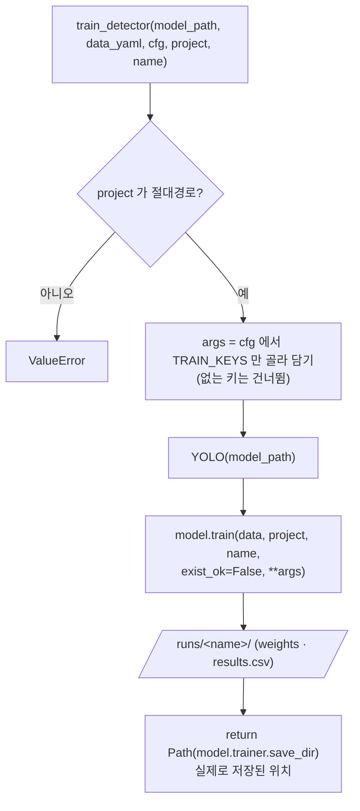

# `src/train_detector.py` 코드 리뷰

> 4일차 · 43줄 · 가이드 8장 · 17.2

## 1. 한 줄 요약

Ultralytics `model.train()`을 감싼 **얇은 학습 함수 하나**입니다. 시작 가중치 · 데이터 yaml · 설정(`cfg`)을 받아 학습하고, **실제로 결과가 저장된 폴더**를 돌려줍니다. 4일차 Baseline(`10_train_baseline.py`)과 7일차 개선 실험이 **같은 함수**를 쓰므로 두 실험의 차이는 넘겨 준 설정값 하나뿐이어야 합니다(가이드 20.2 한 번에 한 변수). 여기서는 **학습만** 하고, 학습 전 검사 · 결과 정리 · 기록은 `scripts/`가 맡습니다.

## 2. 입력 · 출력 · 실행

이 파일은 직접 실행하지 않고, `scripts/`가 가져다 씁니다.

| 구분 | 내용 |
|---|---|
| 입력 | `model_path` (시작 가중치, 예: `prj08/yolo11n.pt`) · `data_yaml` (`configs/dataset.yaml`) · `cfg` (학습 설정 dict) · `project` (결과 상위 폴더 · **절대경로**) · `name` (결과 폴더 이름) |
| 출력 | 실제 결과 폴더 `Path` (`weights/best.pt` · `results.csv`가 있는 곳) |
| 상수 | `TRAIN_KEYS` (`model.train()`에 그대로 넘길 설정 키 12개) |

```python
from src.train_detector import train_detector, TRAIN_KEYS                                  # 10
save_dir = train_detector(str(PROJECT_ROOT / cfg["model"]), str(DATASET_YAML), cfg, RUNS_DIR, cfg["name"])
```

## 3. 구조

| 줄 | 내용 |
|--:|---|
| 8 | `import` (`pathlib`) |
| 10~12 | `TRAIN_KEYS` (설정 키 12개) |
| 15~43 | `train_detector()` |
| 28 | 함수 안에서 `from ultralytics import YOLO` |
| 30~31 | `project`가 절대경로인지 검사 |
| 33~34 | `cfg`에서 `TRAIN_KEYS`만 골라 `args` 만들기 · `YOLO(model_path)` |
| 35~42 | `model.train(...)` 호출 |
| 43 | `model.trainer.save_dir`를 `Path`로 돌려줌 |

### 흐름 그림



폴더 이름이 겹치는지, 결과 파일이 모두 있는지, loss에 NaN이 없는지는 **이 함수가 아니라 10이 확인**합니다.

## 4. 핵심 코드 읽기

### 4.1 `TRAIN_KEYS` — 학습 설정은 이 12개만 쓴다

```python
TRAIN_KEYS = ["epochs", "patience", "imgsz", "batch", "workers", "optimizer", "lr0",
              "momentum", "seed", "deterministic", "amp", "pretrained"]
args = {k: cfg[k] for k in TRAIN_KEYS if k in cfg}
```

- 키 이름은 `configs/baseline.yaml`과 같고 Ultralytics `train()`의 인자 이름과도 같아서, 골라낸 사전을 그대로 `**args`로 넘길 수 있습니다.
- `cfg`에는 `name` · `dataset_version` · `label_fingerprint` · `ultralytics_version` · `model`처럼 기록용 항목도 들어 있지만, `TRAIN_KEYS`에 없으므로 **학습 함수로는 넘어가지 않습니다.**
- 시작 가중치(`model`)는 `TRAIN_KEYS`가 아니라 `model_path` **인자로 따로** 받습니다. `pretrained`는 학습 설정이라 `TRAIN_KEYS`에 있습니다.
- `if k in cfg`는 없는 키를 **조용히 건너뜁니다.** 건너뛴 키는 Ultralytics 기본값으로 학습되므로, 빠진 항목을 막는 일은 10의 `REQUIRED_KEYS` 검사가 합니다. 이 함수 혼자서는 설정 누락을 알리지 않습니다.
- `optimizer` · `lr0` · `momentum`이 목록에 있는 것은 자동(`auto`) 선택에 맡기지 않고 **값을 명시해 고정**하기 위해서입니다(10의 조건 문서 설명).

### 4.2 `ultralytics`는 함수 안에서 불러온다

```python
from ultralytics import YOLO                     # 함수 안에서 import → 검사만 할 때(--dry-run)는 불필요
```

- 파일 맨 위가 아니라 **함수 안**에서 import 합니다. 10은 이 모듈을 맨 위에서 불러오지만(`from src.train_detector import ...`), 그때는 `ultralytics`(무거운 라이브러리)가 아직 로드되지 않습니다.
- 그래서 `--dry-run`처럼 학습 없이 검사만 하는 실행은 이 함수를 부르지 않으므로 `ultralytics`를 불러오는 비용을 치르지 않습니다. (`ultralytics` 버전 검사는 10의 `environment()`가 따로 합니다.)

### 4.3 `project`는 반드시 절대경로

```python
if not Path(project).is_absolute():
    raise ValueError(f"project 는 절대경로여야 합니다: {project}")
```

- docstring에 이유가 적혀 있습니다. **상대경로를 주면 Ultralytics가 자기 `runs_dir` 밑에 폴더를 만들어서** 결과가 `prj08/runs/`가 아닌 엉뚱한 곳에 생길 수 있기 때문입니다.
- 10은 `RUNS_DIR = PROJECT_ROOT / "runs"`를 넘기므로(주석 "절대경로 (project 로 넘김)") 항상 통과합니다.
- 같은 검사가 `evaluate_detector()` · `predict_images()`에도 있습니다. 다만 이 함수는 `ultralytics`를 불러온 **뒤에** 검사하고, `evaluate_detector()`는 검사를 통과한 **뒤에** 불러옵니다. 동작 결과는 같지만, 이 함수에서 상대경로를 넘기면 오류가 나기까지 import 시간이 먼저 듭니다.

### 4.4 `model.train()` — 덮어쓰지 않고, 이름이 겹치면 번호가 붙는다

```python
model = YOLO(model_path)
model.train(
    data=data_yaml,
    project=str(project),
    name=name,
    exist_ok=False,          # 같은 이름 폴더가 있으면 Ultralytics 는 baseline_v12 처럼 번호를 붙임
                             # → 실행 스크립트가 학습 전에 "폴더 없음"을 확인하고, 학습 후 이름을 다시 확인
    **args,
)
```

- `exist_ok=False`는 기존 결과를 **덮어쓰지 않는** 설정입니다. 대신 같은 이름 폴더가 있으면 Ultralytics가 `baseline_v12`처럼 번호를 붙여 새 폴더를 만듭니다. 학습 결과가 두 폴더로 갈라질 수 있다는 뜻입니다.
- 그래서 안전장치가 두 겹입니다. 10은 학습 **전**에 `runs/<name>` 없음(검사 ④)을 확인하고, 학습 **후**에 돌려받은 `save_dir.name`이 `cfg["name"]`과 같은지 다시 확인합니다.
- `**args`가 마지막에 있어서 `epochs` · `imgsz` · `batch` 같은 숫자가 이 줄에서 한꺼번에 전달됩니다. 이 함수에는 학습 숫자가 한 개도 적혀 있지 않습니다.
- `data_yaml`은 docstring에 "train · val만 학습에 사용 · test는 쓰지 않음"이라고 적혀 있지만, 이 함수가 yaml 내용을 **열어 확인하지는 않습니다.** Bridge · Test가 yaml에 없는지는 10의 검사 ②가 맡습니다.

### 4.5 돌려주는 값 — 요청한 폴더가 아니라 실제 저장 위치

```python
return Path(model.trainer.save_dir)              # Ultralytics 가 실제로 저장한 위치
```

- `project / name`으로 **계산한 경로를 돌려주지 않고**, 학습이 끝난 뒤 Ultralytics가 알려 주는 `trainer.save_dir`를 돌려줍니다. 번호가 붙었더라도(`baseline_v12`) 실제 결과가 있는 폴더를 10이 정확히 가리킬 수 있습니다.
- 10은 이 폴더에서 `results.csv` · `weights/best.pt` · `weights/last.pt`를 찾아 보관합니다.

## 5. 연결된 파일

| 관계 | 파일 |
|---|---|
| 부르는 곳 | `10_train_baseline.py` (`train_detector()` · `TRAIN_KEYS`) · 7일차 개선 실험 |
| 설정 원본 | `configs/baseline.yaml` (`TRAIN_KEYS`와 같은 키 이름) |
| 학습 데이터 | `configs/dataset.yaml` (train · val만 · test는 쓰지 않음) |
| 같은 모양의 짝 | `src/evaluate_detector.py` (평가 · 예측 공통 기능) |
| 학습 전 · 후 확인 | `10_train_baseline.py` (`REQUIRED_KEYS` · 폴더 없음 · `save_dir.name` · `results.csv` 검사) |
| 결과를 쓰는 곳 | `runs/<name>/` (`weights/best.pt` · `last.pt` · `results.csv` · 그래프 · Git 제외) |
| 기준 문서 | 가이드 8장 · 17.2 · 20.2 |
